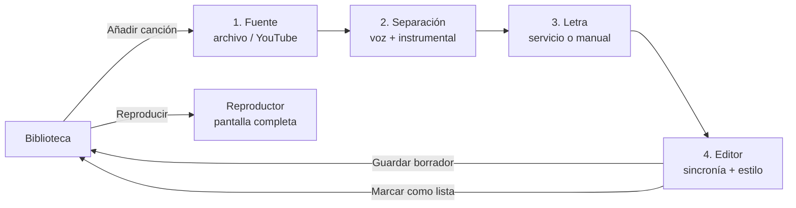

# Pipeline de creación de un karaoke

Cada paso guarda su resultado en el **borrador** de la canción, de modo que se puede salir y retomar desde el último paso completado.

## Pasos y decisiones pendientes

| # | Paso | Entrada | Salida | Decisión del arquitecto (ADR) |
|---|------|---------|--------|-------------------------------|
| 0 | Plataforma | — | — | ¿Web local, escritorio (Tauri/Electron), híbrida? Stack de frontend y backend. Licencia. |
| 1 | Fuente | Ruta de archivo o URL de YouTube | Audio normalizado + metadatos (título, artista, duración) | Herramienta de descarga/decodificación, formatos soportados, riesgos legales. |
| 2 | Separación | Audio | `vocals` + `instrumental` | Modelo/librería (licencia de código y pesos), CPU vs GPU, tiempo estimado, ejecución en segundo plano y progreso. |
| 3 | Letra | Título/artista/duración | Letra (idealmente con marcas de tiempo por línea o palabra) | Servicio de letras gratuito, alternativa sin conexión, ¿alineación automática letra-audio? |
| 4 | Editor | Pistas + letra | Proyecto de karaoke (sincronía + estilo) | Formato de sincronía (LRC / LRC mejorado / propio), render de la letra. |
| 5 | Persistencia | Proyecto | Borrador / Lista | Modelo de datos, dónde se guardan archivos y metadatos. |
| 6 | Reproductor | Proyecto listo | Reproducción a pantalla completa | Motor de render y sincronización audio-letra. |

## Estados de una canción
`borrador:fuente` → `borrador:separando` → `borrador:letra` → `borrador:edicion` → `lista`

(Nombres orientativos; el arquitecto los fija en el modelo de datos.)
