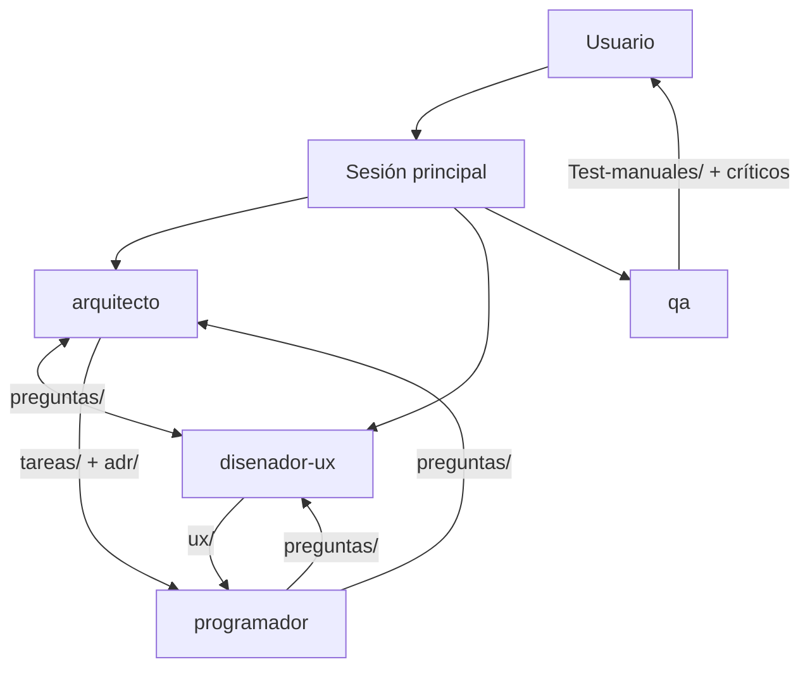

# Flujo de trabajo entre agentes

El proyecto se construye con cuatro agentes del proyecto (definidos en `.codex/agents/` para Codex y `.claude/agents/` para Claude Code), coordinados desde la sesión principal:

| Agente | Rol | Escribe en |
|--------|-----|------------|
| `arquitecto` | Decisiones tecnológicas, arquitectura, desglose de tareas | `docs/adr/`, `docs/arquitectura.md`, `docs/tareas/`, respuestas en `docs/preguntas/` |
| `disenador-ux` | Vistas, flujos, wireframes, sistema visual, microcopy | `docs/ux/`, respuestas en `docs/preguntas/` |
| `programador` | Implementación de tareas | Código del proyecto, notas en `docs/tareas/`, preguntas en `docs/preguntas/` |
| `qa` | Suite crítica del flujo principal, pruebas de feedback, clasificación de fallos del CI y guías manuales | `app/e2e/criticos/`, `docs/pruebas.md`, `docs/Test-manuales/` |



> Los subagentes no se invocan entre sí directamente: **se comunican a través de `docs/`**. La sesión principal lee las preguntas abiertas y lanza al agente destinatario para que responda.

## Ciclo por cada paso del pipeline
1. **Arquitecto** decide la tecnología del paso → ADR.
2. **Diseñador UX** define las vistas afectadas → spec en `docs/ux/` (consultando restricciones de los ADRs).
3. **Arquitecto** desglosa en tareas → `docs/tareas/`, enlazando ADRs y specs.
4. **Programador** implementa tarea a tarea, con pruebas de feedback mínimas ([estrategia de pruebas](pruebas.md)). Dudas → `docs/preguntas/`.
5. **QA** escribe la guía manual de la fase en `docs/Test-manuales/` y mantiene los críticos.
6. Sesión principal enruta preguntas abiertas al agente correspondiente y, si son de producto, al usuario.

## Formato de tarea — `docs/tareas/NNNN-titulo.md`
```markdown
# NNNN — Título
- Estado: Pendiente | En curso | Bloqueada | Hecha
- Paso del pipeline: 0-6
- Depende de: NNNN, NNNN
- ADRs: 0001, 0003
- Spec UX: docs/ux/NN-vista.md (si aplica)

## Objetivo
## Criterios de aceptación
- [ ] ...
## Pruebas de feedback
- Unitarias: qué comprobar (Vitest).
- E2E: ninguna, o una spec mínima si hace falta integración real.
- Críticos: sí/no (si toca el flujo principal, `main/`, `preload/` o `shared/`).
- Manual: qué pasa a la guía de `docs/Test-manuales/`.
## Notas de implementación
(las rellena el programador al terminar)
```

## Formato de pregunta — `docs/preguntas/NNNN-titulo.md`
```markdown
# NNNN — Pregunta breve
- De: programador | arquitecto | disenador-ux
- Para: arquitecto | disenador-ux | usuario
- Estado: Abierta | Respondida
- Bloquea: tarea NNNN (o "no")

## Contexto
## Pregunta
## Opción provisional tomada (si no bloquea)
## Respuesta
```

## Cómo se trabaja en cada fase

1. El arquitecto desglosa la fase en tareas según el plan de la versión.
2. El diseñador UX prepara o actualiza las specs afectadas.
3. El programador implementa las tareas en una rama `fase/0.2.0-N-<nombre>` creada desde `develop`.
4. Pronto se abre un PR borrador de la rama a `develop`: el CI ejecuta la regresión completa en cada push y `qa` clasifica sus fallos. Los agentes solo ejecutan las pruebas de feedback (niveles 1 y 2 de [pruebas](pruebas.md)).
5. El usuario ejecuta la guía manual de la fase (`docs/Test-manuales/`). Se registran el resultado del CI y de la guía en el informe de fase.
6. Se marca el PR como listo con el informe para cerrar la fase. Al cerrar la versión se abre un PR de `develop` a `main` y, tras fusionarlo, se crea el tag `v0.2.0-alpha`. Véase el [flujo de Git](workflow.md).
