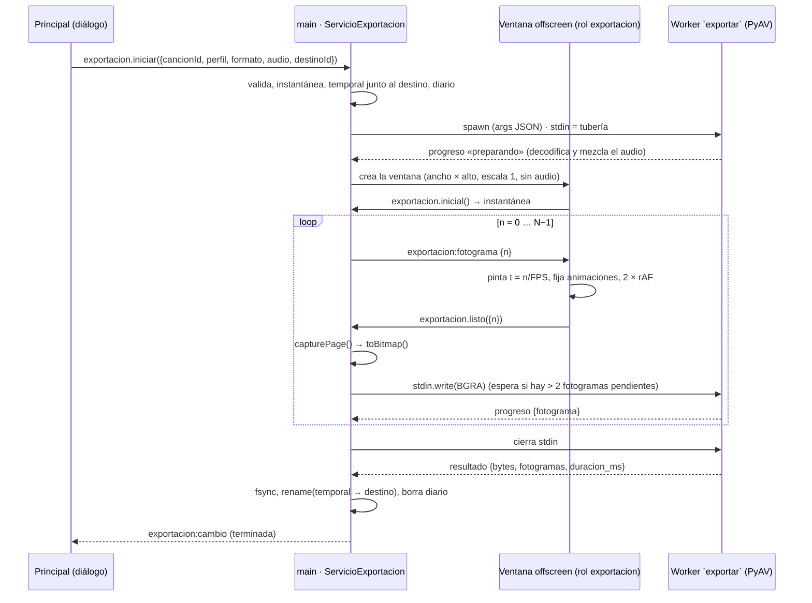

# 0019 — Exportación de video: render por índice de fotograma en una ventana offscreen y codificación con el worker PyAV

- Estado: Aceptado
- Fecha: 2026-11-20
- Paso del pipeline: 6 (salida: reproductor y exportación)
- Versión: 0.2.0-alfa, fase 6 (feature 7 · Exportar a video)
- Alineado con la spec [10 · Exportar a video](../ux/10-exportacion.md) y las secciones «Fase 6» de [02](../ux/02-biblioteca.md), [06](../ux/06-editor.md) y el [sistema visual](../ux/sistema-visual.md). Responde a [0050](../preguntas/0050-perfiles-y-concurrencia-exportacion.md) (estudio técnico) y a [0131](../preguntas/0131-contratos-tecnicos-de-la-exportacion.md) (contratos para la interfaz), y adopta como provisionales las opciones de producto de [0130](../preguntas/0130-decisiones-de-producto-de-la-exportacion.md).

## Contexto

La fase 6 del [plan](../versiones/0.2.0/plan-2.md#fase-6--exportación) pide generar un archivo de video local con la letra y el estilo del reproductor y tiempos deterministas. Decisiones de producto ya tomadas en [0050](../preguntas/0050-perfiles-y-concurrencia-exportacion.md):

- **Formato libre**, con los formatos de OBS como referencia.
- Proporciones **4:3 hasta 2880 × 2160** y **16:9 hasta 3840 × 2160**, con resoluciones habituales y **24, 30 o 60 FPS**.
- Exportar durante un evento solo se impide si hay una razón técnica que no sea de recursos paralelizables.

Lo que existe hoy:

- El render de la letra es DOM + CSS en el renderer: el modelo puro `karaoke/render.ts` (`fotogramaEn(letra, t, ctx)`) y `karaoke/PantallaLetra.tsx`, con unidades `cqh` (escala con el alto del contenedor). Avanza con `requestAnimationFrame` leyendo `obtenerTiempoAudio()`. La entrada de una línea es una animación CSS de 200 ms (`.transicion`). La fase 5 ([ADR 0018](0018-estilo-ampliado-espera-letra-lista-y-ajuste-de-silencios.md)) añade degradados en movimiento (`geometriaFondoEn(fondo, tAudioMs, { estatico })` en `karaoke/fondo.ts`, función pura del tiempo de audio), comodines de espera (`FotogramaLetra.espera`) y la modalidad «Letra lista» (`PantallaLetra` con `barrido={false}`). Su §2 ya prevé que la exportación llame a esas funciones con el tiempo de cada fotograma.
- El worker Python (ADR 0001, 0009) ya usa PyAV 19.0.2 para decodificar audio. Se lanza con `stdio: ['ignore', 'pipe', 'pipe']` y habla JSON Lines por stdout.
- La sesión en vivo (ADR 0017) tiene una ventana secundaria con el único motor de audio de la sesión y main como dueño del estado. Los roles de ventana se comprueban por canal (`ROLES_POR_CANAL`).
- `GestorTrabajos` sirve a los pasos del pipeline (`fuente`, `separacion`) y escribe el estado del paso en `cancion.json`.

Restricciones: GPL-3.0-or-later y nada no libre (ADR 0002); sin dependencias nuevas en el instalador (ADR 0012); IPC mínima validada y remitente por rol (ADR 0008); único escritor de datos (ADR 0006); Windows, macOS 14+ arm64 y Linux x64.

Discusión previa: [R1](../versiones/0.2.0/discusion/r1-arquitecto.md#7--exportación-de-video--l), [R4](../versiones/0.2.0/discusion/r4-arquitecto.md#0050--exportación-libre-y-perfiles) y sus cruces con UX ([R2](../versiones/0.2.0/discusion/r2-disenador-ux.md), [R4](../versiones/0.2.0/discusion/r4-disenador-ux.md)).

## Prueba técnica (2026-11-20)

Prueba de concepto en [`docs/poc/0019-exportacion/`](../poc/0019-exportacion/) (no es código de producción):

- `codificar.py`: codifica fotogramas BGRA (sintéticos o leídos de stdin) y una mezcla de audio con PyAV, y verifica el archivo leyéndolo.
- `matriz.py`: recorre resoluciones × FPS × codificador.
- `electron/`: ventana offscreen de Electron 45.2.2 gobernada por índice de fotograma → `capturePage()` → `toBitmap()` → tubería con contrapresión → `codificar.py`.

### 1. Códecs y licencias de las ruedas de PyAV 19.0.2

`worker/scripts/inspeccionar_av.py` sobre las 6 ruedas fijadas (sin instalarlas, con su SHA-256 comprobado contra los requisitos):

| Plataforma | FFmpeg declarado | Codificadores libres presentes | No libres | Otros (no se usan) |
|---|---|---|---|---|
| `darwin-arm64-mps` | LGPL-3.0+ (`--enable-version3`) | `libsvtav1` (SVT-AV1 4.2.0), `libvpx` (VP8/VP9), `libopus`, `flac`; decodificador `libdav1d` | ninguno | `libx264`, `libx265` (GPL), VideoToolbox |
| `win32-x64-cpu` / `-cuda` | ídem | ídem | ninguno | `libx264`, `libx265`, `nvenc`, `amf`, `libvpl` |
| `linux-x64-cpu` / `-cuda` | ídem | ídem | ninguno | ídem |

Comprobado además en el venv de desarrollo (macOS arm64) con `av.codec.Codec(nombre, 'w')`: existen `libsvtav1`, `libvpx-vp9`, `libopus` y los contenedores `matroska` y `webm`. **No** existen `libaom-av1`, `librav1e` ni `libvorbis`.

Licencias de lo que se usa: SVT-AV1 (BSD-3-Clause-Clear + Alliance for Open Media Patent License 1.0), libvpx (BSD-3-Clause + concesión de patentes de Google para WebM), libopus (BSD-3-Clause), Matroska/WebM (especificaciones abiertas, sin regalías). Todas compatibles con GPL-3.0-or-later. Las ruedas no van en el instalador: se instalan desde PyPI en el primer arranque (ADR 0002, revisión 2026-11-04), así que no hay redistribución nueva.

### 2. Codificación (MacBook Air M1, 8 GB, macOS 26.5)

Fotogramas sintéticos «tipo karaoke» (degradado, dos renglones, barrido que avanza, marca de agua), 20 s de video y audio Opus 192 kbit/s, codificador con todos los núcleos. Equipo **sin ventilador**: tras ~1 h de carga sostenida bajó la frecuencia y las mismas pruebas fueron hasta 3 veces más lentas, así que las cifras son orientativas (± 30 % entre ejecuciones; peor tras mucho rato). FPS de codificación = fotogramas por segundo de reloj, incluida la generación sintética.

| Resolución × FPS | AV1 *preset* 10 | AV1 *preset* 8 | VP9 `realtime` | VP9 `good` (`cpu-used` 5) | Pico de memoria del worker (AV1 / VP9) |
|---|---|---|---|---|---|
| 640 × 480 × 30 | 563 fps | 483 | 495 | 161 | 290 / 210 MB |
| 1280 × 720 × 30 | 338 | 271 | 308 | 87 | 470 / 290 MB |
| 1920 × 1080 × 30 | 186 | 123 | 126 | 29 | 820 / 450 MB |
| 1920 × 1080 × 60 | 219 | 128 | 113 | 23 | 820 / 450 MB |
| 3840 × 2160 × 30 | 39 | 27 | 39 | — | 1,6 / 1,1 GB |
| 3840 × 2160 × 60 | 18 (con el equipo ya caliente) | — | 13 (ídem) | — | 1,3 / 1,2 GB |
| 2880 × 2160 × 30 | 28 | 21 | 24 | 13 | 1,3 / 0,9 GB |

- **Todos los archivos se verificaron** leyéndolos: número exacto de fotogramas, fin del video = `N / FPS` y fin del audio a ≤ 1 ms de la duración, en los dos contenedores.
- **VP9 `good`** es 4–7 veces más lento que `realtime` con un tamaño parecido para este contenido: se descarta.
- **Tamaño**: el contenido de karaoke es casi estático y comprime muchísimo: 1,8–3,7 MB por minuto (incluidos 1,44 MB/min de Opus) con fondo fijo y hasta ~5 MB/min a 1080p con el fondo en movimiento simulado. VP9 da archivos un 5–35 % mayores que AV1.
- SVT-AV1 avisa de que sus *presets* ≥ 10 están pensados para uso automático y «pueden producir artefactos»: ver la tabla de parámetros de §5.

### 3. Render offscreen y captura por fotograma

Página que imita `PantallaLetra` (degradado con `cqh`, texto con sombra, barrido con `clip-path`, entrada de línea con Web Animations **pausada y fijada por `n`**, fondo opcionalmente en movimiento con el ángulo calculado del tiempo, marca de agua). Ventana `offscreen: { useSharedTexture: false, deviceScaleFactor: 1 }`, `show: false`, `setFrameRate(240)`. Por fotograma: `executeJavaScript('renderizar(n)')` (pinta y espera 2 × `requestAnimationFrame`), captura, `toBitmap()` y escritura en el stdin de `codificar.py`.

**Captura sola** (sin codificar):

| | Render (ida y vuelta) | `capturePage()` | `toBitmap()` | Total | Evento `paint` tras `invalidate()` |
|---|---|---|---|---|---|
| 1280 × 720 | 5,2 ms | 5,1 ms | 0,7 ms | 91 fps | — |
| 1920 × 1080 | 5,0 ms | 5,6 ms | 1,3 ms | 84 fps | 120 fps |
| 3840 × 2160 | 4,1 ms | 17–37 ms | 6–11 ms | 36 fps | 61 fps |

- `capturePage()` devuelve **exactamente** `ancho × alto` (también 3840 × 2160 en una pantalla Retina) y el formato es **BGRA** (rojo puro → `00 00 FF FF`).
- El evento `paint` evita la copia de `capturePage` y es 1,5–1,7 veces más rápido, pero la asociación entre el evento y `n` depende del ritmo de composición. Se queda como optimización posible (ver Consecuencias), no como base.
- **Retardo del bucle de eventos de main** durante la exportación: p99 13–19 ms a 1080p y 25–33 ms a 4K, con picos de hasta 140 ms a 4K/60. El audio de una sesión no pasa por main (se mezcla en el renderer de la secundaria), así que esto solo retrasa unos milisegundos los comandos de cola.
- **Memoria de main**: 150–500 MB de RSS en total durante la prueba.

**De extremo a extremo** (render + captura + tubería + PyAV), AV1 salvo que se indique:

| Perfil | Fotogramas por segundo | Tiempo / duración de la canción | Pico del worker |
|---|---|---|---|
| 1280 × 720 × 30 | 72 | 0,4 × | 360 MB |
| 1920 × 1080 × 30 | 21–34 (VP9: 23) | 0,9–1,4 × | 450–540 MB |
| 1920 × 1080 × 60 | 35 | 1,7 × | 500 MB |
| 3840 × 2160 × 30 | 6 | 5 × | 0,9 GB |
| 3840 × 2160 × 60 (equipo caliente) | 3–7 | 9–19 × | 0,5–1,2 GB |

- **Cuello de botella**: el transporte de mapas de bits, no el codificador. La tubería Node → Python mide **~1,05 GB/s** en este equipo (un fotograma 4K son 33 MB: ≥ 31 ms), y a 4K `capturePage` + `toBitmap` ocupan 25–50 ms de main por fotograma. Con 2 fotogramas en vuelo (contrapresión por bytes pendientes) la misma prueba a 1080p30 pasó de 21 a 34 fps.
- **Conversión BGRA → YUV** en el worker: 44 ms por fotograma 4K con `from_ndarray` + `reformat` de un hilo; leyendo stdin directamente en el plano de un `VideoFrame` reutilizable y con `reformat(threads=0)` baja a ~15 ms. La tarea del worker usa esa forma.
- Todas las salidas pasaron la verificación (fotogramas, duración de video y audio).

**Conclusión de la prueba**: la arquitectura funciona en Electron 45.2.2 y PyAV 19.0.2 sin dependencias nuevas, con tiempos deterministas. Los perfiles hasta 1080p30 van en torno al tiempo real en un M1; 4K/60 tarda de 5 a 20 veces la duración de la canción (20–80 min para 4 min). Es caro pero viable porque la exportación no es en tiempo real: se ofrece con la nota de perfil costoso de la spec y una estimación que se corrige en cada equipo.

### 4. Lo que no se ha podido medir aquí

- Windows y Linux (ni Intel/AMD x86): pasan a la CI (prueba de codificación del worker en los 3 SO, §13) y a la guía manual (tiempos reales y 4K/60).
- Interferencia con una sesión en vivo en dos pantallas reales: guía manual (§9).
- Equipos más lentos que un M1: la estimación de tiempo se corrige con el factor medido en cada equipo (§11).

## Alternativas consideradas

### 1. Cómo se obtienen los fotogramas

| Opción | Licencia | Pros | Contras |
|---|---|---|---|
| A. **Ventana offscreen de Electron gobernada por índice de fotograma, con el mismo `PantallaLetra`** | Electron (MIT), Chromium (BSD) | Un solo layout (fuentes, `cqh`, barrido por renglón, degradados de la fase 5). Determinista: cada fotograma depende solo de `n / FPS`. No es tiempo real: un equipo lento tarda más, pero no salta fotogramas. | Copia de mapas de bits grandes por main (33 MB por fotograma a 4K). Hay que controlar las animaciones CSS. |
| B. Grabar la pantalla del reproductor en tiempo real (`desktopCapturer`, `MediaRecorder`) | — | Poco código. | No garantiza FPS ni sincronía: si el equipo va justo, se pierden fotogramas. `MediaRecorder` solo produce WebM con los parámetros de Chromium. Pide permisos de captura de pantalla (denegados, ADR 0008). |
| C. Volver a dibujar la letra en Python (Pillow, Skia, Cairo) | varias | Sin Electron en el bucle. | Duplica el layout (ajuste de líneas, `text-wrap: balance`, barrido por renglón, sombras, degradados), con discrepancias tipográficas seguras y doble mantenimiento (plan, «riesgo»). Dependencias nuevas. |
| D. Chromium sin interfaz con control de fotogramas (Puppeteer y `HeadlessExperimental.beginFrame`) | Apache-2.0 | Control exacto del reloj de render. | Otro navegador de ~150 MB, solo en Linux en la práctica. |

### 2. Cómo se capturan los fotogramas de la ventana offscreen

| Opción | Pros | Contras |
|---|---|---|
| A. **El renderer pinta `n` y confirma tras dos `requestAnimationFrame`; main llama a `webContents.capturePage()`** | Asociación inequívoca entre `n` y la imagen. API estable. | Un viaje de ida y vuelta por fotograma. |
| B. Evento `paint` tras `invalidate()` | Sin copia extra en `capturePage`. | La asociación entre el evento y `n` depende del ritmo de composición; con la página quieta no llegan eventos. Ver los resultados de §3 de la prueba. |
| C. `useSharedTexture` | Sin copia GPU → CPU. | Experimental y exige un módulo nativo (ADR 0012: sin módulos nativos). |

### 3. Codificador y contenedor (todos libres)

| Opción | Pros | Contras |
|---|---|---|
| A. **Matroska (`.mkv`) con AV1 (SVT-AV1) y Opus** | Combinación de OBS (MKV es su contenedor por defecto y AV1 su códec más nuevo). La mejor compresión. SVT-AV1 es rápido en sus *presets* altos. | QuickTime de macOS no abre MKV. AV1 necesita decodificación por software en equipos anteriores a ~2020 (un 4K/60 puede ir a tirones en un portátil antiguo). En Windows, el Reproductor multimedia necesita la «Extensión de video AV1» de la Microsoft Store (gratuita). |
| B. **WebM (`.webm`) con VP9 (libvpx) y Opus** | Se abre en todos los navegadores (incluido Safari), en el Reproductor multimedia de Windows (extensión VP9 de serie), Android, VLC y OBS como fuente. Decodificación por hardware desde ~2016. | Archivos algo mayores a igual calidad. libvpx es más lento que SVT-AV1 en sus modos de calidad (ver §2). OBS no graba WebM. |
| C. WebM con AV1 y Opus | WebM admite AV1. | Suma las limitaciones de A (decodificación) sin la ventaja de compatibilidad de B. |
| D. MP4 con AV1 y Opus | MP4 es el contenedor más conocido; OBS lo usa («MP4 híbrido»). | Opus en MP4 tiene peor soporte en editores y en QuickTime; no gana compatibilidad real frente a A. |
| E. MP4 con H.264 y AAC | Máxima compatibilidad. | No es un formato libre (patentes con licencia de pago); `libx264` es GPL. Contrario a la decisión de 0050. Queda como [propuesta 008](../propuestas/008-formato-de-video-de-maxima-compatibilidad.md). |

### 4. Cómo llegan los fotogramas al codificador

| Opción | Pros | Contras |
|---|---|---|
| A. **Tubería (stdin del worker) con BGRA crudo de tamaño fijo y contrapresión por bytes pendientes** | Memoria acotada (2 fotogramas en vuelo). Sin disco intermedio. Main y worker trabajan en paralelo. | Ancho de banda por la tubería (2 GB/s a 4K/60 en tiempo real; aquí no es tiempo real). |
| B. Fotogramas a disco en lotes (PNG o crudo) | Reanudable. | Crudo a 1080p30: ~250 MB/s → ~60 GB para 4 min (R1). PNG: coste de compresión y E/S. |
| C. Codificar en el renderer con WebCodecs | Sin Python. | `VideoEncoder` de Chromium: AV1/VP9 por software sin control fino ni Opus en un contenedor (habría que escribir un *muxer* en JS). Más código propio. |

### 5. Cola de la exportación

| Opción | Pros | Contras |
|---|---|---|
| A. **Cola propia de exportación (concurrencia 1) en un servicio nuevo, fuera de `GestorTrabajos`** | Una exportación larga (4K/60) no retrasa la separación de una canción recién añadida. `GestorTrabajos` sigue siendo de los pasos del pipeline. | Separar y exportar a la vez comparten CPU (se mitiga con prioridad baja, §9). |
| B. Compartir la cola `pesada` con la separación | Nunca hay dos trabajos pesados a la vez. | Añadir una canción espera a que termine una exportación de 30 min. `GestorTrabajos` escribe pasos de `cancion.json` que la exportación no tiene. |

## Decisión

Opciones elegidas: 1A, 2A, 3A **y** 3B (dos formatos, AV1 por defecto), 4A y 5A.

### 1. Visión general

Componentes nuevos:

- **`ServicioExportacion`** (`main/exportacion/`): cola propia con concurrencia 1, instantánea, destinos, diario, orquestación del bucle, cancelación y limpieza, perfiles y estimaciones. Emite `exportacion:cambio` y `exportacion:progreso` a la principal.
- **Ventana de exportación** (rol `exportacion`): offscreen, entrada `renderer/exportacion.html`, preload `preload/exportacion.ts` con `window.shinobiExportacion`, anfitrión `renderer/src/exportacion/` que monta `PantallaLetra` en modo fotograma y la marca de agua.
- **Comandos del worker**: `exportar` (codifica) y `capacidades-exportacion` (sondeo de codificadores).

### 2. Render determinista por índice de fotograma

- **Tiempo**: el fotograma `n` representa el instante `t_n = n / FPS` s de la canción, con PTS `n` en base de tiempo `1/FPS`. El tiempo de letra es `t_n × 1000 − letra.offset_ms`, como en el reproductor (ADR 0005, ADR 0011). `N = ceil(duracion_ms × FPS / 1000)`. El video empieza en 00:00 **sin silencio previo** (0130 §3, provisional) y dura lo mismo que el audio, con una diferencia menor que un fotograma.
- **`PantallaLetra` en modo fotograma**: una prop nueva `tiempoFijoMs` (tiempo de **audio** del fotograma) sustituye al bucle de `requestAnimationFrame`: en el mismo paso síncrono calcula `fotogramaEn(letra, tiempoFijoMs − offset_ms, ctx)` (incluido `espera`, los comodines de la fase 5), aplica el progreso del barrido y escribe las variables CSS del fondo con `geometriaFondoEn(fondo, tiempoFijoMs, { estatico: false })` (ADR 0018 §2: tiempo de audio sin `offset_ms`). Con `tiempoFijoMs` no se lee `obtenerTiempoAudio` ni ningún reloj. La modalidad (`karaoke` | `letra_lista`) sale de la instantánea; en «Letra lista» se monta con `barrido={false}` (ADR 0018 §5). Una canción en borrador se exporta siempre como `karaoke` (ADR 0018: la modalidad se ignora en borrador).
- **Animaciones**: toda animación CSS o Web Animations del render (entrada de línea de 200 ms, comodines y movimiento de la fase 5 si usan animaciones) se gobierna por el índice: el anfitrión de exportación, tras cada render, recorre `document.getAnimations()`, pausa las nuevas, anota el fotograma en que nacieron y fija `currentTime = (n − n₀) × 1000 / FPS`. Regla para el render compartido desde esta fase: **ningún efecto visual puede depender de `Date.now`, `performance.now` ni del reloj del documento** salvo a través de animaciones que este mecanismo controla. Los degradados en movimiento de la fase 5 derivan su fase del tiempo de la canción (ADR 0018), así que son deterministas sin más.
- **Movimiento reducido**: no se aplica al video (spec 10 y ADR 0018 §2, provisional en [0100](../preguntas/0100-decisiones-provisionales-de-la-fase-5.md) §3: el archivo se verá en otros equipos). `PantallaLetra` y el fondo reciben `movimiento: 'completo' | 'reducido'` explícito; el anfitrión de exportación pasa siempre `'completo'` y el CSS deja de depender solo de `@media (prefers-reduced-motion)` (se añade un atributo de datos que el anfitrión fija).
- **Fuentes**: antes del fotograma 0, el anfitrión espera `document.fonts.load()` de la familia y el peso de la letra y de la marca de agua, y `document.fonts.ready`. Si una fuente no carga, la exportación falla con `ERROR_INTERNO` antes de empezar (no se exporta con una fuente de respaldo sin avisar).
- **Tamaño**: la ventana tiene exactamente `ancho × alto` píxeles CSS con `offscreen.deviceScaleFactor = 1`, `zoomFactor = 1` y `enableLargerThanScreen: true`. La prueba comprueba que `capturePage()` devuelve ese tamaño; si un sistema devolviera otro, la exportación falla con `PERFIL_NO_SOPORTADO` en vez de escalar.
- **Contenido**: el mismo que el reproductor a pantalla completa (spec 10 §«Qué contiene»), sin controles, cursor ni indicadores. «Letra lista» se pinta sin barrido ni color de resaltado (ADR 0018). Las proporciones de sistema-visual §10 salen solas por las unidades `cqh`.
- **Marca de agua** «Shinobi Karaoke»: un componente del anfitrión de exportación, encima de `PantallaLetra`, con los valores de la spec 10 (abajo a la derecha, margen 3 % del alto, cuerpo `máx(14 px, 2,2 % del alto)`, Atkinson Hyperlegible Next 700, que ya se incluye como fuente de letra, píldora `rgba(0,0,0,0.5)`, opacidad 85 %). No se puede desactivar. No concede derechos sobre la música ni la letra.
- **Tolerancia (V17 de la spec)**: la igualdad se comprueba sobre el **modelo**, no sobre píxeles: para cada `n` muestreado, el `FotogramaLetra` que pinta el anfitrión es idéntico a `fotogramaEn(letra, n × 1000 / FPS − offset)`. Sobre el video decodificado solo se comprueban sondas de color con tolerancia ± 16 niveles por canal en zonas planas (la conversión a YUV 4:2:0 y la compresión cambian los valores).

### 3. Instantánea

- Se toma **en main al aceptar `exportacion.iniciar`**, de lo **guardado** (0131 §8): letra, `offset_ms`, estilo resuelto con su procedencia (ADR 0016), modalidad «Letra lista» (ADR 0018), título, artista, duración, `ganancia_db` y qué pistas existen. El editor vacía su guardado antes de abrir el diálogo (spec 06); un borrador de tema sin guardar no entra. Se descarta tomarla del estado en memoria del editor, como hace «Probar»: el diálogo también se abre desde la Biblioteca, y una sola fuente es más simple y verificable.
- La instantánea vive en memoria de main y se entrega a la ventana offscreen por `exportacion.inicial()`. No se escribe en `cancion.json`.
- El audio queda fijado en la fase «preparando»: el worker decodifica y mezcla las pistas completas antes del primer fotograma (§4), así que una re-separación posterior no afecta al video en marcha.
- Editar, volver a borrador o cambiar el tema durante la exportación está permitido y no cambia el video (V14). **Eliminar** la canción cancela su exportación con limpieza antes de moverla a la papelera (spec 10).

### 4. Worker: `exportar` y `capacidades-exportacion`

**`exportar`** (`worker/shinobi_worker/exportar.py`):

- **Argumentos** (JSON, como los demás comandos): `temporal`, `formato` (`mkv_av1` | `webm_vp9`), `ancho`, `alto`, `fps`, `total_fotogramas`, `duracion_ms`, `audio: { instrumental, voz | null, ganancia_db }`.
- **Entrada**: stdin binario; cada fotograma son exactamente `ancho × alto × 4` bytes BGRA sin cabecera. Si stdin se cierra antes de `total_fotogramas`, termina con `ENTRADA_INCOMPLETA` y borra el temporal (es lo que ocurre al cancelar o si main cae).
- **Audio** (fase `preparando`): decodifica con PyAV y remuestrea a 48 kHz estéreo float. Mezcla = `instrumental × 10^(ganancia_db/20)` y, con «Instrumental y voz», `+ voz × 10^(ganancia_db/20)` al 100 % (0130 §2, provisional). **No** se aplican el volumen ni la voz guía del reproductor. Si el pico supera 0,999, toda la mezcla se multiplica por una ganancia constante `0,999 / pico` (sin recortes ni compresor). Memoria: ~92 MB para 4 min y ~230 MB para 10 min, como los dos `AudioBuffer` del reproductor. Si falta una pista: `CANCION_NO_DISPONIBLE`.
- **Video**: stdin se lee con `readinto` directamente en el plano de un `VideoFrame` BGRA reutilizable (sin `from_ndarray`) → `reformat('yuv420p', BT.709, rango limitado, threads=0)` → codificador. Metadatos de color BT.709 en el flujo. GOP de 5 s (para poder saltar en el video).
  - `mkv_av1`: `libsvtav1`, *preset* y CRF de la tabla de §5.
  - `webm_vp9`: `libvpx-vp9`, `deadline=realtime`, `cpu-used=8`, `row-mt=1`, CRF de la tabla de §5 con `b=0`.
- **Audio en el contenedor**: Opus (`libopus`) a 48 kHz, estéreo, 192 kbit/s, intercalado con el video por tiempo de presentación.
- **Hilos y prioridad**: el codificador usa `núcleos − 1` hilos como máximo. Main baja la prioridad del proceso (§9).
- **Progreso** (JSON Lines): `preparando` (indeterminado), `codificando` con `detalle: { fotograma, total }` como mucho 4 veces por segundo, `finalizando` (indeterminado, vaciado del codificador y cierre del contenedor).
- **Al terminar**: cierra el contenedor, hace `fsync`, vuelve a abrir el archivo y comprueba flujos, número de fotogramas y duración (± 1 fotograma). Resultado: `{ bytes, fotogramas, duracion_ms }`.
- **Errores**: `SIN_ESPACIO` (ENOSPC/EDQUOT), `DESTINO_NO_DISPONIBLE` (permisos, carpeta desaparecida), `MEMORIA_INSUFICIENTE` (`MemoryError` o el proceso muerto por el sistema, como en la separación), `SIN_CODIFICADOR` (falta el codificador en esta rueda), `RUNTIME_NO_DISPONIBLE` (`ImportError`, como en ADR 0009), `ENTRADA_INCOMPLETA`, `ERROR_INTERNO`. Cada error lleva `detalle.fotograma` con el último fotograma escrito, para `exp.error.posicion`.

**`capacidades-exportacion`**: responde en < 2 s con los codificadores presentes (`libsvtav1`, `libvpx-vp9`, `libopus`) y, para cada formato, si el codificador abre con la resolución máxima de cada proporción (abrir el contexto, sin codificar). Main lo lanza una vez por arranque de la app, la primera vez que se abre el diálogo, y guarda el resultado en memoria (§5).

### 5. Formatos y catálogo de perfiles

**Formatos** (0131 §1): dos, con un control segmentado en el diálogo.

| Formato | Contenedor y extensión | Video | Audio | Por defecto | Texto de compatibilidad (`exp.formato.ayuda`, base técnica) |
|---|---|---|---|---|---|
| `mkv_av1` | Matroska, `.mkv` | AV1 (SVT-AV1), 8 bits, 4:2:0 | Opus 192 kbit/s | **Sí** | El formato de OBS. Lo abren VLC, OBS, Chrome y Firefox. En Windows, el Reproductor multimedia necesita la extensión AV1 gratuita de la Microsoft Store. QuickTime (macOS) no lo abre: usa VLC o IINA. Los equipos anteriores a 2020 pueden reproducir a tirones los perfiles 4K/60. |
| `webm_vp9` | WebM, `.webm` | VP9 (libvpx), 8 bits, 4:2:0 | Opus 192 kbit/s | No | El más compatible entre los libres: navegadores (también Safari), Reproductor multimedia de Windows, Android, VLC y OBS como fuente. Archivos algo más grandes. QuickTime no lo abre. |

**Catálogo** (0131 §2): 8 resoluciones × 3 FPS × 2 formatos = 48 combinaciones.

| Proporción | Resoluciones (nombre de la spec) |
|---|---|
| 16:9 | 1280 × 720 (HD), 1920 × 1080 (Full HD), 2560 × 1440 (QHD), 3840 × 2160 (4K UHD) |
| 4:3 | 640 × 480 (SD), 1024 × 768 (XGA), 1600 × 1200 (UXGA), 2880 × 2160 (4:3 máxima) |

Se añade 2560 × 1440 a la propuesta de la spec por ser una resolución habitual de monitor (0050: «resoluciones más comunes hasta 4K»). Todas las dimensiones son pares (requisito de 4:2:0).

**Parámetros por resolución** (`PARAMETROS_CODIFICACION` en `shared/exportacion.ts`; el codificador no es el cuello de botella, ver la prueba, así que se prima la calidad del texto):

| Líneas | `mkv_av1` (SVT-AV1) | `webm_vp9` (libvpx-vp9, `realtime`) | Memoria total mínima del equipo |
|---|---|---|---|
| 480–1200 | *preset* 8, CRF 32 | `cpu-used` 8, CRF 32 | — |
| 1440 | *preset* 8, CRF 34 | `cpu-used` 8, CRF 33 | — |
| 2160 | *preset* 10, CRF 35 | `cpu-used` 8, CRF 34 | 7 GiB según `os.totalmem()` (equipos de «8 GB»; `motivo: memoria` por debajo) |

Los *presets* 10 y superiores de SVT-AV1 avisan de que pueden producir artefactos fuera de usos automáticos; por eso se usa el 8 hasta 1440 líneas, donde el coste extra (+30–50 % de tiempo de codificación) no alarga la exportación. 2160 líneas usa el 10 para que el codificador no pase a ser el cuello de botella. Ajustar CRF o *preset* es un cambio de tabla validado en la guía manual (M1, calidad visual).

**Soporte por combinación** (0131 §2):

- `exportacion.perfiles()` devuelve las 48 combinaciones con `soportado: boolean` y `motivo: 'codificador' | 'memoria' | 'no_comprobado' | null`.
- `codificador`: el sondeo `capacidades-exportacion` no encontró el codificador o no abrió con esa resolución.
- `memoria`: la memoria total del equipo (`os.totalmem()`) es menor que la mínima de la tabla de parámetros para esa resolución. El umbral es **7 GiB** (7 × 2³⁰ B) y no 8 GiB: un equipo vendido con 8 GB informa menos en Windows y Linux por la memoria reservada por el *firmware* y la gráfica integrada (típicamente 7,4–7,9 GiB). Revisión del 2026-11-20 tras las notas de la tarea 0230.
- `no_comprobado`: el sondeo falló (p. ej. motor de audio no instalado). Con `RUNTIME_NO_DISPONIBLE`, el diálogo muestra el estado F de la spec.
- **Tiempo de respuesta**: la primera apertura del diálogo en cada arranque espera el sondeo (~1–2 s, estado «Cargando perfiles» de la spec). Las siguientes responden al momento desde memoria. No se sondea al arrancar la app, para no lanzar Python sin necesidad.
- Ninguna combinación queda excluida **por ser lenta**: la exportación no es en tiempo real, así que un equipo lento tarda más pero produce el mismo archivo. La nota `exp.nota.costoso` de la spec avisa de los perfiles caros.

### 6. Destino, temporal y sustitución

- **Destino elegido en main**. El renderer nunca envía una ruta.
  - `exportacion.destinoPropuesto({ cancionId, formato })` calcula la carpeta (la última usada si existe y se puede escribir; si no, `app.getPath('videos')`; si no, `app.getPath('home')`) y el nombre `exp.nombre` saneado (spec 10). Devuelve `{ destinoId, ruta, existe, libreBytes, carpetaRecordadaNoDisponible }`.
  - Con `desdeTrabajoId` (`destinoPropuesto({ cancionId, formato, desdeTrabajoId })`), main propone la misma carpeta y el mismo nombre que usó esa exportación terminada en esta sesión de la app, con la extensión del formato pedido, para «Reintentar» y «Cambiar opciones» ([0133](../preguntas/0133-reintentar-una-exportacion-con-el-mismo-destino.md)). Es excluyente con `desdeDestinoId`. Si el trabajo no existe, devuelve el propuesto normal.
  - Con `desdeDestinoId` (`destinoPropuesto({ cancionId, formato, desdeDestinoId })`), main conserva la carpeta y el nombre del destino anterior (elegido con [Cambiar…]) y solo cambia la extensión al formato nuevo; vuelve a calcular `existe` y `libreBytes` y emite un `destinoId` nuevo (el anterior caduca). Si el anterior ya no es válido, devuelve el propuesto normal. Así cambiar de formato no pierde la elección del usuario ([0124](../preguntas/0124-destino-conservado-al-cambiar-de-formato.md)).
  - `exportacion.elegirDestino({ destinoId })` abre `dialog.showSaveDialog` sobre la ventana principal con esa ruta y el filtro de la extensión. Main fuerza la extensión del formato si el usuario escribió otra.
  - `destinoId` es un UUID de un solo uso que main asocia en memoria a la ruta absoluta. Caduca a los 30 min o al usarse.
  - Main **rechaza** destinos dentro del directorio de datos de la app (`biblioteca/`, `runtime/`…) con `DESTINO_NO_DISPONIBLE`, para mantener el único escritor (ADR 0006).
  - `DESTINO_OCUPADO` si otra exportación en curso o en cola tiene ese destino.
- **Temporal junto al destino** (0131 §5): `<carpeta>/.<nombre>.<8 hex>.shinobi-parcial`. Estar en la misma carpeta permite sustituir con un `rename` atómico en el mismo sistema de archivos. Un archivo existente con el nombre de destino **no se toca** hasta el éxito.
- **Éxito**: el worker ya hizo `fsync`. Main hace `fs.rename(temporal, destino)`, que sustituye de forma atómica en macOS y Linux y con `MoveFileEx(REPLACE_EXISTING)` en Windows. Si el `rename` falla (p. ej. el destino está abierto en otro programa en Windows: `EBUSY`/`EPERM`), el error es `DESTINO_NO_DISPONIBLE`, se borra el temporal y el archivo anterior sigue intacto.
- **Cancelación o fallo**: main mata el árbol del worker (como los demás trabajos), destruye la ventana offscreen, borra el temporal y el diario. Si el borrado del temporal falla, `LIMPIEZA_FALLIDA` con la ruta para «Mostrar en la carpeta» (toast `exp.toast.limpieza`); el diario se conserva para reintentar al arrancar.
- **Diario** (0131 §5): antes de lanzar el worker, main escribe `exportacion/en-curso.json` en el directorio de datos con `{ trabajoId, cancionId, titulo, temporal, destino, inicio }` (escritura atómica, ADR 0006). Al arrancar, si existe: borra el temporal si sigue ahí, borra el diario y emite **una vez** el aviso `interrumpida` con el título (toast `exp.toast.interrumpida`). Al terminar, cancelar o fallar se borra.
- **«Mostrar en la carpeta»** (0131 §10): `exportacion.mostrarEnCarpeta({ trabajoId } | { avisoId })` → `shell.showItemInFolder(ruta)`. Con un trabajo terminado con éxito muestra el destino; con `limpiezaFallida` o con un aviso de limpieza muestra el temporal que no se pudo borrar. `shell.showItemInFolder` que selecciona el archivo en Windows y macOS y abre la carpeta en Linux (la selección depende del gestor de archivos). Si ya no existe: `DESTINO_NO_DISPONIBLE` → toast `exp.toast.noExiste`.
- **Preferencias** (0130 §5, provisional): `config.exportacion = { formato, audio, proporcion, ancho, alto, fps, carpeta }`, con lectura tolerante por campo (ADR 0006, revisión de fase 6). Se escriben en main al aceptar `iniciar`, nunca desde el renderer.

### 7. Contrapresión y memoria

- Main mantiene como mucho **2 fotogramas pendientes** en la tubería (`stdin.writableLength ≤ 2 × ancho × alto × 4`); por encima espera a `drain` antes de pedir el siguiente fotograma. A 4K son ~66 MB en vuelo.
- El render del fotograma `n + 1` empieza mientras el worker consume el `n`.
- Memoria de main por exportación: los 2 fotogramas en vuelo más la copia de `toBitmap()`. Memoria del worker: audio mezclado + codificador (ver la tabla de la prueba). La ventana offscreen es un renderer más (~100–200 MB).

### 8. Cola, concurrencia y suspensión

- **Una exportación a la vez**, en la cola propia de `ServicioExportacion` (0131 §6). Las demás esperan `en_cola` y una canción solo puede tener una exportación en curso o en cola. «Quitar de la cola» la retira sin rastro. `exp.cola.separacion` no se usa.
- **Con la separación**: pueden ir a la vez (colas distintas). La prioridad baja de la exportación (§9) deja que la separación avance antes.
- **Con el reproductor local**: permitido. La ventana offscreen está silenciada y no crea `AudioContext`, así que no hay un segundo audio.
- **Suspensión** (0131 §10): mientras haya una exportación en curso, `powerSaveBlocker.start('prevent-app-suspension')`, que impide la suspensión del equipo pero deja apagar la pantalla. Es un bloqueo distinto del de `GestorReposo` (pantalla encendida), que no cambia.
- **Cerrar la app**: `hayAlgoEnCurso` cuenta las exportaciones en curso o en cola; el diálogo de cierre de spec 04 las lista. Al confirmar se cancelan con limpieza. En macOS, cerrar la ventana principal no detiene la exportación (la app sigue abierta).
- **Reparar el motor de audio** cancela las exportaciones como un trabajo más.

### 9. Convivencia con una sesión en vivo

**Decisión: se permite exportar durante una sesión y abrir una sesión durante una exportación.** No se ha encontrado ninguna incompatibilidad técnica:

| Recurso | ¿Se comparte? | Aislamiento |
|---|---|---|
| Audio | No | La ventana offscreen está silenciada (`setAudioMuted`) y no reproduce. El worker no toca el dispositivo de audio. El único motor sigue siendo el de la secundaria (ADR 0017 §7). |
| Ventanas y foco | No | La ventana offscreen no se muestra ni recibe foco ni ocupa pantalla. |
| Proceso del renderer | No | Proceso propio. El audio de la secundaria se mezcla en el hilo de audio de su propio renderer. |
| Proceso main | Sí | Main hace `capturePage()`/`toBitmap()` y escribe en la tubería; la sesión pasa sus comandos por main. Medido en la prueba: ver §3 (retardo del bucle de eventos de main). Un retraso de unos milisegundos en un comando de cola no afecta al audio. |
| GPU | Sí | La composición offscreen comparte el proceso de GPU de Chromium con la secundaria. Se verifica en la guía manual. |
| CPU y memoria | Sí (recursos paralelizables) | El worker y el renderer offscreen bajan su prioridad con `os.setPriority(pid, PRIORITY_BELOW_NORMAL)` (Windows) / `nice 10` (macOS y Linux); el codificador usa `núcleos − 1` hilos. |

Según 0050, la competencia por recursos no es motivo de bloqueo. Por eso:

- La spec muestra la nota `exp.nota.sesion` en el diálogo y no hay candado (V23, rama «pueden convivir»). `EXPORTACION_BLOQUEADA` **no** se define en esta fase. V24 no aplica.
- **Reserva**: `perfilCompatibleConSesion(perfil, plataforma)` es una función pura con una tabla, hoy vacía de bloqueos. Si la guía manual demuestra que algún perfil corta el audio de una sesión en alguna plataforma pese al aislamiento, se añade a la tabla con un motivo y se crea entonces el código y el bloqueo de la spec (candado en el punto de entrada, diálogo `exp.bloqueo`), con una revisión de este ADR.
- **Pausar la exportación durante la sesión** (0130 §4 C) sería posible (main dejaría de pedir fotogramas y el worker esperaría en stdin), pero no se hace: no hay conflicto que lo justifique.

### 10. IPC y seguridad (ADR 0008)

**Rol nuevo `exportacion`** en `RegistroVentanas`, asignado por main al crear la ventana offscreen. Es la tercera entrada del build (`renderer/exportacion.html`, misma CSP y `<meta name="referrer" content="origin">`) con su preload `preload/exportacion.ts`, que expone `window.shinobiExportacion` y nada más. Opciones de la ventana: `show: false`, `webPreferences.offscreen = { useSharedTexture: false, deviceScaleFactor: 1 }`, `sandbox`, `contextIsolation`, sin `nodeIntegration`, `backgroundThrottling: false`, `enableLargerThanScreen: true`, `setAudioMuted(true)`, zoom fijo en 1 y toda navegación bloqueada. Se destruye al terminar, cancelar o fallar. El remitente se comprueba como en la secundaria: rol, *frame* principal, origen, ruta `/exportacion.html` y `trabajoId` vigente.

| Canal | Rol | Argumentos | Respuesta |
|---|---|---|---|
| `exportacion.perfiles` | principal | — | `{ formatos: FormatoIpc[], perfiles: PerfilIpc[] }` con `soportado` y `motivo` |
| `exportacion.estimar` | principal | `{ cancionId, formato, ancho, alto, fps, audio }` | `{ bytes: number \| null, segundos: number \| null }` |
| `exportacion.destinoPropuesto` | principal | `{ cancionId, formato, desdeDestinoId?: uuid, desdeTrabajoId?: uuid }` (excluyentes) | `DestinoIpc` (`destinoId`, `ruta`, `existe`, `libreBytes`, `carpetaRecordadaNoDisponible`) |
| `exportacion.elegirDestino` | principal | `{ destinoId: uuid }` | `DestinoIpc \| null` (cancelado) |
| `exportacion.iniciar` | principal | `{ cancionId, formato, ancho, alto, fps, audio: 'instrumental' \| 'instrumental_voz', destinoId: uuid }` | `{ trabajoId: uuid }` |
| `exportacion.cancelar` | principal | `{ trabajoId: uuid }` | `void` (también quita de la cola) |
| `exportacion.estado` | principal | — | `ExportacionIpc[]` (en curso, en cola y terminadas de esta sesión de la app) |
| `exportacion.mostrarEnCarpeta` | principal | `{ trabajoId: uuid } \| { avisoId: uuid }` | `void` |
| `exportacion.avisosPendientes` | principal | — | `AvisoExportacionIpc[]` (los entrega y los da por vistos) |
| `exportacion.inicial` | exportacion | — | `{ trabajoId, instantanea, ancho, alto, fps, total }` |
| `exportacion.listo` | exportacion | `{ trabajoId: uuid, n: int ≥ 0 }` | `void` |

Eventos: a la principal, `exportacion:cambio` (alta, posición, estado y resultado), `exportacion:aviso` (`AvisoExportacionIpc`) y `exportacion:progreso` (`{ trabajoId, fase, valor, fotograma, total, posicionMs, duracionMs, etaSegundos }`, como mucho 4 por segundo); a la ventana de exportación, solo `exportacion:fotograma` (`{ trabajoId, n }`).

- Validación Zod con los catálogos cerrados (formatos, resoluciones y FPS del §5: no se aceptan dimensiones libres), `idCancionSchema`, UUID y enteros acotados.
- El renderer no recibe rutas salvo la del destino elegido, que muestra el diálogo. `ExportacionIpc` lleva el nombre de archivo, la carpeta para mostrar y los datos del resultado, más (revisión 2026-11-20, [0132](../preguntas/0132-avisos-de-limpieza-e-interrupcion-de-la-exportacion.md)):
  - `destinoExistia: boolean`: había un archivo con ese nombre al iniciar. Sirve para `exp.error.conservado` y para B3;
  - `iniciadaEn` y `terminadaEn` (ISO, `null` mientras no apliquen). «Tardó…» es su diferencia y la calcula el renderer;
  - `limpiezaFallida: boolean`: el temporal no se pudo borrar tras cancelar o fallar. El `resultado` y `error.codigo` siguen siendo los reales (`cancelado` o el código del fallo). `LIMPIEZA_FALLIDA` no se usa como código de un trabajo, solo como causa en `AvisoExportacionIpc`.
- **Avisos fuera de un trabajo en marcha** (`AvisoExportacionIpc = { avisoId, tipo: 'interrumpida' | 'limpieza_fallida', cancionId, titulo }`). Main los guarda en memoria hasta entregarlos y los emite con `exportacion:aviso`. La principal llama a `exportacion.avisosPendientes()` al montarse, así que un aviso emitido antes de que se suscribiera no se pierde. Cada aviso se entrega una sola vez.
  - `interrumpida`: al arrancar, `recuperarAlArrancar()` encontró el diario de una exportación sin terminar (toast `exp.toast.interrumpida` con [Exportar video…] para `cancionId`).
  - `limpieza_fallida` al arrancar: además, el temporal de esa exportación no se pudo borrar. [Mostrar en la carpeta] usa `avisoId`.
  - Tras cancelar o fallar en esta sesión, la limpieza fallida va en `ExportacionIpc.limpiezaFallida`, no como aviso.
- Ninguna variable `SHINOBI_*` de exportación actúa en la app empaquetada.

**Códigos de error** (0131 §3): `SIN_ESPACIO`, `DESTINO_NO_DISPONIBLE`, `DESTINO_OCUPADO`, `CANCION_NO_DISPONIBLE`, `PERFIL_NO_SOPORTADO`, `MEMORIA_INSUFICIENTE`, `RUNTIME_NO_DISPONIBLE`, `SIN_CODIFICADOR`, `LIMPIEZA_FALLIDA`, `ERROR_INTERNO`, más `ENTRADA_INCOMPLETA` y `PROCESO_TERMINADO` que main traduce (cancelación propia → `cancelado`; caída → `ERROR_INTERNO`; muerto por el sistema → `MEMORIA_INSUFICIENTE`, como en la separación). `EXPORTACION_BLOQUEADA` no existe en esta fase (§9). Todos los errores de ejecución llevan `posicionMs` (fotograma alcanzado × 1000 / FPS).

### 11. Estimación y espacio (0131 §4)

- **Tamaño**: `bytes ≈ (video_MB_min × k_fps × k_fondo × k_formato + 1,44) × minutos × 1,3`, donde `video_MB_min` es 2 (≤ 768 líneas), 3 (1080–1200), 4 (1440) y 6 (2160); `k_fps` = 1 con 24/30 y 1,3 con 60; `k_fondo` = 1,5 si el estilo resuelto tiene movimiento (fase 5); `k_formato` = 1 en AV1 y 1,3 en VP9; 1,44 MB/min es el Opus; ×1,3 de margen. Valores conservadores a partir de la prueba (§2), en `shared/exportacion.ts`.
- **Tiempo**: `segundos ≈ factor(resolución, fps) × duración × corrección`, con el factor de la prueba (M1, valores conservadores): 0,6 (≤ 768 líneas a 24/30), 1,2 (1080–1200 a 24/30), 2 (1440 a 24/30), 6 (2160 a 24/30) y el doble a 60 FPS; VP9 ×1,2. Lleva una `corrección` que main aprende como en la separación: tras cada exportación guarda en `config.exportacion.factor_corrector` la media móvil de real / estimado (entre 0,25 y 8). Las primeras exportaciones de un equipo lento pueden quedarse cortas; la spec lo asume (M4: ± 50 %).
- **Espacio libre**: `fs.statfs` de la carpeta de destino en `destinoPropuesto`/`elegirDestino`. Si el tamaño estimado lo supera, la spec avisa sin bloquear (`exp.aviso.espacio`).
- **Progreso** (0131 §11): por **fotogramas codificados** (el worker informa del fotograma que ha escrito), convertidos a `posicionMs` para «mm:ss de mm:ss». Las tres fases de la spec se corresponden con `preparando` (instantánea, ventana, fuentes y audio), `codificando` y `finalizando`. Main suaviza y calcula el tiempo restante con el módulo de progreso existente; al menos un evento cada 2 s.

### 12. Empaquetado (ADR 0012 y 0013)

- Sin dependencias nuevas en el instalador ni en el runtime: PyAV ya está en los requisitos de los 5 perfiles.
- `electron-vite` compila la tercera entrada de renderer y de preload. La prueba de humo del paquete comprueba que `exportacion.html` está en el asar (ADR 0013, revisión de fase 6).
- `worker/scripts/inspeccionar_av.py` pasa a **fallar** si una rueda no trae `libsvtav1`, `libvpx` o `libopus` (además de lo no libre), para detectarlo al subir de versión `av`.
- `THIRD_PARTY_NOTICES.md` acredita SVT-AV1 (BSD-3-Clause-Clear y AOM Patent License 1.0), libvpx (BSD-3-Clause y concesión de patentes de WebM) y libopus (BSD-3-Clause), dentro del bloque de FFmpeg de PyAV.

### 13. Estrategia de pruebas ([pruebas.md](../pruebas.md))

**Vitest (feedback principal)**:

- Catálogo de perfiles, validación de combinaciones, `perfilCompatibleConSesion`, estimaciones y nombre propuesto saneado (funciones puras de `shared/exportacion.ts`).
- `ServicioExportacion` con dobles de worker, ventana y sistema de archivos: éxito con `rename`; cancelación y fallo que borran el temporal y conservan el destino existente; `LIMPIEZA_FALLIDA`; diario y aviso tras una caída; `DESTINO_OCUPADO`; cola de una a la vez; eliminar la canción cancela; destino dentro del directorio de datos rechazado.
- Bucle de fotogramas con una tubería falsa: nunca más de 2 fotogramas pendientes, orden de `n` y ningún salto.
- Controlador de animaciones con animaciones falsas: `currentTime` en función de `n`.
- `PantallaLetra` con `tiempoFijoMs`: el modelo pintado coincide con `fotogramaEn` (V17) y no usa `requestAnimationFrame`.
- Seguridad: `ROLES_POR_CANAL` cubre los canales nuevos; la ventana de exportación no puede llamar a canales de la principal ni al revés.

**pytest del worker** (se ejecuta en la CI en Windows, macOS y Linux: es la verificación de codificadores en los 3 SO): `exportar` con 1–2 s de fotogramas sintéticos por stdin a 320 × 240 en los dos formatos, comprobando flujos, FPS, fotogramas, duración y canales; mezcla y normalización por pico; `ENTRADA_INCOMPLETA` con stdin cortado (y temporal borrado); `capacidades-exportacion`.

**E2E**: una spec, `e2e/exportacion.spec.ts` (secundaria), con el worker real en desarrollo, audio generado de 3 s y un perfil de prueba diminuto que solo existe sin empaquetar (`SHINOBI_EXPORTACION_PERFIL_PRUEBA`): exportar y leer el archivo con PyAV; cancelar a mitad (temporal borrado, destino previo intacto por hash); y exportar con una sesión abierta en pantallas simuladas (la sesión sigue en `reproduciendo`). Más los críticos al tocar `main/`, `preload/` o `shared/`.

**Guía manual de la fase** (la ejecuta el usuario): M1–M8 de la spec 10, más tiempos de 1080p30 y 4K/60 en Windows y Linux, y la convivencia con una sesión en dos pantallas reales (cortes de audio, tirones en la secundaria, CPU, GPU y memoria) con un perfil modesto y con 4K/60.

## Consecuencias

- **Positivas**:
  - el video es idéntico en contenido al reproductor (mismo componente), con tiempos exactos por fotograma y sin pérdida de fotogramas en equipos lentos;
  - formatos libres verificados en las ruedas de los 3 sistemas, sin dependencias nuevas;
  - memoria acotada (2 fotogramas en vuelo);
  - un archivo existente nunca se pierde por cancelar o fallar;
  - se puede exportar durante un evento.
- **Negativas / riesgos**:
  - main copia mapas de bits grandes por fotograma y la tubería mueve ~1 GB/s: a 4K domina el tiempo y 4K/60 tarda de 5 a 20 veces la duración de la canción en un M1 (ver la prueba). Optimizaciones posibles sin cambiar la arquitectura, si la guía manual lo pide: capturar con el evento `paint` (1,5–1,7 veces más rápido, exige comprobar la asociación con `n`, p. ej. con un píxel de control solo en pruebas) y sustituir la tubería por un anillo de ranuras en un archivo compartido leído con `mmap`;
  - los equipos sin ventilador bajan la frecuencia en exportaciones largas: la estimación inicial puede quedarse corta hasta que el factor corrector aprenda;
  - los dos formatos libres no los abre QuickTime ni muchos televisores antiguos ([propuesta 008](../propuestas/008-formato-de-video-de-maxima-compatibilidad.md));
  - los resultados de la GPU (suavizado de texto, degradados) pueden variar un poco entre equipos: no afecta a los tiempos;
  - `capturePage` en ventanas offscreen depende de Chromium: una regresión de Electron se detectaría en la E2E de la exportación;
  - el sondeo de codificadores lanza Python la primera vez que se abre el diálogo (~1–2 s).
- **Legales**: el usuario aporta el audio y la letra (ADR 0003 y 0005). Un video con una canción con derechos es para uso personal; compartirlo o proyectarlo en público puede requerir licencias que la app no da. La marca de agua es una atribución del programa y no concede derechos sobre el material. La ayuda puede mencionarlo sin bloquear nada.
- **Impacto en UX**: dos formatos (control segmentado en la spec), 4 resoluciones por proporción (añade 2560 × 1440), sin bloqueo por evento (solo la nota), estimaciones con aprendizaje, códigos de error finales y textos de compatibilidad (§5). Ver la respuesta a [0131](../preguntas/0131-contratos-tecnicos-de-la-exportacion.md).

## Fuentes

Consultadas el 2026-11-20.

- Electron, renderizado offscreen (modos GPU y software, `useSharedTexture`, `setFrameRate`, evento `paint`): https://www.electronjs.org/docs/latest/tutorial/offscreen-rendering
- Electron, `webContents.capturePage`, `invalidate`, `setFrameRate`, `setAudioMuted`, `getOSProcessId`: https://www.electronjs.org/docs/latest/api/web-contents ; `webPreferences.offscreen` (`deviceScaleFactor`, por defecto 1): tipos de `electron.d.ts` 45.2.2 leídos en local
- Electron, corrección de `capturePage` con ventanas ocultas: https://github.com/electron/electron/pull/40186 ; `invalidate()`: https://github.com/electron/electron/pull/7062
- Electron, `powerSaveBlocker` (`prevent-app-suspension`): https://www.electronjs.org/docs/latest/api/power-save-blocker ; `dialog.showSaveDialog` y `shell.showItemInFolder`: https://www.electronjs.org/docs/latest/api/dialog , https://www.electronjs.org/docs/latest/api/shell
- Node.js `os.setPriority`: https://nodejs.org/api/os.html#ossetprioritypid-priority
- OBS, guía de formatos de audio y video (MKV por defecto y compatible con todo; AV1; Opus libre): https://obsproject.com/kb/audio-video-formats-guide ; MP4 híbrido: https://obsproject.com/kb/hybrid-mp4 ; grabación estándar: https://obsproject.com/kb/standard-recording-output-guide
- SVT-AV1, licencia BSD-3-Clause-Clear y AOM Patent License 1.0: https://gitlab.com/BtbN/SVT-AV1/-/blob/master/LICENSE.md , https://aomedia.googlesource.com/aom/+show/HEAD/third_party/SVT-AV1/PATENTS.md , https://metadata.ftp-master.debian.org/changelogs/main/s/svt-av1/testing_copyright
- libvpx, BSD-3-Clause y concesión de patentes: https://sources.debian.org/src/libvpx/1.16.0-3/PATENTS , https://chromium.googlesource.com/webm/libvpx/+/2eb934d9c1fb4a460e3f03c8578b7b4f4f195784/PATENTS
- Opus (BSD-3-Clause): https://opus-codec.org/license/
- FFmpeg, licencia: https://ffmpeg.org/legal.html ; ruedas de PyAV: https://github.com/PyAV-Org/pyav-ffmpeg
- MDN, contenedores y códecs de video en la web (WebM, AV1, VP9): https://developer.mozilla.org/docs/Web/Media/Formats/Containers , https://developer.mozilla.org/docs/Web/Media/Formats/Video_codecs ; caniuse AV1: https://caniuse.com/av1 ; Bitmovin, soporte de AV1: https://bitmovin.com/av1-playback-support/
- Microsoft Store, Extensión de video AV1: https://apps.microsoft.com/detail/9MVZQVXJBQ9V
- Datos propios: [`docs/poc/0019-exportacion/`](../poc/0019-exportacion/) y `worker/scripts/inspeccionar_av.py`.
