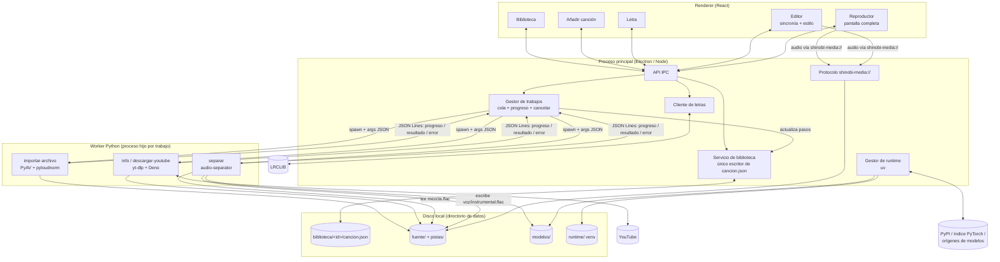
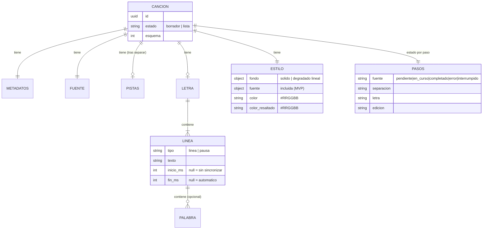

# Arquitectura de Shinobi Karaoke (MVP)

> Documento vivo del arquitecto. Decisiones de detalle en `docs/adr/`:
> [0001 Plataforma y stack](adr/0001-plataforma-y-stack.md) ·
> [0002 Licencia](adr/0002-licencia-del-proyecto.md) ·
> [0003 Fuente de audio](adr/0003-fuente-de-audio.md) ·
> [0004 Separación](adr/0004-separacion-voz-instrumental.md) ·
> [0005 Letras y sincronía](adr/0005-letras-y-formato-de-sincronia.md) ·
> [0006 Persistencia y modelo de datos](adr/0006-persistencia-y-modelo-de-datos.md) ·
> [0007 Herramientas de desarrollo](adr/0007-herramientas-de-desarrollo-y-calidad.md)
>
> Última revisión: 2026-11-03, tras las respuestas a las preguntas 0001–0005.

## 1. Visión general
Aplicación de **escritorio Electron** (GPL-3.0-or-later) con interfaz web (React + TypeScript) y un **worker Python** que se ejecuta como proceso hijo para el trabajo pesado de audio (YouTube, decodificación, separación). Todo es local; los únicos accesos a red son: instalación del entorno en el primer arranque, descarga de modelos, YouTube (si el usuario lo usa), LRCLIB (búsqueda de letras) y actualización de yt-dlp.

## 2. Componentes

| Componente | Proceso | Tecnología | Responsabilidades |
|-----------|---------|-----------|-------------------|
| **Renderer (UI)** | Renderer de Electron (sandbox, `contextIsolation`) | React + TS | Vistas: primer arranque, biblioteca, añadir canción, progreso, letra, editor, reproductor a pantalla completa. Reproducción y render de letra sincronizada (Web Audio + DOM/CSS). No toca el disco ni la red directamente. |
| **Preload / API IPC** | Preload | TS | Expone al renderer una API tipada mínima (`biblioteca.*`, `trabajos.*`, `letras.*`, `config.*`, `sistema.*`) y eventos (`trabajo:progreso`, `cancion:cambiada`). |
| **Servicio de biblioteca** | Main | TS | Escaneo de `biblioteca/`, CRUD de canciones, lectura/validación/migración y escritura atómica de `cancion.json` (único escritor), reglas de estado (ADR 0006). |
| **Gestor de trabajos** | Main | TS | Cola de trabajos en segundo plano, lanzamiento del worker, lectura de JSON Lines, progreso/ETA, cancelación (matar árbol de procesos), recuperación de trabajos interrumpidos. |
| **Gestor de runtime** | Main | TS + binario `uv` | Detección previa de hardware sin Python (SO/arquitectura + `nvidia-smi`) y espacio libre (`fs.statfs`); primer arranque: Python 3.12, venv, dependencias (`--torch-backend=auto`), modelo del perfil, Deno, con tamaños tomados del manifiesto de runtime; confirmación del perfil con PyTorch; descarga de modelos bajo demanda (Ajustes); actualización de yt-dlp. |
| **Avisos del sistema** | Main | Electron `Notification`, `app.dock`, `BrowserWindow.flashFrame` | Notificación al terminar/fallar un trabajo con la ventana sin foco; alternativa sin firma en macOS (rebote + insignia del Dock). |
| **Cliente de letras** | Main | TS (`fetch`) | LRCLIB `get` → `search`; parseo LRC / LRC mejorado / Lyricsfile YAML → formato interno; importación de `.lrc`/`.txt` (ADR 0005). |
| **Protocolo de medios** | Main | `protocol.handle` de Electron | Esquema propio `shinobi-media://<id>/<ruta-relativa>` para servir audio y miniaturas de la biblioteca al renderer (con soporte de rangos), sin habilitar `file://`. |
| **Worker de audio** | Proceso hijo Python (uno por trabajo) | Python 3.12, yt-dlp + Deno, PyAV, pyloudnorm, audio-separator (PyTorch/ONNX Runtime), soundfile | Comandos: `info-youtube`, `descargar-youtube`, `importar-archivo` (decodificar a `fuente/mezcla.flac`, sonoridad, metadatos), `separar`, `diagnostico` (hardware/aceleración). Emite JSON Lines por stdout. Sin estado propio. |

## 3. Flujo de datos



### Secuencia típica de creación
1. **Añadir canción**:
   - Archivo local: `importar-archivo` se ejecuta en `biblioteca/.importando/<id>/` → `fuente/mezcla.flac`, metadatos, `ganancia_db` (el original no se conserva). El usuario revisa título/artista y, al pulsar "Continuar", el servicio de biblioteca escribe `cancion.json` (paso `fuente` = `completado`) y renombra la carpeta a `biblioteca/<id>/`. Si abandona, se borra.
   - YouTube: `info-youtube` (sin archivos); al confirmar se crea `biblioteca/<id>/cancion.json` (paso `fuente` = `en_curso`) y se encolan `descargar-youtube` → `importar-archivo` sobre la descarga (que se borra al terminar).
2. **Fuente completada** → `fuente/mezcla.flac` + metadatos.
3. **Separación** se encola automáticamente al completar la fuente, con el modo vigente al empezar → `pistas/voz.flac`, `pistas/instrumental.flac`. La mezcla se conserva (pista "Original" del editor).
4. **Letra** (puede hacerse en paralelo a la separación): LRCLIB o manual → `letra.lineas`.
5. **Editor**: sincronía (escuchando la mezcla original o la voz) y estilo; autoguardado.
6. **Marcar como lista** cuando se cumplen las condiciones (ADR 0006) → aparece reproducible en la biblioteca.
7. **Reproductor**: instrumental + letra + estilo a pantalla completa.

## 4. Modelo de datos
Definido en [ADR 0006](adr/0006-persistencia-y-modelo-de-datos.md). Resumen:



Almacenamiento: una carpeta por canción con `cancion.json` + audio (`fuente/mezcla.flac`, `pistas/*.flac`); carpeta oculta `biblioteca/.importando/` para importaciones sin confirmar; `config.json` global (instalación, modo de separación, volumen del reproductor, estilo predeterminado); `runtime/` y `modelos/` compartidos. Ubicación por SO en el ADR 0006.

Reglas derivadas (funciones puras en `app/src/shared/`, no se guardan): **paso actual**, **puede marcarse como lista**, **incompleta** (lista con líneas sin inicio), **fin efectivo** de cada línea (ADR 0005). Operaciones puras de edición de tiempos: `moverInicioLinea` y `borrarTiemposLinea` (arrastran las palabras de la línea; ADR 0006).

## 5. Estructura de carpetas del código (propuesta)

```
shinobi-karaoke/
├── LICENSE                       # GPL-3.0
├── THIRD_PARTY_NOTICES.md        # créditos y licencias de terceros (UVR, modelos, fuentes OFL, FFmpeg…)
├── docs/                         # documentación (este directorio)
├── app/                          # aplicación Electron (TypeScript)
│   ├── package.json              # scripts: dev, build, lint, typecheck, test, test:e2e, semilla (ADR 0007)
│   ├── electron.vite.config.ts
│   ├── electron-builder.yml      # NSIS (Win), DMG (macOS), AppImage + deb (Linux)
│   ├── resources/
│   │   ├── fonts/                # 8 familias OFL de karaoke + Atkinson Hyperlegible Next 400/600 (interfaz), WOFF2, con OFL.txt por familia
│   │   ├── runtime-manifest.json # tamaños, URLs, SHA-256 de modelos y factores de tiempo por perfil (ADR 0004)
│   │   └── bin/                  # binario uv por plataforma (descargado en el build)
│   └── src/
│       ├── shared/               # tipos y validación del esquema (cancion, estilo, config), contratos IPC, protocolo JSON Lines
│       ├── main/
│       │   ├── index.ts          # ventana, ciclo de vida, protocolo shinobi-media://
│       │   ├── ipc/              # handlers de la API expuesta al renderer
│       │   ├── biblioteca/       # escaneo, lectura/escritura atómica, migraciones, reglas de estado
│       │   ├── trabajos/         # cola, spawn del worker, parser JSON Lines, cancelación, ETA
│       │   ├── runtime/          # primer arranque con uv, detección de hardware, actualización de yt-dlp
│       │   └── letras/           # cliente LRCLIB, parsers LRC / LRC mejorado / Lyricsfile
│       ├── preload/
│       │   └── index.ts          # contextBridge con API tipada
│       └── renderer/
│           ├── index.html
│           └── src/
│               ├── vistas/       # PrimerArranque, Biblioteca, AnadirCancion, Letra, Editor, Reproductor
│               ├── componentes/
│               ├── karaoke/      # motor de reproducción (Web Audio) y render de letra (compartido editor/reproductor)
│               └── estilos/      # tokens del sistema visual (variables CSS) y @font-face
├── worker/                       # worker Python
│   ├── pyproject.toml            # dependencias: yt-dlp[default], deno, av, soundfile, pyloudnorm, audio-separator[...]
│   ├── uv.lock
│   ├── shinobi_worker/
│   │   ├── __main__.py           # CLI: despacha comandos
│   │   ├── protocolo.py          # emisión de JSON Lines (progreso, log, resultado, error con códigos)
│   │   ├── fuente.py             # importar-archivo, info/descargar-youtube
│   │   ├── audio.py              # decodificación PyAV, remuestreo, sonoridad
│   │   ├── separacion.py         # interfaz Separador + adaptador audio-separator, intercepción de tqdm
│   │   └── diagnostico.py        # detección de CUDA/MPS/CPU y memoria
│   └── tests/
├── spikes/                       # pruebas de concepto desechables (no se empaquetan ni se importan desde app/ o worker/)
└── .github/workflows/            # CI (lint + tests en Windows, macOS y Linux) y, más adelante, builds por SO
```

## 6. Procesos largos (trabajos en segundo plano)

### Modelo de ejecución
- **Un proceso hijo Python por trabajo**, lanzado por el gestor de trabajos con el intérprete del venv: `runtime/venv/bin/python -m shinobi_worker <comando> --args '<json>'`.
- **Colas**: `pesada` (separación) con concurrencia 1; `ligera` (YouTube, importación) con concurrencia 1. Así una descarga puede avanzar mientras otra canción se separa, sin saturar la máquina.
- **Protocolo JSON Lines** (stdout, una línea JSON por mensaje; stderr va a `registros/`):
  ```json
  {"tipo":"progreso","fase":"descargando","valor":0.37,"detalle":{"bytes":1234567,"total":3333333}}
  {"tipo":"progreso","fase":"cargando_modelo","valor":null}
  {"tipo":"log","nivel":"info","mensaje":"…"}
  {"tipo":"resultado","datos":{"voz":"pistas/voz.flac","instrumental":"pistas/instrumental.flac"}}
  {"tipo":"error","codigo":"MEMORIA_INSUFICIENTE","mensaje":"…","reintentable":true}
  ```
  `valor: null` = progreso indeterminado. Los códigos de error forman un catálogo estable en `app/src/shared/` que la UX traduce a textos.
- **Progreso y ETA**: el main suaviza el progreso, calcula el tiempo restante con la velocidad observada y lo emite al renderer (máx. ~4 eventos/s). También se refleja `progreso` en `cancion.json` con menos frecuencia (p. ej. cada 5 %).
- **Cancelación**: matar el árbol de procesos (SIGTERM → SIGKILL a los 3 s; `taskkill /T /F` en Windows), borrar salidas parciales, paso → `pendiente`.
- **Cierre de la app**: si hay trabajos, diálogo de confirmación; al reabrir, los `en_curso` pasan a `interrumpido`.
- **Reintentos automáticos**: separación sin memoria → un reintento con bloques menores / perfil Rápido; descarga de YouTube con error de extracción → actualizar yt-dlp y reintentar una vez; descargas de red → reintento con espera exponencial.
- **Arranque en frío del worker**: importar PyTorch y cargar el modelo cuesta 5–20 s por trabajo de separación; se acepta en el MVP (alternativa futura: worker persistente).

### Primer arranque
Antes de empezar (pantalla de bienvenida): detección previa de hardware sin Python (SO/arquitectura, `nvidia-smi`) → perfil provisional → tamaño de descarga y espacio requerido leídos del manifiesto; espacio libre con `fs.statfs`. Requisito provisional: CPU ≈ 3 GB, Apple Silicon ≈ 4 GB, NVIDIA ≈ 8 GB (8 GB si la detección falla); a confirmar en la tarea 0005.

Secuencia del gestor de runtime, cada fase reanudable e idempotente (en la UI se agrupan en 3 fases visibles, `docs/ux/01-primer-arranque.md`):
1. Detección básica de plataforma.
2. `uv python install 3.12` → `uv venv` en `runtime/`.
3. `uv pip install --torch-backend=auto -r <requisitos bloqueados>` (incluye yt-dlp[default] y Deno).
4. `python -m shinobi_worker diagnostico` → confirma el perfil de hardware (CUDA / MPS / CPU; solo puede rebajar Calidad → Rápido), guardado en `config.json`.
5. Descarga y verificación SHA-256 del modelo del perfil en `modelos/`.

Progreso: bytes exactos para Python y modelo; para las dependencias, crecimiento de la caché de `uv` (en `runtime/`) frente al total del manifiesto (aproximado). ETA = bytes restantes / velocidad observada.

### Avisos al terminar un trabajo
Con la ventana sin foco: `Notification` de Electron en Windows (requiere el acceso directo con `AppUserModelID` que crea el instalador NSIS y `app.setAppUserModelId`) y Linux (libnotify). En macOS sin firma la notificación falla (evento `failed`) → rebote del icono (`app.dock.bounce('informational')`) e insignia numérica del Dock; en Windows/Linux además `flashFrame`. Siempre toast al volver a la ventana.

## 7. Reproducción y render de la letra
- Motor compartido por **editor y reproductor** (`renderer/src/karaoke/`).
- Audio con **Web Audio API**: el FLAC se decodifica en un `AudioBuffer` (~80–90 MB en memoria para 4 min, aceptable), `GainNode` con `ganancia_db`. Reloj = `AudioContext.currentTime` corregido con `outputLatency`, más `letra.offset_ms`. El reproductor reproduce **solo el instrumental**; el editor puede alternar mezcla original / voz / instrumental.
- Render en **DOM + CSS** con `requestAnimationFrame`: línea actual y siguiente(s); resaltado por palabra o barrido progresivo de línea (ADR 0005) usando capas con `clip-path`/`background-clip: text`; fondo con `linear-gradient`. Valores fijos de render en `docs/ux/sistema-visual.md` §10. Fin de cada línea con `finEfectivo` (ADR 0005); las líneas sin inicio se omiten; las pausas no se dibujan.
- Pistas: "Original" = `fuente/mezcla.flac`, "Voz", "Instrumental". El reproductor usa el instrumental (o la mezcla en la vista previa desde el editor si aún no hay pistas). Volumen del usuario en `config.reproductor` (se aplica tras `ganancia_db`).
- **Toque al ritmo**: tiempo de la pulsación = `KeyboardEvent.timeStamp` → tiempo del `AudioContext` (`getOutputTimestamp()`) − latencia de salida → tiempo de canción según la velocidad. Velocidades < 1× cambian el tono en el MVP (ADR 0005).
- Pantalla completa con la Fullscreen API / `BrowserWindow.setFullScreen`.

## 8. Seguridad
- Renderer con `sandbox`, `contextIsolation`, sin `nodeIntegration`; CSP estricta; solo el protocolo `shinobi-media://` para medios, limitado a `biblioteca/`.
- Las URLs de YouTube se validan en main antes de pasarlas al worker; argumentos siempre como JSON (nunca concatenados en un shell).
- Sin telemetría.

---

## Restricciones e implicaciones para UX

> Sección pensada para el diseñador UX. Las cifras son estimaciones a validar en la primera tarea técnica; el arquitecto las actualizará.

### 1. Instalación y primer arranque
- **Instalador** ~100–150 MB. **Sin firma de código en el MVP** (decisión del usuario, `preguntas/0001`): Windows (SmartScreen) y macOS (Gatekeeper) muestran avisos de "app no reconocida" que el usuario salta con la guía de instalación (`ux/01`, Parte A).
- **Primer arranque obligatorio con conexión**: descarga de Python, dependencias y el modelo de separación.
  | Equipo | Descarga aprox. | Tiempo aprox. (conexión 50 Mbps) |
  |--------|----------------|-------------------------------|
  | Solo CPU (Win/macOS/Linux) | ~0,5–0,8 GB | 3–8 min |
  | Apple Silicon | ~1,3–1,7 GB | 5–12 min |
  | NVIDIA (CUDA) | ~3–4 GB | 10–25 min |
  Necesita: pantalla dedicada con fases (*Preparando motor de audio*, *Instalando componentes*, *Descargando modelo de separación*), progreso, tamaño, posibilidad de reintentar/reanudar, error de "sin conexión" o "sin espacio en disco" (pedir ≈ 3 GB en CPU, ≈ 4 GB en Apple Silicon, ≈ 8 GB con NVIDIA; el perfil se conoce antes de instalar). La app no es utilizable hasta completarlo.
- Arranques posteriores: 1–3 s. Ocasionalmente (≤ 1 vez/semana) actualización silenciosa de yt-dlp en segundo plano.

### 2. Tiempos esperados por paso (canción de ~4 min)
| Paso | Tiempo | ¿Asíncrono? | ¿Cancelable? |
|------|--------|-------------|--------------|
| Importar archivo local | 2–10 s | Sí (breve) | Sí |
| YouTube: obtener info (título, duración, miniatura) | 2–5 s | Sí | Sí |
| YouTube: descarga | 5–60 s según conexión | Sí, con % | Sí |
| Separación — GPU NVIDIA (Calidad) | ~0,5–2 min | **Sí, en segundo plano** | Sí |
| Separación — Apple Silicon (Calidad) | ~2–6 min | Sí | Sí |
| Separación — solo CPU (Rápido) | ~3–7 min | Sí | Sí |
| Separación — CPU en modo Calidad (elegido en Ajustes) | ~15–40 min | Sí | Sí |
| + carga del modelo al inicio de cada separación | 5–20 s, progreso **indeterminado** | — | Sí |
| Búsqueda de letra (LRCLIB) | < 2 s (timeout 10 s) | Sí | — |
| Sincronía manual por líneas | lo que tarde el usuario (≈ duración de la canción + ajustes) | — | — |
| Reproducir canción lista | inmediato (decodificar FLAC < 1 s) | — | — |

Implicaciones:
- La separación **no debe bloquear**: el usuario puede volver a la biblioteca, añadir otra canción (quedará en cola: una separación a la vez) o **avanzar a Letra y Editor** mientras tanto. Solo "Marcar como lista" y el reproductor requieren las pistas.
- La biblioteca debe poder mostrar en cada tarjeta: estado (Borrador/Lista), paso actual, progreso en curso, en cola, error o interrumpido.
- Hay progreso con **tiempo restante estimado**, pero puede ser impreciso al principio y tiene una fase indeterminada (carga del modelo).
- Varias canciones pueden tener trabajos simultáneos: una separando y otra descargando.

### 3. Qué puede fallar (códigos de error estables para textos de UX)
| Situación | Paso | Código previsto | Recuperación |
|-----------|------|----------------|--------------|
| Sin conexión | Primer arranque, YouTube, letras, modelo | `SIN_CONEXION` | Reintentar; en letras → entrada manual |
| Sin espacio en disco | Todos | `SIN_ESPACIO` | Liberar espacio, reintentar |
| Formato no soportado / archivo dañado / sin audio | Fuente | `FORMATO_NO_SOPORTADO` | Elegir otro archivo |
| Audio demasiado corto (< 10 s) | Fuente | `AUDIO_DEMASIADO_CORTO` | — |
| Audio largo (> 10 min) | Fuente | aviso, no error | Continuar o cancelar |
| URL no válida / no es de YouTube | Fuente | `URL_NO_VALIDA` | Corregir |
| Es una lista de reproducción / directo | Fuente | `URL_NO_SOPORTADA` | Usar URL de un vídeo |
| Vídeo privado, eliminado, con restricción de edad o región | Fuente | `VIDEO_NO_DISPONIBLE` | — (sin login en el MVP) |
| YouTube bloquea la descarga ("confirma que no eres un bot", 403/429) | Fuente | `YOUTUBE_BLOQUEADO` | Reintento automático tras actualizar yt-dlp; si persiste, probar más tarde o usar archivo local |
| Memoria insuficiente (RAM/VRAM) | Separación | `MEMORIA_INSUFICIENTE` | Reintento automático en modo más ligero |
| Modelo no descargado o corrupto | Separación | `MODELO_NO_DISPONIBLE` | Re-descarga |
| Trabajo interrumpido por cierre de la app | Fuente/Separación | estado `interrumpido` | Reintentar desde cero ese paso |
| Letra no encontrada / es instrumental | Letra | `LETRA_NO_ENCONTRADA` / `INSTRUMENTAL` | Pegar o importar `.lrc`/`.txt`; editar título/artista y buscar de nuevo |
| LRCLIB caído o limitando (429) | Letra | `SERVICIO_NO_DISPONIBLE` | Reintentar más tarde o entrada manual |
| Letra desfasada respecto al audio | Editor | — | Ajuste de desplazamiento global y fino por línea |
| Pistas borradas o `cancion.json` dañado | Biblioteca | canción "dañada" | Re-separar / eliminar |

### 4. Datos de entrada que la UX debe contemplar
- **Título y artista** se infieren con heurísticas y fallarán a menudo (sobre todo con YouTube): deben poder **revisarse y editarse** antes de buscar la letra.
- La búsqueda de letras puede devolver **varios candidatos**: indicar si cada uno es *sincronizado por palabra*, *sincronizado por línea* o *solo texto*, y su duración frente a la de la canción.
- La letra viene como líneas; las líneas vacías del LRC indican pausas/instrumentales.

### 5. Editor y reproductor
- **Sincronía**: herramienta de "toque al ritmo" por línea (tecla/botón al inicio de cada línea mientras suena, con velocidad 0,5×–1×; por debajo de 1× el tono baja), ajuste fino por línea (±10/100 ms o arrastre) y desplazamiento global. **Solo por línea en el MVP** (decisión del usuario, `preguntas/0002`); la sincronía por palabra solo existe si viene de LRCLIB/LRC importado, y se muestra pero no se edita (al mover el inicio de una línea sus palabras se desplazan lo mismo y al borrar sus tiempos se borran también; ADR 0006).
- Para sincronizar, el usuario necesita oír la voz: el editor puede alternar **mezcla original / voz / instrumental** (disponible antes de terminar la separación solo la mezcla original).
- **Resaltado**: por palabra si hay tiempos de palabra; si no, barrido progresivo de la línea completa (lineal entre su inicio y fin).
- **Estilo** editable (MVP): fondo sólido o degradado lineal (ángulo + 2–4 colores), color de letra, color de resaltado, fuente. Tamaño, sombra/contorno y posición de la letra: valores fijos que define la UX (no editables en el MVP); si se requieren editables, pedirlo vía pregunta.
- **Contraste**: la app no impide combinaciones ilegibles (letra/resaltado/fondo); la UX puede querer avisos de contraste o paletas sugeridas.
- **Autoguardado** continuo: no hay pérdida de cambios; "Guardar borrador" es una acción de tranquilidad/salida, no un requisito técnico.
- **Marcar como lista** solo es posible si: existen ambas pistas y todas las líneas (no pausas) tienen tiempo de inicio. La UX debe explicar qué falta cuando no se puede. Una canción lista no vuelve sola a borrador (indicador derivado "incompleta").
- **Reproductor**: solo instrumental + letra + estilo, a pantalla completa; reproducción inmediata. Volumen igualado entre canciones (normalización de sonoridad).

### 6. Fuentes tipográficas
- **Decidido** (`preguntas/0004`): 8 familias **SIL OFL** incluidas, un peso cada una (Atkinson Hyperlegible Next, Nunito, Montserrat, Oswald, Lora, Playfair Display, Bangers, Noto Sans), WOFF2, ~1,5–2,5 MB en total; sin CJK. Sin fuentes del sistema en el MVP (el esquema reserva `origen: "sistema"`).
- Caracteres no cubiertos por la fuente elegida se muestran con una fuente de respaldo (posible mezcla visual con idiomas no latinos).

### 7. Avisos y textos obligatorios
- **Aviso legal único** antes de la primera importación desde YouTube (uso personal, responsabilidad del usuario).
- **Atribución** de la letra cuando viene de LRCLIB ("Letra: LRCLIB").
- Sección **Acerca de / Licencias** con la licencia GPL-3.0 y créditos de terceros (UVR y autores de modelos, fuentes, FFmpeg, yt-dlp).

### 8. Requisitos del equipo (orientativos)
- Windows 10/11 x64, macOS 12+ (Apple Silicon recomendado; Intel soportado en modo Rápido), Linux x64 con glibc ≥ 2.28.
- 8 GB de RAM mínimo; 3–8 GB de disco para el motor (según equipo) + ≈ 70–100 MB por canción de 4 min.
- GPU opcional: NVIDIA con ≥ 4 GB de VRAM o Apple Silicon para el modo Calidad.
- La resolución del reproductor se adapta a la pantalla; sin requisitos de GPU para el render de la letra.
