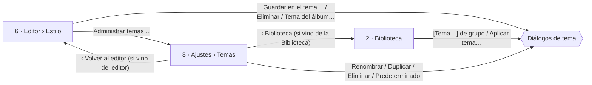
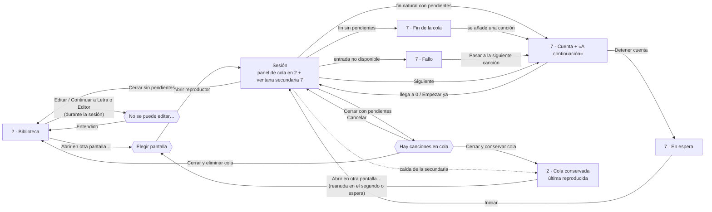
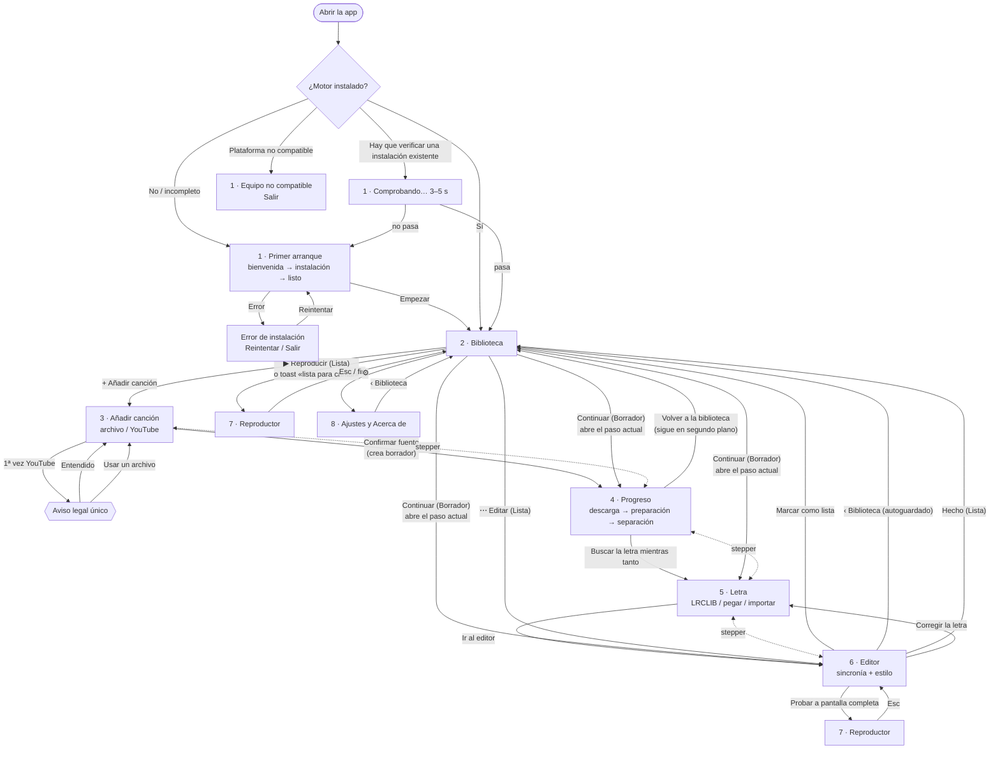
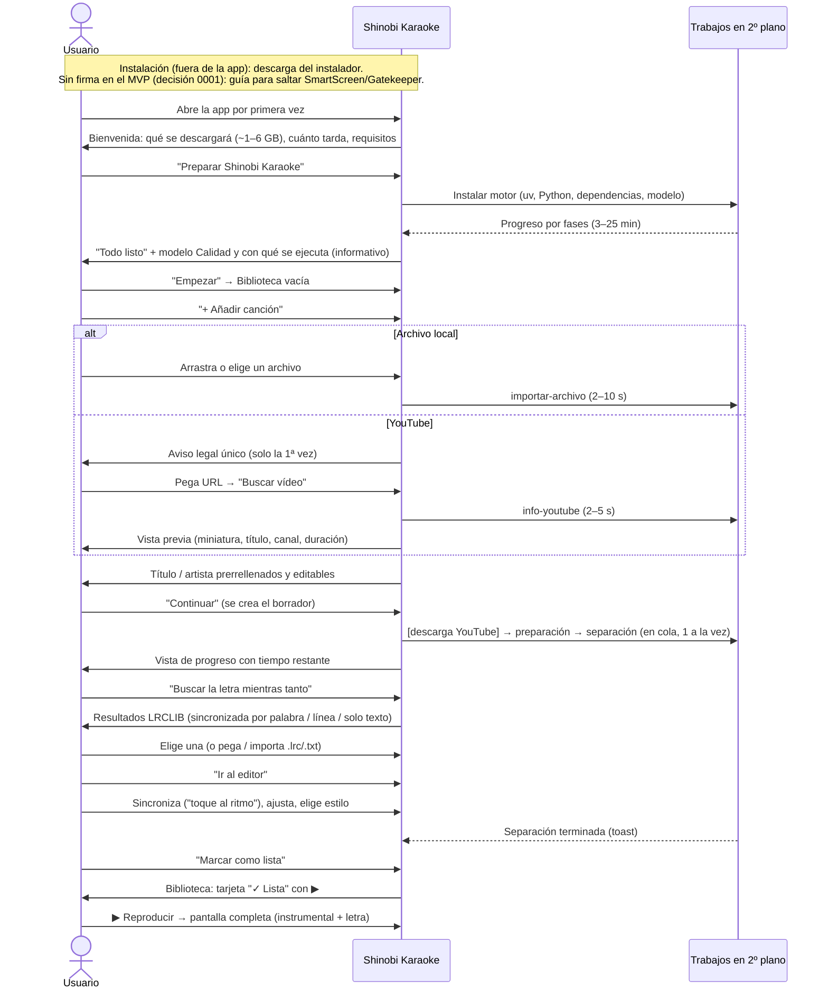

# Mapa de vistas y flujos — Shinobi Karaoke (MVP)

> Responsable: diseñador UX. Base: [00-vision-y-alcance.md](../00-vision-y-alcance.md), [01-pipeline.md](../01-pipeline.md), [arquitectura.md](../arquitectura.md) (sección "Restricciones e implicaciones para UX"), ADR [0003](../adr/0003-fuente-de-audio.md), [0004](../adr/0004-separacion-voz-instrumental.md), [0005](../adr/0005-letras-y-formato-de-sincronia.md), [0006](../adr/0006-persistencia-y-modelo-de-datos.md). Sistema visual: [sistema-visual.md](sistema-visual.md).

## 1. Inventario de vistas

| # | Vista | Spec | Tipo | Se llega desde |
|---|-------|------|------|----------------|
| — | **Descarga e instalación** (README e `INSTALAR.md`, fuera de la app) | [09-descarga-e-instalacion.md](09-descarga-e-instalacion.md) | Documentos del repositorio, no es una vista | Página del proyecto; notas de cada *Release* |
| 1 | **Primer arranque** (bienvenida → instalación del motor → listo) | [01-primer-arranque.md](01-primer-arranque.md) | Pantalla completa de la ventana, bloqueante | Arranque de la app si `config.instalacion.estado ≠ "completa"` |
| 2 | **Biblioteca** (vista inicial) | [02-biblioteca.md](02-biblioteca.md) | Vista raíz | Arranque normal, botón "Biblioteca" de cualquier vista, salir del reproductor |
| 3 | **Añadir canción** (fuente: archivo / YouTube + metadatos) | [03-anadir-cancion.md](03-anadir-cancion.md) | Paso 1 del espacio de canción | Botón "Añadir canción" (Ctrl/Cmd+N) |
| 4 | **Progreso del pipeline** (descarga, preparación, separación) | [04-progreso-pipeline.md](04-progreso-pipeline.md) | Paso 2 del espacio de canción + componentes globales (indicador de actividad, tarjeta) | Confirmar la fuente; "Continuar" de un borrador en ese paso; panel de actividad |
| 5 | **Letra** (buscar en LRCLIB, elegir, pegar/importar, revisar) | [05-letra.md](05-letra.md) | Paso 3 del espacio de canción | Vista de progreso ("Buscar la letra mientras tanto"), stepper, "Continuar" |
| 6 | **Editor** (sincronía + estilo + vista previa) | [06-editor.md](06-editor.md) | Paso 4 del espacio de canción | Letra ("Ir al editor"), stepper, "Continuar"/"Editar" desde la biblioteca |
| 7 | **Reproductor** a pantalla completa | [07-reproductor.md](07-reproductor.md) | Superpuesta (la Biblioteca o el Editor siguen montados debajo), pantalla completa | "Reproducir" en la biblioteca (tarjeta, menú ⋯, toast «lista para cantar»); "Probar a pantalla completa" o F en el editor |
| 8 | **Ajustes y Acerca de** | [08-ajustes-y-acerca.md](08-ajustes-y-acerca.md) | Vista secundaria | Botón ⚙ de la barra superior |
| 7b | **Reproductor en otra pantalla** (0.2.0, fase 4) | [07 · Fase 4](07-reproductor.md#fase-4-de-020--ventana-secundaria-y-cola) | **Segunda ventana** de rol fijo, en la pantalla elegida | «Abrir en otra pantalla…» de la Biblioteca o de su panel de cola |
| 2b | **Panel «Cola de reproducción»** (0.2.0, fase 4) | [02 · Fase 4](02-biblioteca.md#fase-4-de-020--ventana-secundaria-y-cola) | Panel lateral de la Biblioteca | Al abrir una sesión, «Cola {n}» de la cabecera, indicador de sesión de la barra superior |

Diálogos transversales (definidos en las specs que los originan): aviso legal de YouTube (03), confirmar cierre con trabajos (04), eliminar canción (02), volver a borrador (02/06), atajos de teclado (06/07).

### 0.2.0, fase 3 · Temas y biblioteca
- **Biblioteca** (02): «Agrupar por» Sin agrupar / Artista / Álbum, búsqueda en título, artista y álbum, modo selección con «Aplicar tema…» y [Tema…] en los encabezados de artista y álbum.
- **Editor › Estilo** (06): sección «Tema» (Temas definidos / Tema personalizado, procedencia, editar, guardar como, renombrar, duplicar, eliminar, tema del álbum o artista).
- **Ajustes › Temas** (08): tema predeterminado y lista completa del catálogo. Es el único lugar con todos los temas; el aspecto de un tema se edita solo desde el editor.
- Diálogos nuevos, definidos en 06 y reutilizados en 02 y 08: confirmar impacto (guardar en el tema, tema de grupo, cambiar o quitar el predeterminado), nombre del tema (nuevo, duplicar, renombrar), eliminar tema, descartar cambios del tema, salir con un borrador de tema (también al cerrar la ventana). En 02: tema de artista o álbum y «Aplicar tema» (con resultado por canción).


- **Ajustes vuelve a su origen**: «Volver» y Esc regresan a la Biblioteca o al editor de la canción desde la que se abrió (⚙, Ctrl/Cmd + , o «Administrar temas…»).
- Salir del editor con un borrador de tema pide confirmar antes que cualquier otra cosa (`tema.dialogo.salir`).
- Atajos nuevos de la Biblioteca (modo selección): Ctrl/Cmd + A selecciona las visibles, Espacio/Intro alternan, Esc termina. En vistas agrupadas, Ctrl/Cmd + Inicio/Fin van a la primera y última tarjeta.

### 0.2.0, fase 4 · Ventana secundaria y cola
- **Reproductor en otra pantalla** (07 · Fase 4): **segunda ventana** de rol fijo que solo muestra el reproductor y es la única que suena durante la **sesión**. Estados propios: cuenta entre canciones (contador central y tarjeta «A continuación»), en espera, fin de la cola, fallo de una entrada, reanudación. Esc no cierra la sesión.
- **Biblioteca** (02 · Fase 4): botón «Abrir en otra pantalla…» y «Reproducir en otra pantalla…» del menú de una Lista (los únicos puntos de inicio de una sesión), diálogo de pantallas, **panel «Cola de reproducción»** a la derecha (activa, pendientes, controles de operación, cola conservada), tarjetas con «A la cola» durante la sesión.
- **Barra superior**: **indicador de sesión** (a la izquierda del de actividad) visible con sesión o cola; lleva a la Biblioteca con el panel abierto.
- **Editor y Letra** (06 · Fase 4): bloqueados durante la sesión con el diálogo «No se puede editar mientras el reproductor está abierto en otra ventana». La escucha de la vista de progreso, también.
- **Ajustes › Reproductor** (08 · Fase 4): «Cuenta entre canciones» (4 s por defecto).
- Diálogos nuevos: abrir en otra pantalla / cambiar de pantalla (02), «Hay canciones en cola» al cerrar (02, en la ventana donde se pide el cierre), vaciar pendientes y eliminar cola (02), salir de la app con sesión o cola (02, combinado con el de trabajos de 04), bloqueo de edición (06).


- **Una sola sesión** y un solo transporte audible: durante la sesión no se abre el reproductor local ni suena nada en la principal.
- La cola vive **en memoria** mientras la app está abierta: se puede preparar antes de abrir la sesión, conservar al cerrarla y se pierde al salir de la app (con confirmación).

## 2. Estructura de la ventana

```
┌──────────────────────────────────────────────────────────────────────────┐
│ BARRA SUPERIOR (fija, 56 px)                                              │
│ [◆ Shinobi Karaoke]  ‹contexto›                [⟳ 1 en curso] [⚙] [+ Añadir]│
├──────────────────────────────────────────────────────────────────────────┤
│                                                                          │
│                     CONTENIDO DE LA VISTA                                │
│                                                                          │
└──────────────────────────────────────────────────────────────────────────┘
```
- El logotipo es un botón que lleva a la Biblioteca (equivale a "‹ Biblioteca").
- `‹contexto›`: en Biblioteca, nada; en el espacio de canción, el **stepper** con el título de la canción.
- `+ Añadir canción` (primario) solo aparece en la Biblioteca (en el resto de vistas no hay dos primarios).
- La barra superior no existe en Primer arranque ni en el Reproductor.

### Espacio de canción (vistas 3–6)
Las vistas de creación comparten cabecera con stepper:
```
┌──────────────────────────────────────────────────────────────────────────┐
│ ‹ Biblioteca │ «Bohemian Rhapsody» · Queen     ✎ Borrador · guardado ✓   │
│   (1)✓ Fuente ──── (2)⟳ Separación 42 % ──── (3)● Letra ──── (4)○ Editor │
└──────────────────────────────────────────────────────────────────────────┘
```
**Reglas del stepper** (paso derivado del ADR 0006):
| Paso | Navegable cuando | Indicador |
|------|------------------|-----------|
| 1 Fuente | Siempre que exista la canción. Tras completarse, muestra un resumen de la fuente y permite editar los metadatos (no cambiar el audio). | ✓ completado · ⟳ descargando · ✕ error · ⚠ interrumpido |
| 2 Separación | Cuando la fuente está completada o en curso | ⟳ con % · "En cola" · ✓ · ✕ · ⚠ |
| 3 Letra | Cuando la fuente está completada (no espera a la separación) | ✓ si hay ≥ 1 línea (también estando en la vista Letra); ● si es el actual y aún no tiene líneas |
| 4 Editor | Cuando la fuente está completada y hay letra (≥ 1 línea) | ✓ si la canción está **Lista** (también estando en el Editor); ● si es el actual y no está Lista |

**Paso actual** ([0024](../preguntas/0024-stepper-letra-actual-y-volver-a-letra-desde-el-editor.md)): el indicador del círculo muestra siempre el estado del paso (✓, ⟳, ✕, ⚠…); ● solo sustituye a "pendiente" en el paso actual. El paso actual se marca además con la etiqueta en `texto-1` 600, subrayado de 2 px `acento-texto` y `aria-current="step"`; su `aria-label` añade ", paso actual" (p. ej. "Paso 3, Letra, completado, paso actual").
Los pasos no navegables tienen `aria-disabled` y muestran *tooltip* con el motivo (definitivos, `preguntas/0022` §8):

| Clave | Cuándo | Texto |
|-------|--------|-------|
| `paso.motivo.sinFuente` | Pasos 2–4 con la fuente `pendiente`, `error` o `interrumpido` | Primero añade el audio |
| `paso.motivo.descargando` | Pasos 3–4 con la fuente `en_curso` (descargando de YouTube) | Espera a que termine la descarga |
| `paso.motivo.sinLetra` | Paso 4 con la fuente completada y sin letra (0 líneas) | Primero elige una letra |
| `paso.motivo.sesion` | Pasos 3–4 durante una sesión en otra pantalla (0.2.0, fase 4; spec 06) | No se puede editar mientras el reproductor está abierto en otra ventana |

## 3. Navegación



**"Continuar" de un borrador** abre la vista del paso actual derivado:
| Situación de la canción | Vista que abre |
|-------------------------|---------------|
| Fuente pendiente / error / interrumpida | 3 Añadir canción (con el error o "interrumpido" y Reintentar; YouTube pendiente sin trabajo vivo: "Falta descargar el audio" y "Descargar ahora", spec 03 wireframe E) |
| Fuente en curso (descargando) | 4 Progreso |
| Separación en curso / en cola / error / interrumpida **y** sin letra | 4 Progreso |
| Sin letra (separación completada o en curso pero ya vista) | 5 Letra |
| Con letra, sin terminar de sincronizar | 6 Editor |
Nota: si la separación está en curso pero ya hay letra, "Continuar" abre el **Editor** (el progreso sigue visible en el stepper).

## 4. Flujo principal de punta a punta



### Puntos de salida y retorno
- **En cualquier momento** se puede volver a la Biblioteca (`‹ Biblioteca` o Esc fuera de campos de texto en vistas del espacio de canción). Todo se autoguarda (ADR 0006); no hay diálogo de "cambios sin guardar".
- Los trabajos (descarga, separación) **siguen en segundo plano** al salir de la vista. Se ven en la tarjeta de la canción y en el indicador de actividad.
- **Cerrar la app** con trabajos en curso → diálogo de confirmación (spec 04). Al reabrir, el paso queda **interrumpido** con "Reintentar".

## 5. Primer arranque y aviso legal (resumen)
- **Primer arranque** (spec 01): obligatorio y con conexión. Tres fases visibles: *Preparando el motor de audio* → *Instalando componentes* → *Descargando el modelo de separación*. Reanudable; si se cierra, al volver a abrir continúa. Errores de conexión y espacio con acción clara. Antes, fuera de la app, la **guía de instalación** cubre los avisos de SmartScreen/Gatekeeper (instaladores sin firmar en el MVP, decisión del usuario en la [pregunta 0001](../preguntas/0001-firma-de-codigo-instaladores.md)).
- **Aviso legal de YouTube** (spec 03): se muestra **una sola vez**, en línea dentro de la opción "Enlace de YouTube", la primera vez que el usuario la abre; no se puede usar YouTube sin aceptarlo; la aceptación queda en `config.json` (`aviso_youtube_aceptado`) y se puede volver a leer en Ajustes → Acerca de.

## 6. Atajos globales
| Atajo | Acción | Disponible en |
|-------|--------|---------------|
| Ctrl/Cmd + N | Añadir canción | Biblioteca, espacio de canción |
| Ctrl/Cmd + F | Buscar en la biblioteca | Biblioteca |
| Esc | Cerrar diálogo/menú; si no hay, volver a la Biblioteca (espacio de canción) o salir del reproductor | Todas |
| Ctrl/Cmd + , | Ajustes | Todas salvo primer arranque y reproductor |
| F1 / ? | Atajos de teclado | Editor, Reproductor |
| Ctrl/Cmd + + / − / 0 | Zoom de la interfaz | Todas salvo reproductor |
| Alt + ↑ / ↓ · Alt + Inicio / Fin · Supr | Mover una pendiente una posición · al principio / al final · quitarla (0.2.0, fase 4) | Panel de la cola (fila enfocada) |
| Mayús + N | Siguiente canción de la cola (0.2.0, fase 4) | Ventana secundaria |
| Ctrl/Cmd + W | Cerrar el reproductor (con confirmación si hay pendientes) (0.2.0, fase 4) | Ventana secundaria |

En la ventana secundaria, **Esc** no sale: pasa de pantalla completa a ventana (spec 07 · Fase 4). En la principal, ninguna acción de la sesión tiene atajo de una sola tecla.

## 7. Índice de textos de error
Los códigos estables de `arquitectura.md §3` se traducen así (detalle y acciones en cada spec):
| Código | Spec | Título visible |
|--------|------|---------------|
| `SIN_CONEXION` | 01, 03, 04, 05 | "Sin conexión a internet" |
| `SIN_ESPACIO` | 01, 03, 04 | "No queda espacio en el disco" |
| `FORMATO_NO_SOPORTADO` | 03 | "No podemos leer este archivo" |
| `AUDIO_DEMASIADO_CORTO` | 03 | "El audio es demasiado corto" |
| `URL_NO_VALIDA` | 03 | "Este enlace no es de un vídeo de YouTube" |
| `URL_NO_SOPORTADA` | 03 | "Las listas y los directos no se pueden usar" |
| `VIDEO_NO_DISPONIBLE` | 03 | "Este vídeo no está disponible" |
| `YOUTUBE_BLOQUEADO` | 03, 04 | "YouTube no permite la descarga ahora mismo" |
| `MEMORIA_INSUFICIENTE` | 04 | "Tu equipo se quedó sin memoria" |
| `MODELO_NO_DISPONIBLE` | 04 | "Falta el modelo de separación" |
| `RUNTIME_NO_DISPONIBLE` | 01, 04 | "Hay que reparar el motor de audio" (acción [Reparar el motor de audio] en la vista de progreso; la tarjeta ofrece [Ver]) |
| `interrumpido` (estado) | 02, 03, 04 | "Se interrumpió" |
| `LETRA_NO_ENCONTRADA` | 05 | "No encontramos la letra" |
| `INSTRUMENTAL` | 05 | "Esta canción es instrumental" |
| `SERVICIO_NO_DISPONIBLE` | 05 | "El servicio de letras no responde" |
| canción dañada | 02 | "No se puede abrir esta canción" |
| fuente del sistema no instalada | — (no aplica en el MVP: solo fuentes incluidas, ver respuesta a 0004) | — |
| Cualquier código desconocido | todas | "Algo salió mal" + "Copiar detalles" |

| `CONFIRMACION_OBSOLETA` | 02, 06, 08 | Aviso en el diálogo: «Mientras confirmabas cambió qué canciones usan este tema…» (`tema.obsoleto`) |
| `TEMA_NOMBRE_DUPLICADO` | 06, 08 | «Ya tienes un tema con ese nombre.» (en el campo) |
| `TEMA_NO_ENCONTRADO` | 02, 06, 08 | «Este tema ya no existe…» (`tema.error.noExiste`) |
| `TEMAS_SOLO_LECTURA` | 02, 06, 08 | «Tus temas se guardaron con una versión más nueva…» |
| `BORRADO_PENDIENTE` | 02, 06, 08 | «La eliminación de este tema quedó a medias…» |
| sesión activa (bloqueo) | 02, 04, 06 | «No se puede editar mientras el reproductor está abierto en otra ventana» (`edi.bloqueo.titulo`) |
| no se pudo abrir la secundaria | 02 | «No se pudo abrir el reproductor en esa pantalla…» (`ses.error.abrir`) |
| entrada de la cola no disponible | 02, 07 | Principal: «No se puede reproducir «{título}»» + causa (`cola.causa.*`); público: «Esta canción no se puede reproducir ahora.» |
| secundaria caída / sin respuesta | 02 | «El reproductor se cerró de forma inesperada…» · «El reproductor no responde.» |
| pantalla desconectada | 02 | «Se desconectó «{pantalla}»…» |

Códigos estables en el [ADR 0017](../adr/0017-ventana-secundaria-sesion-en-vivo-y-cola-de-reproduccion.md) §11: `EDICION_BLOQUEADA`, `SESION_EN_CURSO`, `GUARDADO_PENDIENTE`, `PANTALLA_NO_DISPONIBLE`, `CANCION_NO_DISPONIBLE`, `ENTRADA_NO_ENCONTRADA`, `COLA_LLENA` (texto `cola.llena`, spec 02) y `CONFIRMACION_OBSOLETA` (al confirmar el cierre: el diálogo se actualiza y pide confirmar otra vez).

Tono del microcopy: tuteo, frases cortas, sin jerga técnica (no se dice "worker", "modelo ONNX", "venv"); cada error dice **qué pasó** y **qué puede hacer** el usuario.
