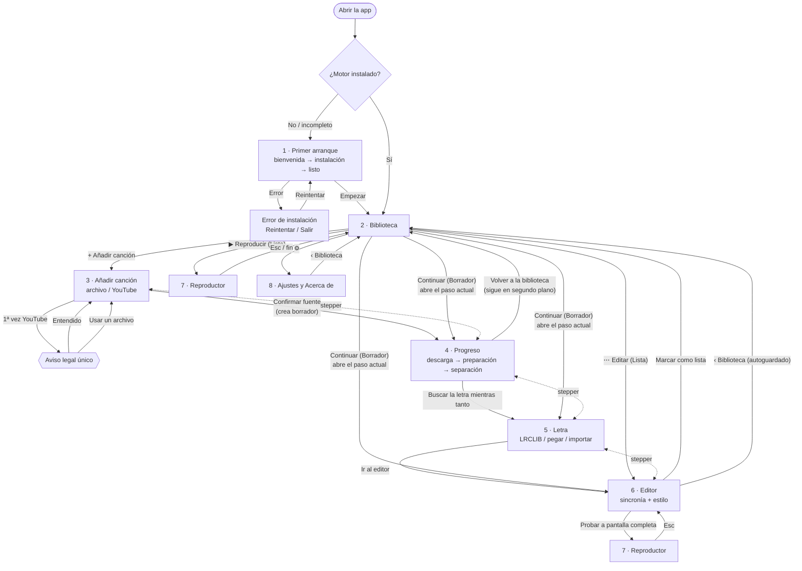
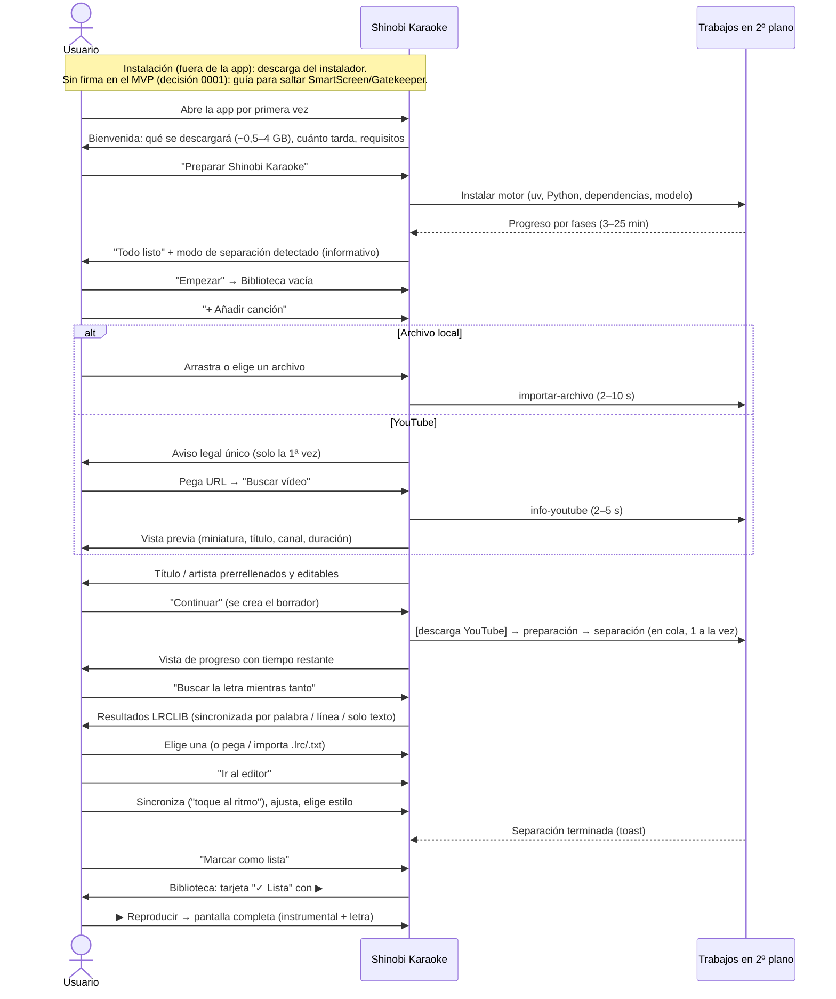

# Mapa de vistas y flujos — Shinobi Karaoke (MVP)

> Responsable: diseñador UX. Base: [00-vision-y-alcance.md](../00-vision-y-alcance.md), [01-pipeline.md](../01-pipeline.md), [arquitectura.md](../arquitectura.md) (sección "Restricciones e implicaciones para UX"), ADR [0003](../adr/0003-fuente-de-audio.md), [0004](../adr/0004-separacion-voz-instrumental.md), [0005](../adr/0005-letras-y-formato-de-sincronia.md), [0006](../adr/0006-persistencia-y-modelo-de-datos.md). Sistema visual: [sistema-visual.md](sistema-visual.md).

## 1. Inventario de vistas

| # | Vista | Spec | Tipo | Se llega desde |
|---|-------|------|------|----------------|
| 1 | **Primer arranque** (bienvenida → instalación del motor → listo) | [01-primer-arranque.md](01-primer-arranque.md) | Pantalla completa de la ventana, bloqueante | Arranque de la app si `config.instalacion.estado ≠ "completa"` |
| 2 | **Biblioteca** (vista inicial) | [02-biblioteca.md](02-biblioteca.md) | Vista raíz | Arranque normal, botón "Biblioteca" de cualquier vista, salir del reproductor |
| 3 | **Añadir canción** (fuente: archivo / YouTube + metadatos) | [03-anadir-cancion.md](03-anadir-cancion.md) | Paso 1 del espacio de canción | Botón "Añadir canción" (Ctrl/Cmd+N) |
| 4 | **Progreso del pipeline** (descarga, preparación, separación) | [04-progreso-pipeline.md](04-progreso-pipeline.md) | Paso 2 del espacio de canción + componentes globales (indicador de actividad, tarjeta) | Confirmar la fuente; "Continuar" de un borrador en ese paso; panel de actividad |
| 5 | **Letra** (buscar en LRCLIB, elegir, pegar/importar, revisar) | [05-letra.md](05-letra.md) | Paso 3 del espacio de canción | Vista de progreso ("Buscar la letra mientras tanto"), stepper, "Continuar" |
| 6 | **Editor** (sincronía + estilo + vista previa) | [06-editor.md](06-editor.md) | Paso 4 del espacio de canción | Letra ("Ir al editor"), stepper, "Continuar"/"Editar" desde la biblioteca |
| 7 | **Reproductor** a pantalla completa | [07-reproductor.md](07-reproductor.md) | Superpuesta, pantalla completa | "Reproducir" en la biblioteca; "Probar a pantalla completa" en el editor |
| 8 | **Ajustes y Acerca de** | [08-ajustes-y-acerca.md](08-ajustes-y-acerca.md) | Vista secundaria | Botón ⚙ de la barra superior |

Diálogos transversales (definidos en las specs que los originan): aviso legal de YouTube (03), confirmar cierre con trabajos (04), eliminar canción (02), volver a borrador (02/06), atajos de teclado (06/07).

## 2. Estructura de la ventana

```
┌──────────────────────────────────────────────────────────────────────────┐
│ BARRA SUPERIOR (fija, 56 px)                                              │
│ [◆ Shinobi Karaoke]  ‹contexto›                [⟳ 1 en curso] [⚙] [+ Añadir]│
├──────────────────────────────────────────────────────────────────────────┤
│                                                                          │
│                     CONTENIDO DE LA VISTA                                │
│                                                                          │
└──────────────────────────────────────────────────────────────────────────┘
```
- El logotipo es un botón que lleva a la Biblioteca (equivale a "‹ Biblioteca").
- `‹contexto›`: en Biblioteca, nada; en el espacio de canción, el **stepper** con el título de la canción.
- `+ Añadir canción` (primario) solo aparece en la Biblioteca (en el resto de vistas no hay dos primarios).
- La barra superior no existe en Primer arranque ni en el Reproductor.

### Espacio de canción (vistas 3–6)
Las vistas de creación comparten cabecera con stepper:
```
┌──────────────────────────────────────────────────────────────────────────┐
│ ‹ Biblioteca │ «Bohemian Rhapsody» · Queen     ✎ Borrador · guardado ✓   │
│   (1)✓ Fuente ──── (2)⟳ Separación 42 % ──── (3)● Letra ──── (4)○ Editor │
└──────────────────────────────────────────────────────────────────────────┘
```
**Reglas del stepper** (paso derivado del ADR 0006):
| Paso | Navegable cuando | Indicador |
|------|------------------|-----------|
| 1 Fuente | Siempre que exista la canción. Tras completarse, muestra un resumen de la fuente y permite editar los metadatos (no cambiar el audio). | ✓ completado · ⟳ descargando · ✕ error · ⚠ interrumpido |
| 2 Separación | Cuando la fuente está completada o en curso | ⟳ con % · "En cola" · ✓ · ✕ · ⚠ |
| 3 Letra | Cuando la fuente está completada (no espera a la separación) | ✓ si hay ≥ 1 línea; ● si es el actual |
| 4 Editor | Cuando hay letra (≥ 1 línea) | ✓ si la canción está **Lista** |
Los pasos no navegables muestran *tooltip* con el motivo ("Primero elige una letra").

## 3. Navegación



**"Continuar" de un borrador** abre la vista del paso actual derivado:
| Situación de la canción | Vista que abre |
|-------------------------|---------------|
| Fuente pendiente / error / interrumpida | 3 Añadir canción (con el error o "interrumpido" y Reintentar) |
| Fuente en curso (descargando) | 4 Progreso |
| Separación en curso / en cola / error / interrumpida **y** sin letra | 4 Progreso |
| Sin letra (separación completada o en curso pero ya vista) | 5 Letra |
| Con letra, sin terminar de sincronizar | 6 Editor |
Nota: si la separación está en curso pero ya hay letra, "Continuar" abre el **Editor** (el progreso sigue visible en el stepper).

## 4. Flujo principal de punta a punta



### Puntos de salida y retorno
- **En cualquier momento** se puede volver a la Biblioteca (`‹ Biblioteca` o Esc fuera de campos de texto en vistas del espacio de canción). Todo se autoguarda (ADR 0006); no hay diálogo de "cambios sin guardar".
- Los trabajos (descarga, separación) **siguen en segundo plano** al salir de la vista. Se ven en la tarjeta de la canción y en el indicador de actividad.
- **Cerrar la app** con trabajos en curso → diálogo de confirmación (spec 04). Al reabrir, el paso queda **interrumpido** con "Reintentar".

## 5. Primer arranque y aviso legal (resumen)
- **Primer arranque** (spec 01): obligatorio y con conexión. Tres fases visibles: *Preparando el motor de audio* → *Instalando componentes* → *Descargando el modelo de separación*. Reanudable; si se cierra, al volver a abrir continúa. Errores de conexión y espacio con acción clara. Antes, fuera de la app, la **guía de instalación** cubre los avisos de SmartScreen/Gatekeeper (instaladores sin firmar en el MVP, decisión del usuario en la [pregunta 0001](../preguntas/0001-firma-de-codigo-instaladores.md)).
- **Aviso legal de YouTube** (spec 03): se muestra **una sola vez**, en línea dentro de la opción "Enlace de YouTube", la primera vez que el usuario la abre; no se puede usar YouTube sin aceptarlo; la aceptación queda en `config.json` (`aviso_youtube_aceptado`) y se puede volver a leer en Ajustes → Acerca de.

## 6. Atajos globales
| Atajo | Acción | Disponible en |
|-------|--------|---------------|
| Ctrl/Cmd + N | Añadir canción | Biblioteca, espacio de canción |
| Ctrl/Cmd + F | Buscar en la biblioteca | Biblioteca |
| Esc | Cerrar diálogo/menú; si no hay, volver a la Biblioteca (espacio de canción) o salir del reproductor | Todas |
| Ctrl/Cmd + , | Ajustes | Todas salvo primer arranque y reproductor |
| F1 / ? | Atajos de teclado | Editor, Reproductor |
| Ctrl/Cmd + + / − / 0 | Zoom de la interfaz | Todas salvo reproductor |

## 7. Índice de textos de error
Los códigos estables de `arquitectura.md §3` se traducen así (detalle y acciones en cada spec):
| Código | Spec | Título visible |
|--------|------|---------------|
| `SIN_CONEXION` | 01, 03, 04, 05 | "Sin conexión a internet" |
| `SIN_ESPACIO` | 01, 03, 04 | "No queda espacio en el disco" |
| `FORMATO_NO_SOPORTADO` | 03 | "No podemos leer este archivo" |
| `AUDIO_DEMASIADO_CORTO` | 03 | "El audio es demasiado corto" |
| `URL_NO_VALIDA` | 03 | "Este enlace no es de un vídeo de YouTube" |
| `URL_NO_SOPORTADA` | 03 | "Las listas y los directos no se pueden usar" |
| `VIDEO_NO_DISPONIBLE` | 03 | "Este vídeo no está disponible" |
| `YOUTUBE_BLOQUEADO` | 03, 04 | "YouTube no permite la descarga ahora mismo" |
| `MEMORIA_INSUFICIENTE` | 04 | "Tu equipo se quedó sin memoria" |
| `MODELO_NO_DISPONIBLE` | 04 | "Falta el modelo de separación" |
| `interrumpido` (estado) | 02, 03, 04 | "Se interrumpió" |
| `LETRA_NO_ENCONTRADA` | 05 | "No encontramos la letra" |
| `INSTRUMENTAL` | 05 | "Esta canción es instrumental" |
| `SERVICIO_NO_DISPONIBLE` | 05 | "El servicio de letras no responde" |
| canción dañada | 02 | "No se puede abrir esta canción" |
| fuente del sistema no instalada | — (no aplica en el MVP: solo fuentes incluidas, ver respuesta a 0004) | — |
| Cualquier código desconocido | todas | "Algo salió mal" + "Copiar detalles" |

Tono del microcopy: tuteo, frases cortas, sin jerga técnica (no se dice "worker", "modelo ONNX", "venv"); cada error dice **qué pasó** y **qué puede hacer** el usuario.
