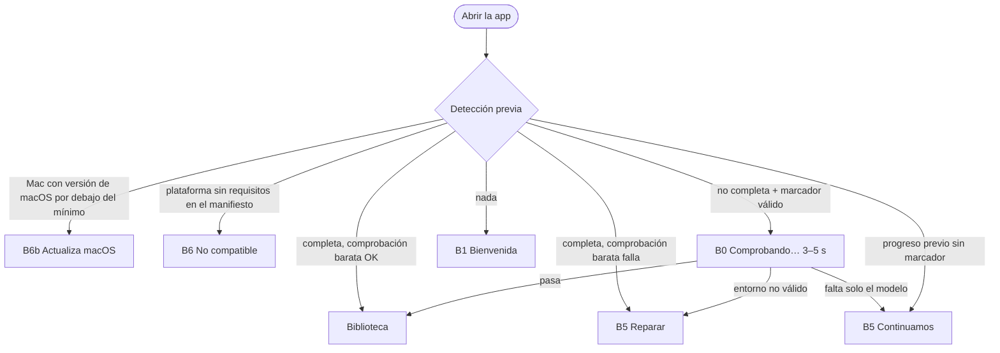

# 01 — Primer arranque (e instalación)

- Paso del pipeline: 0
- ADRs: [0001](../adr/0001-plataforma-y-stack.md), [0004](../adr/0004-separacion-voz-instrumental.md), [0006](../adr/0006-persistencia-y-modelo-de-datos.md)
- Restricciones: [arquitectura.md §6 Primer arranque y "Restricciones e implicaciones para UX" §1, §8](../arquitectura.md)
- Preguntas relacionadas: [0013](../preguntas/0013-huecos-ux-de-la-fase-2.md) (respondida: B0, B6, yt-dlp automático, cifras), [0015](../preguntas/0015-macos-intel-sin-pytorch-y-macos-minimo.md) y [0017](../preguntas/0017-textos-de-requisitos-macos-14-y-mac-intel.md) (respondidas: macOS 14, B6b, textos de requisitos), [0016](../preguntas/0016-mac-intel-fuera-del-mvp.md) (decidida por el usuario: **Mac Intel no compatible en el MVP**, opción C), [0001](../preguntas/0001-firma-de-codigo-instaladores.md) (decidida por el usuario: sin firma en el MVP), [0019](../preguntas/0019-calidad-por-defecto-y-rapido-con-consentimiento.md) (respondida: modelo Calidad en todos los equipos, oferta del modelo Rápido con consentimiento en B4), [0003](../preguntas/0003-elegir-calidad-o-rapidez-separacion.md), [0005](../preguntas/0005-viabilidad-detalles-ux-fase-0.md) y [0006](../preguntas/0006-ajustes-specs-ux-tras-0005.md) (respondidas)
- Cifras de tamaño, espacio y tiempo: se leen del **manifiesto de runtime** (`{n}` en los textos); los valores de los ejemplos son provisionales hasta el spike ([tarea 0005](../tareas/0005-spike-separacion-y-runtime.md)).

## Objetivo
Que una persona no técnica pase de "he descargado el instalador" a "tengo la biblioteca abierta" sin asustarse ni quedarse atascada, sabiendo en cada momento **qué se descarga, cuánto falta y qué hacer si falla**.

Usuario/tarea principal: abrir Shinobi Karaoke por primera vez y dejarlo listo para usar.

---

## Parte A — Fuera de la app: guía de instalación (instaladores sin firmar)

El MVP se publica con **instaladores sin firmar** (decisión del usuario en la [pregunta 0001](../preguntas/0001-firma-de-codigo-instaladores.md)). La app no puede ayudar antes de abrirse, así que la guía vive en la sección "Descargar" del README y en `INSTALAR.md` (sin web propia, [0017](../preguntas/0017-textos-de-requisitos-macos-14-y-mac-intel.md), Seguimiento).

**El texto final, los estados (sin versión / con versión), las capturas y las fuentes están en [09-descarga-e-instalacion.md](09-descarga-e-instalacion.md).** Esta parte solo resume su estructura y conserva la numeración que citan otros documentos:

1. **Descargas por SO**, en orden fijo, sin detectar el SO del visitante (Markdown no puede). La de macOS se llama **"Descargar para Mac con chip Apple"**, con el requisito y **"¿Qué Mac tengo?"** siempre visibles debajo (Safari dice "Intel" también en los Mac con chip Apple, así que tampoco se podría detectar). Spec 09 §1.
2. **Requisitos en una línea**: "Windows 10/11 de 64 bits, Mac con chip Apple y macOS 14 o posterior, o Linux de 64 bits · 8 GB de RAM · entre 4 y 10 GB libres según tu equipo (más unos 100 MB por canción) · conexión a internet la primera vez". Debajo: "Los Mac con procesador Intel no son compatibles por ahora." Spec 09 §1 y §2.
3. **Bloque "¿Por qué mi equipo me avisa?"**. Spec 09 §2.
4. **Pasos por SO** (SmartScreen, Gatekeeper en macOS 14 frente a macOS 15 o posterior, AppImage y `.deb`), con el texto de los botones del sistema y una captura por SO. Spec 09 §2 y §7.
5. **"¿Sigue sin abrirse?"**, con las dos entradas de macOS ("no es compatible con este Mac", que distingue **Chip** de **Procesador** Intel, y «Necesitas actualizar macOS»). Spec 09 §2.
6. Si en una versión posterior al MVP se firman los instaladores de algún SO, se elimina la sección de ese SO.

---

## Parte B — Dentro de la app

### Pantallas
B1 Bienvenida → B2 Instalando (3 fases) → B3 Todo listo → Biblioteca. B4 (error) es variante de B2; B5 (reanudar / reparar) y B6 (equipo no compatible) son variantes de B1. B0 (comprobando la instalación) se muestra antes de la Biblioteca o de B5 solo cuando hay que verificar una instalación existente.



### Wireframes

**B1 — Bienvenida** (ventana 1280 × 800, sin barra superior, fondo `fondo-0`, columna central de 560 px)
```
┌──────────────────────────────────────────────────────────────────────────┐
│                                                                          │
│                          ◆ Shinobi Karaoke                               │
│                                                                          │
│                Hola. Vamos a preparar tu estudio de karaoke.             │
│                                                                          │
│   Antes de empezar, Shinobi Karaoke necesita descargar su motor de audio │
│   (lo que separa la voz de la música). Solo se hace una vez.             │
│                                                                          │
│   ┌──────────────────────────────────────────────────────────────────┐   │
│   │ ⬇  Descarga:  unos 1,3 GB para tu equipo                         │   │
│   │ ⏱  Tiempo:    de 5 a 25 minutos, según tu conexión               │   │
│   │ 💾 Espacio:   necesitas al menos 4 GB libres  (tienes 120 GB ✓)  │   │
│   │ 🌐 Conexión:  necesaria solo durante esta preparación            │   │
│   └──────────────────────────────────────────────────────────────────┘   │
│                                                                          │
│   Puedes seguir usando el ordenador mientras tanto. Si se corta,         │
│   continuará donde lo dejó.                                              │
│                                                                          │
│                      [ Preparar Shinobi Karaoke ]  (primario, grande)    │
│                                                                          │
│                 Shinobi Karaoke es software libre (GPL-3.0) · Licencias  │
└──────────────────────────────────────────────────────────────────────────┘
```
(Los iconos son de Lucide, no emojis; aquí se representan con símbolos. Ejemplo de un equipo solo CPU; las cifras dependen del **perfil previsto**, detectado sin instalar nada antes de mostrar B1: ver "Perfil previsto" en la tabla de componentes.)

**B2 — Instalando**
```
┌──────────────────────────────────────────────────────────────────────────┐
│                          ◆ Shinobi Karaoke                               │
│                                                                          │
│                     Preparando Shinobi Karaoke                           │
│                                                                          │
│   ✓  Preparando el motor de audio                                        │
│   ⟳  Instalando componentes                     312 MB de 780 MB         │
│      ████████████████░░░░░░░░░░░░░░░░░░  40 %                            │
│   ○  Descargando el modelo de separación                                 │
│                                                                          │
│   ─────────────────────────────────────────────────────────────────      │
│   Total  ███████████░░░░░░░░░░░░░░░░░░░░░  35 % · quedan unos 6 minutos  │
│                                                                          │
│   ⓘ Separaremos las pistas con el modelo Calidad usando tu tarjeta       │
│     gráfica NVIDIA.                         (visible desde el inicio)    │
│                                                                          │
│                    [ Pausar y salir ]  (secundario)                      │
│   ▸ Ver detalles                                                         │
└──────────────────────────────────────────────────────────────────────────┘
```
"▸ Ver detalles" despliega un área de solo lectura (fuente monoespaciada, 8 líneas, desplazable) con el registro técnico, y un botón "Copiar detalles".

**B3 — Todo listo**
```
┌──────────────────────────────────────────────────────────────────────────┐
│                               ✓                                          │
│                         Todo listo                                       │
│                                                                          │
│   Shinobi Karaoke ya puede separar la voz de tus canciones.              │
│   Modelo de separación: Calidad, con tu tarjeta gráfica NVIDIA.          │
│   Una canción de 4 minutos tardará entre 1 y 2 minutos.                  │
│                                                                          │
│                        [ Empezar ]  (primario, grande)                   │
└──────────────────────────────────────────────────────────────────────────┘
```

**B4 — Error** (sustituye la zona de progreso; las fases completadas siguen con ✓)
```
│   ✓  Preparando el motor de audio                                        │
│   ✕  Instalando componentes                                              │
│   ┌──────────────────────────────────────────────────────────────────┐   │
│   │ ✕ Sin conexión a internet                                        │   │
│   │   Comprueba tu conexión y vuelve a intentarlo. No perderás lo    │   │
│   │   que ya se ha descargado.                                       │   │
│   └──────────────────────────────────────────────────────────────────┘   │
│                 [ Reintentar ] (primario)   [ Salir ] (fantasma)         │
│   ▸ Ver detalles                                                         │
```

**B4 con oferta del modelo Rápido** (solo con `ofrecerRapido` del estado del runtime: fallo definitivo de la fase de modelo por verificación fallida tras el reintento, servidores no disponibles en todas las URLs, o espacio suficiente para Rápido pero no para Calidad; **nunca** con `SIN_CONEXION` ni en otras fases; [0019](../preguntas/0019-calidad-por-defecto-y-rapido-con-consentimiento.md))
```
│   ✓  Preparando el motor de audio                                        │
│   ✓  Instalando componentes                                              │
│   ✕  Descargando el modelo de separación                                 │
│   ┌──────────────────────────────────────────────────────────────────┐   │
│   │ ✕ Los servidores de descarga no responden                        │   │
│   │   Suele ser temporal. Vuelve a intentarlo en unos minutos.       │   │
│   │                                                                  │   │
│   │   Si no puedes esperar, hay otra opción: el modelo Rápido, más   │   │
│   │   ligero. Antes de usarlo, lee el aviso.                         │   │
│   └──────────────────────────────────────────────────────────────────┘   │
│   [ Reintentar ] (primario)  [ Usar el modelo Rápido… ] (secundario)     │
│                                              [ Salir ] (fantasma)        │
│   ▸ Ver detalles                                                         │
```
- "Reintentar" sigue siendo la acción principal y el foco inicial: Calidad es el modelo de todos los equipos. "Usar el modelo Rápido…" (puntos suspensivos: abre un diálogo) nunca descarga nada por sí mismo.
- Con `SIN_ESPACIO` y oferta, la línea de la oferta es `rapido.oferta.espacio` (Rápido ocupa mucho menos); en los demás casos, `rapido.oferta`.

**Diálogo de consentimiento del modelo Rápido** (componente compartido `aviso-rapido`: se usa aquí y en la vista de progreso, spec 04; es el **único** texto de riesgo de Rápido de la app). Diálogo modal de 520 px, `role="dialog"`, `aria-labelledby` = título, `aria-describedby` = cuerpo.
```
┌────────────────────────────────────────────────────────────┐
│ ¿Usar el modelo Rápido?                                    │
│                                                            │
│ No hemos podido preparar el modelo Calidad.  (motivo según │
│                                               el origen)   │
│ El modelo Rápido es más ligero y necesita menos memoria,   │
│ pero puede dejar algo más de voz de fondo en el karaoke.   │
│                                                            │
│ ┌────────────────────────────────────────────────────────┐ │
│ │ ⚠ Antes de aceptar                                     │ │
│ │ • Sus autores (la comunidad UVR) no han declarado bajo │ │
│ │   qué licencia se puede usar.                          │ │
│ │ • Shinobi Karaoke no lo distribuye: se descarga desde  │ │
│ │   su origen (59 MB).                                   │ │
│ │ • Si lo usas, es bajo tu responsabilidad.              │ │
│ │ Ver créditos y licencias de terceros                   │ │
│ └────────────────────────────────────────────────────────┘ │
│                                                            │
│ Se usará en todas las separaciones a partir de ahora.      │
│ Podrás volver al modelo Calidad desde Ajustes.             │
│                                                            │
│            [ Cancelar ] (secundario, foco inicial)         │
│            [ Usar el modelo Rápido ] (primario)            │
└────────────────────────────────────────────────────────────┘
```
- Motivo (primera línea), según el origen: primer arranque → `rapido.motivo.preparar`; separación con `MEMORIA_INSUFICIENTE` → `rapido.motivo.memoria`; separación con `MODELO_NO_DISPONIBLE` → `rapido.motivo.descarga`.
- "(59 MB)" es el tamaño de Rápido del manifiesto; si Rápido ya está descargado y verificado, la viñeta termina en "…desde su origen." sin tamaño.
- El consentimiento es **pulsar "Usar el modelo Rápido"** (sin casilla adicional): la frase de responsabilidad está justo encima del botón. Cancelar, Esc o cerrar el diálogo no guardan nada y devuelven el foco al botón que lo abrió.
- "Ver créditos y licencias de terceros" es un enlace (no un botón) que abre el diálogo de créditos (spec 08) **encima** del de consentimiento; al cerrarlo, el foco vuelve al enlace y el diálogo de consentimiento sigue abierto.
- Al aceptar en el primer arranque: el diálogo se cierra, se llama a `aceptarYUsarRapido('primer_arranque')` y B2 vuelve a mostrar la fase "Descargando el modelo de separación" en curso, ahora con `pa.fase.modelo.rapido` y "X MB de 59 MB"; el mensaje de modo pasa a `pa.modo.rapido.aceptado` (sin resaltado `aviso`). La barra total se recalcula con el tamaño de Rápido sin retroceder el porcentaje mostrado. Al terminar → B3 con la variante Rápido.
- Si la descarga de Rápido falla, B4 muestra el error de esa descarga **sin** oferta (ya se aceptó); "Reintentar" repite la descarga de Rápido sin volver a pedir el consentimiento (pendiente de confirmar por el arquitecto: [0021](../preguntas/0021-detalles-tecnicos-de-la-oferta-de-rapido-y-volver-a-calidad.md) §1).

**B3 con el modelo Rápido**
```
│                         Todo listo                                       │
│   Shinobi Karaoke ya puede separar la voz de tus canciones.              │
│   Modelo de separación: Rápido, con el procesador.                       │
│   Una canción de 4 minutos tardará entre 3 y 7 minutos.                  │
│   ⓘ Usas el modelo Rápido bajo tu responsabilidad. Cuando quieras,       │
│     puedes volver al modelo Calidad desde Ajustes.                       │
│                        [ Empezar ]  (primario, grande)                   │
```

**B5 — Reanudar** (al abrir la app con instalación incompleta): B1 con título "Continuamos donde lo dejamos", texto "Faltan unos 450 MB por descargar." y botón "Continuar la preparación".

**B0 — Comprobando tu instalación** (solo si hay que verificar un motor ya instalado; ADR 0009 §6.2; 3–5 s). Misma composición que B1 (fondo `fondo-0`, columna de 560 px, logotipo), sin botones ni enlace de licencias.
```
┌──────────────────────────────────────────────────────────────────────────┐
│                                                                          │
│                          ◆ Shinobi Karaoke                               │
│                                                                          │
│                    Comprobando tu instalación…                           │
│               Solo tardará unos segundos.                                │
│                                                                          │
│            ░░░░░░▓▓▓▓▓▓▓▓░░░░░░░░░░░░░░░░░░  (barra indeterminada, 320 px)│
│                                                                          │
└──────────────────────────────────────────────────────────────────────────┘
```

**B6 — Tu equipo no es compatible todavía** (la plataforma no tiene requisitos en el manifiesto; `arquitectura.md` "Restricciones" §8). Composición de B1; la caja de requisitos se sustituye por un banner `error`; no hay "Preparar".
```
┌──────────────────────────────────────────────────────────────────────────┐
│                          ◆ Shinobi Karaoke                               │
│                                                                          │
│                 Tu equipo no es compatible todavía                       │
│                                                                          │
│   ┌──────────────────────────────────────────────────────────────────┐   │
│   │ ✕ Shinobi Karaoke necesita instalar un motor de audio que, por   │   │
│   │   ahora, solo existe para Windows 10/11 y Linux con procesador de│   │
│   │   64 bits (x64) y para Mac con chip Apple y macOS 14 o posterior.│   │
│   │   Tu equipo: Linux · procesador ARM de 64 bits                    │   │
│   └──────────────────────────────────────────────────────────────────┘   │
│                                                                          │
│   Si quieres que lo soportemos, cuéntanoslo: copia los detalles y        │
│   ábrenos una incidencia en la web del proyecto.                         │
│                                                                          │
│   [ Pedir soporte para mi equipo ]  [ Copiar detalles ]  [ Salir ]       │
│        (secundario)                    (secundario)       (primario)     │
│                                                                          │
│                 Shinobi Karaoke es software libre (GPL-3.0) · Licencias  │
└──────────────────────────────────────────────────────────────────────────┘
```

**B6b — Necesitas actualizar macOS** (variante de B6: Mac cuya versión de macOS está por debajo del mínimo de su procesador; [0015](../preguntas/0015-macos-intel-sin-pytorch-y-macos-minimo.md) §1, [0017](../preguntas/0017-textos-de-requisitos-macos-14-y-mac-intel.md)). A diferencia de B6, **el usuario lo puede resolver él mismo**, así que el banner es `aviso` (no `error`) y la acción principal explica cómo actualizar. Misma composición que B6; no hay "Preparar".
```
┌──────────────────────────────────────────────────────────────────────────┐
│                          ◆ Shinobi Karaoke                               │
│                                                                          │
│                     Necesitas actualizar macOS                           │
│                                                                          │
│   ┌──────────────────────────────────────────────────────────────────┐   │
│   │ ⚠ Shinobi Karaoke necesita macOS 14 (Sonoma) o posterior y tu    │   │
│   │   Mac tiene macOS 13.6.                                          │   │
│   │   Todos los Mac con chip Apple pueden actualizar gratis.         │   │
│   └──────────────────────────────────────────────────────────────────┘   │
│                                                                          │
│   Para actualizar: menú Apple (la manzana de la esquina de la pantalla)  │
│   → Ajustes del Sistema (o Configuración del Sistema) → General →        │
│   Actualización de Software. Antes, conviene hacer una copia de          │
│   seguridad. Cuando termines, vuelve a abrir Shinobi Karaoke.            │
│                                                                          │
│   [ Cómo actualizar macOS ↗ ]  [ Copiar detalles ]  [ Salir ]            │
│        (secundario)               (secundario)       (primario)          │
│                                                                          │
│                 Shinobi Karaoke es software libre (GPL-3.0) · Licencias  │
└──────────────────────────────────────────────────────────────────────────┘
```
B6b solo la ven los Mac con chip Apple en macOS 13 (todos pueden actualizar gratis). Con macOS 12 o anterior, el sistema no llega a abrir la app (`LSMinimumSystemVersion` de Electron es 13.0, [0041](../preguntas/0041-gatekeeper-con-firma-ad-hoc.md)); ese caso lo cubre la guía (spec 09). Los Mac Intel no se soportan en el MVP ([0016](../preguntas/0016-mac-intel-fuera-del-mvp.md), opción C): reciben **B6 general**, nunca B6b, sea cual sea su versión de macOS (en la práctica ni siquiera abren la app, porque solo se publica el DMG para chip Apple; B6 cubre builds de desarrollo o x64). Si en el futuro se soportan los Mac Intel con otro mínimo, B6b ya admite un `{min}` por procesador, pero su texto `pa.macos.gratis` habría que revisarlo (no todos los Mac Intel pueden actualizar).

### Componentes e interacciones
| Elemento | Comportamiento |
|----------|----------------|
| Perfil previsto (antes de B1) | El proceso principal detecta, sin Python, SO/arquitectura y GPU NVIDIA (`nvidia-smi`) → perfil previsto: **NVIDIA**, **Apple Silicon** o **solo CPU**. Con él se leen del manifiesto la descarga y el espacio requerido de ese perfil (todos los perfiles descargan el modelo Calidad, 913 MB; valores de ejemplo: solo CPU ≈ 1,25–1,4 GB de descarga y 4 GB de espacio; Apple Silicon ≈ 1,2–1,3 GB y 4 GB; NVIDIA ≈ 4–5,5 GB y 10 GB; la cifra real es siempre la del manifiesto, ADR 0009 §2). La descarga se muestra redondeada a una cifra: `pa.req.descarga` ("unos {n} GB"). Si la detección falla: `pa.req.descarga.generica` (`{a}` y `{b}`: la menor y la mayor descarga de los perfiles de la plataforma en el manifiesto, redondeadas a GB enteros hacia abajo y hacia arriba) y el mayor espacio del manifiesto (hoy 10 GB). Si la plataforma no tiene entrada en el manifiesto → B6. La detección tarda milisegundos: B1 no tiene estado de carga propio. |
| Comprobación de espacio (B1) | Al mostrar B1 (y al pulsar "Comprobar de nuevo") se consulta el espacio libre del disco del directorio de datos (o de su carpeta existente más cercana). Requisito mostrado: el del perfil previsto. Si no alcanza: fila en `error` con `pa.req.espacio.insuficiente` ("Necesitas 10 GB libres y tienes 3,1 GB") y el botón primario cambia a "Comprobar de nuevo". |
| "Preparar Shinobi Karaoke" | Inicia la secuencia del gestor de runtime. Foco inicial de B1. |
| Lista de fases | 3 fases visibles (las 5 técnicas de arquitectura §6 se agrupan: 1–2 → "Preparando el motor de audio", 3 → "Instalando componentes", 4 → se integra al final de "Instalando componentes" como subestado "Comprobando tu equipo…", 5 → "Descargando el modelo de separación"). Cada fase: pendiente ○ / en curso ⟳ / completada ✓ / error ✕. |
| Progreso por fase | "X MB de Y MB" con Y tomado del manifiesto desde el inicio. Python y el modelo tienen progreso exacto; en "Instalando componentes" X es una aproximación (crece a saltos): la barra **nunca retrocede** y nunca muestra 100 % hasta que la fase termina (máximo 99 %). "Calculando tamaño…" (indeterminado) solo si faltara el dato del manifiesto. |
| Progreso total y ETA | Barra total ponderada por bytes. ETA: no se muestra los primeros 10 s ("Calculando tiempo…"); después se redondea: "< 1 minuto", "unos N minutos" (N entero), "más de 30 minutos". |
| Mensaje de modo (0003, 0019) | Informativo, no interactivo. Dice **con qué modelo** (siempre Calidad) y **con qué se ejecuta** (tarjeta NVIDIA, chip Apple o procesador). Con perfil previsto, aparece en B2 **desde el inicio** (`pa.modo.calidad.nvidia` / `.apple` / `.cpu`). Al final de "Instalando componentes" ("Comprobando tu equipo…") el diagnóstico con PyTorch lo confirma; si **rebaja** NVIDIA → procesador, el mensaje se sustituye por `pa.modo.rebajado.memoria` o `pa.modo.rebajado.generico` (resaltado `aviso` durante 4 s y anunciado a lectores de pantalla). La rebaja **no cambia el modelo** ni el tamaño de la fase del modelo ni la barra total. Si no hubo perfil previsto, el mensaje aparece al terminar el diagnóstico. Ningún texto de B1–B3 menciona Rápido salvo tras aceptarlo en B4. `{a}`–`{b}` = estimación para 4 min (factor del manifiesto × 4; si el factor es `null`, la estimación del ADR 0004, p. ej. 6–15 min en CPU x86). |
| "Pausar y salir" | Diálogo: "¿Pausar la preparación? Se guardará lo descargado y continuará la próxima vez que abras Shinobi Karaoke." [Seguir preparando] [Pausar y salir]. Cierra la app. |
| Cerrar la ventana (X) | Mismo diálogo que "Pausar y salir". |
| "Reintentar" | Relanza desde la fase fallida (las fases son idempotentes). En la fase de modelo, con el modelo que se estaba descargando (Calidad, o Rápido si ya se aceptó). |
| "Usar el modelo Rápido…" (B4) | Solo visible con `ofrecerRapido`. Abre el diálogo de consentimiento `aviso-rapido` con el motivo `rapido.motivo.preparar`. Ver "B4 con oferta del modelo Rápido". |
| "Ver detalles" / "Copiar detalles" | Copia al portapapeles versión de la app, SO, fase, código de error y últimas 50 líneas del registro. Toast "Detalles copiados". |
| "Empezar" | Abre la Biblioteca (estado vacío). Foco inicial de B3. |
| Licencias (B1) | Abre Ajustes → Acerca de (en un diálogo, ya que aún no hay barra superior). |
| Teclado | Tab recorre los botones; Intro activa; Esc en B2 = "Pausar y salir". |
| B0 Comprobando | Se muestra solo en el caso 2 de ADR 0009 §6 (estado distinto de `completa` con marcador válido). Para no parpadear, la ventana muestra solo el fondo y el logotipo los primeros 300 ms y el texto y la barra después. Sin botones: cerrar la ventana (X) cierra la app **sin diálogo** (no se pierde nada; al reabrir se repite la comprobación); Esc no hace nada. Si pasa 15 s sin terminar, el subtítulo cambia a `pa.comprobando.lento`. Resultado: **pasa** → directamente a la Biblioteca (sin B3 ni toast: el usuario ya tenía la app preparada); **falta solo el modelo** (entorno y marcador correctos) → B5 "Continuamos donde lo dejamos" con lo que falta; **entorno no válido** o error inesperado de la verificación → B5 "Hay que reparar el motor de audio". La comprobación barata de cada arranque (milisegundos) no muestra B0. Anuncio a lectores de pantalla: `pa.comprobando.titulo` (una vez). |
| B6 No compatible | Se decide antes de B1, con la misma detección previa (SO + **arquitectura real** + versión de macOS) que el perfil previsto. "Tu equipo:" usa `pa.nocompat.equipo` con nombres legibles: SO `Windows`, `macOS {versión}` (la versión solo en macOS, tal como la da el sistema, p. ej. `macOS 13.6.1`), `Linux`; procesador `procesador x64`, `procesador ARM de 64 bits`, `procesador de 32 bits`, y en macOS `chip Apple` (arm64) o `procesador Intel` (x64). Ejemplos: "Tu equipo: Linux · procesador ARM de 64 bits", "Tu equipo: macOS 15.1 · procesador Intel". "Pedir soporte para mi equipo" abre en el navegador la página de incidencias del proyecto (enlace permitido, como "Web del proyecto" en spec 08). "Copiar detalles" copia versión de la app, SO y versión, arquitectura y la marca `plataforma no compatible`; toast "Detalles copiados". "Salir" (foco inicial) cierra la app. "Licencias" igual que en B1. No hay acceso a ninguna otra vista. |
| B6b Actualiza macOS | Se muestra **en lugar de B6** cuando el procesador sí es compatible pero la versión de macOS es menor que su mínimo (`{min}`: hoy 14 en chip Apple). El orden de la decisión es: 1) procesador/SO sin entrada en el manifiesto (incluido cualquier Mac Intel) → B6; 2) Mac con chip Apple y versión de macOS < mínimo → B6b; 3) resto → B1/B0/B5. La versión mínima la da la detección del proceso principal (no se escribe a mano en el renderer). "Cómo actualizar macOS" abre en el navegador la página oficial de Apple sobre actualizar macOS, en español (enlace permitido, como "Pedir soporte"; el programador fija la URL de support.apple.com y comprueba que abre). "Copiar detalles" igual que en B6, con la marca `macos por debajo del mínimo ({min})`. "Salir" (primario, foco inicial). Sin "Pedir soporte para mi equipo": el problema tiene solución por parte del usuario (sigue disponible la web del proyecto desde Licencias → Acerca de). Anuncio a lectores de pantalla: título + cuerpo, una vez. |
| Lectores de pantalla | Anunciar el cambio de fase ("Instalando componentes") y cada 25 % del total, no cada evento. En B4 con oferta se anuncia el banner completo (título, texto y línea de la oferta), una vez. Al abrir el diálogo de consentimiento se lee su título y su cuerpo (`aria-describedby`, incluidas las tres viñetas). Al aceptar: `rapido.anuncio.descargando` ("Descargando el modelo Rápido."); al terminar, el anuncio normal de B3. |

### Estados
| Estado | Presentación |
|--------|--------------|
| Vacío | No aplica (B1 es el estado inicial). |
| Cargando / procesando | B2. Fase con progreso indeterminado cuando el tamaño no se conoce. |
| Error | B4, con textos por código (tabla de microcopy). Las fases completadas no se repiten. En la fase de modelo, con `ofrecerRapido`, B4 añade la oferta del modelo Rápido. |
| Consentimiento de Rápido | Diálogo `aviso-rapido` sobre B4. |
| Éxito con Rápido | B3, variante Rápido. |
| Éxito | B3. |
| Interrumpido / reanudación | B5 al reabrir; también si se pierde la conexión y se recupera, B4 → Reintentar. |
| Actualización de yt-dlp (arranques posteriores) | **Automática, nunca se ofrece ni se pregunta** ([0013](../preguntas/0013-huecos-ux-de-la-fase-2.md) §1). La semanal es invisible. La que sigue a un bloqueo de YouTube solo se ve como texto de reintento en la operación que la provocó (`add.reintento.ytdlp` en spec 03, `prog.reintento.ytdlp` en spec 04). |
| Instalación dañada en un arranque posterior (falta el venv o el modelo) | Se vuelve a B5 con título "Hay que reparar el motor de audio" y botón "Reparar". |
| Instalación dañada a mitad de sesión (separación con `RUNTIME_NO_DISPONIBLE`) | Desde [Reparar el motor de audio] de la vista de progreso (spec 04) se abre la misma B5 "Hay que reparar el motor de audio", con los mismos textos y sin acceso a otras vistas hasta terminar. B3 → "Empezar" vuelve a la Biblioteca (no vacía: con las canciones del usuario). Si el usuario cierra la app en B5, al reabrir arranca en B5 (`dañada`). |
| Verificando una instalación existente | B0 (3–5 s), luego Biblioteca o B5. |
| Plataforma no compatible | B6. |
| macOS por debajo del mínimo (procesador compatible) | B6b. |

### Microcopy
| Clave | Texto |
|-------|-------|
| `pa.bienvenida.titulo` | Hola. Vamos a preparar tu estudio de karaoke. |
| `pa.bienvenida.cuerpo` | Antes de empezar, Shinobi Karaoke necesita descargar su motor de audio (lo que separa la voz de la música). Solo se hace una vez. |
| `pa.req.descarga` | Descarga: unos {n} GB para tu equipo |
| `pa.req.descarga.generica` | Descarga: entre {a} y {b} GB según tu equipo (con el manifiesto actual, p. ej. "entre 1 y 6 GB") |
| `pa.req.tiempo` | Tiempo: de 5 a 25 minutos, según tu conexión |
| `pa.req.espacio` | Espacio: necesitas al menos {n} GB libres (tienes {m} GB) |
| `pa.req.espacio.insuficiente` | Necesitas {n} GB libres y tienes {m} GB. Libera espacio y pulsa "Comprobar de nuevo". |
| `pa.boton.comprobar` | Comprobar de nuevo |
| `pa.req.conexion` | Conexión: necesaria solo durante esta preparación |
| `pa.bienvenida.nota` | Puedes seguir usando el ordenador mientras tanto. Si se corta, continuará donde lo dejó. |
| `pa.boton.preparar` | Preparar Shinobi Karaoke |
| `pa.instalando.titulo` | Preparando Shinobi Karaoke |
| `pa.fase.motor` | Preparando el motor de audio |
| `pa.fase.componentes` | Instalando componentes |
| `pa.fase.diagnostico` | Comprobando tu equipo… |
| `pa.fase.modelo` | Descargando el modelo de separación |
| `pa.modo.calidad.nvidia` | Separaremos las pistas con el modelo Calidad usando tu tarjeta gráfica NVIDIA. |
| `pa.modo.calidad.apple` | Separaremos las pistas con el modelo Calidad usando el chip Apple de tu Mac. |
| `pa.modo.calidad.cpu` | Tu equipo no tiene una tarjeta gráfica compatible: separaremos las pistas con el modelo Calidad usando el procesador. Es más lento: una canción de 4 minutos tardará entre {a} y {b} minutos. |
| `pa.modo.rebajado.memoria` | Tu tarjeta gráfica no tiene memoria suficiente: separaremos las pistas con el modelo Calidad usando el procesador. Es más lento: una canción de 4 minutos tardará entre {a} y {b} minutos. |
| `pa.modo.rebajado.generico` | No hemos podido usar tu tarjeta gráfica: separaremos las pistas con el modelo Calidad usando el procesador. Es más lento: una canción de 4 minutos tardará entre {a} y {b} minutos. |
| `pa.modo.rapido.aceptado` | Separaremos las pistas con el modelo Rápido usando el procesador. |
| `pa.fase.modelo.rapido` | Descargando el modelo de separación (Rápido) |
| `pa.boton.pausar` | Pausar y salir |
| `pa.listo.titulo` | Todo listo |
| `pa.listo.cuerpo` | Shinobi Karaoke ya puede separar la voz de tus canciones. |
| `pa.listo.modelo` | Modelo de separación: Calidad, con tu tarjeta gráfica NVIDIA. · …Calidad, con el chip Apple. · …Calidad, con el procesador. · …Rápido, con el procesador. |
| `pa.listo.tiempo` | Una canción de 4 minutos tardará entre {a} y {b} minutos. |
| `pa.listo.tiempo.aprox` | Una canción de 4 minutos tardará entre {a} y {b} minutos, aproximadamente. Lo ajustaremos tras tu primera canción. (cuando el factor del perfil × modelo no está medido) |
| `pa.listo.rapido` | Usas el modelo Rápido bajo tu responsabilidad. Cuando quieras, puedes volver al modelo Calidad desde Ajustes. |
| `pa.boton.empezar` | Empezar |
| `pa.reanudar.titulo` | Continuamos donde lo dejamos |
| `pa.boton.continuar` | Continuar la preparación |
| `pa.reparar.titulo` | Hay que reparar el motor de audio |
| `pa.reparar.cuerpo` | Falta una parte de lo que se descargó la primera vez. Vamos a descargarla de nuevo. |
| `pa.error.SIN_CONEXION` | **Sin conexión a internet.** Comprueba tu conexión y vuelve a intentarlo. No perderás lo que ya se ha descargado. |
| `pa.error.SIN_ESPACIO` | **No queda espacio en el disco.** Necesitas {n} GB libres. Libera espacio (por ejemplo, vaciando la papelera) y vuelve a intentarlo. |
| `pa.error.servidor` | **Uno de los servidores de descarga no responde.** Suele ser temporal. Vuelve a intentarlo en unos minutos. |
| `pa.error.servidor.todos` | **Los servidores de descarga no responden.** Suele ser temporal. Vuelve a intentarlo en unos minutos. (fase de modelo, todas las URLs fallan) |
| `pa.error.verificacion` | **El archivo descargado no es correcto.** Lo hemos descargado dos veces y no coincide con el original. Vuelve a intentarlo más tarde; si se repite, copia los detalles y abre una incidencia en la web del proyecto. (se muestra tras el reintento automático) |
| `rapido.oferta` | Si no puedes esperar, hay otra opción: el modelo Rápido, más ligero. Antes de usarlo, lee el aviso. |
| `rapido.oferta.espacio` | Si no puedes liberar espacio, hay otra opción: el modelo Rápido, que ocupa mucho menos ({n}). Antes de usarlo, lee el aviso. |
| `rapido.boton.oferta` | Usar el modelo Rápido… |
| `rapido.titulo` | ¿Usar el modelo Rápido? |
| `rapido.motivo.preparar` | No hemos podido preparar el modelo Calidad. |
| `rapido.motivo.memoria` | Tu equipo no tiene memoria suficiente para el modelo Calidad. |
| `rapido.motivo.descarga` | No hemos podido descargar de nuevo el modelo Calidad. |
| `rapido.cuerpo` | El modelo Rápido es más ligero y necesita menos memoria, pero puede dejar algo más de voz de fondo en el karaoke. |
| `rapido.aviso.titulo` | Antes de aceptar |
| `rapido.aviso.licencia` | Sus autores (la comunidad UVR) no han declarado bajo qué licencia se puede usar. |
| `rapido.aviso.origen` | Shinobi Karaoke no lo distribuye: se descarga desde su origen ({n}). · (ya descargado) Shinobi Karaoke no lo distribuye: se descargó desde su origen. |
| `rapido.aviso.responsabilidad` | Si lo usas, es bajo tu responsabilidad. |
| `rapido.aviso.creditos` | Ver créditos y licencias de terceros |
| `rapido.alcance` | Se usará en todas las separaciones a partir de ahora. Podrás volver al modelo Calidad desde Ajustes. |
| `rapido.boton.cancelar` / `rapido.boton.aceptar` | Cancelar · Usar el modelo Rápido |
| `rapido.anuncio.descargando` | Descargando el modelo Rápido. |
| `pa.error.generico` | **Algo salió mal durante la preparación.** Vuelve a intentarlo. Si se repite, copia los detalles y abre una incidencia en la web del proyecto. |
| `pa.boton.reintentar` | Reintentar |
| `pa.boton.salir` | Salir |
| `pa.detalles` | Ver detalles · Copiar detalles |
| `pa.dialogo.pausar` | ¿Pausar la preparación? Se guardará lo descargado y continuará la próxima vez que abras Shinobi Karaoke. — [Seguir preparando] [Pausar y salir] |
| `pa.comprobando.titulo` | Comprobando tu instalación… |
| `pa.comprobando.cuerpo` | Solo tardará unos segundos. |
| `pa.comprobando.lento` | Está tardando un poco más de lo normal. No cierres la aplicación. |
| `pa.nocompat.titulo` | Tu equipo no es compatible todavía |
| `pa.nocompat.cuerpo` | Shinobi Karaoke necesita instalar un motor de audio que, por ahora, solo existe para Windows 10/11 y Linux con procesador de 64 bits (x64) y para Mac con chip Apple y macOS 14 o posterior. |
| `pa.nocompat.equipo` | Tu equipo: {so} · {procesador} |
| `pa.nocompat.nota` | Si quieres que lo soportemos, cuéntanoslo: copia los detalles y ábrenos una incidencia en la web del proyecto. |
| `pa.nocompat.soporte` | Pedir soporte para mi equipo |
| `pa.macos.titulo` | Necesitas actualizar macOS |
| `pa.macos.cuerpo` | Shinobi Karaoke necesita macOS {min} o posterior y tu Mac tiene macOS {version}. ({min} con nombre: "14 (Sonoma)"; {version} tal como la da el sistema) |
| `pa.macos.gratis` | Todos los Mac con chip Apple pueden actualizar gratis. |
| `pa.macos.pasos` | Para actualizar: menú Apple (la manzana de la esquina de la pantalla) → Ajustes del Sistema (o Configuración del Sistema) → General → Actualización de Software. Antes, conviene hacer una copia de seguridad. Cuando termines, vuelve a abrir Shinobi Karaoke. (Sin carácter de uso privado; [0039](../preguntas/0039-icono-de-la-app-y-texto-del-menu-apple.md)) |
| `pa.macos.ayuda` | Cómo actualizar macOS |
| `pa.boton.copiar` | Copiar detalles |
| `pa.eta` | quedan unos {n} minutos · menos de 1 minuto · Calculando tiempo… |

## Criterios de aceptación
1. Si `config.instalacion.estado` no es `"completa"`, la app abre B1 (o B5 si había progreso previo) y no permite acceder a ninguna otra vista hasta completar la instalación.
2. B1 muestra la descarga y el espacio requeridos **del perfil previsto** (leídos del manifiesto; si la detección previa falla, el rango genérico de descarga y el mayor espacio del manifiesto, hoy 10 GB), el tiempo y el espacio libre real del disco del directorio de datos; si el espacio libre es menor que el requerido, se muestra `pa.req.espacio.insuficiente`, el botón principal es "Comprobar de nuevo" y la instalación no empieza.
3. B2 muestra exactamente tres fases con sus estados (○ ⟳ ✓ ✕) y una barra total; la fase en curso muestra "X MB de Y MB" con Y del manifiesto; ninguna barra retrocede y "Instalando componentes" no pasa de 99 % hasta terminar.
4. El tiempo restante no aparece durante los primeros 10 s; después se muestra redondeado según la tabla de microcopy y se actualiza como máximo una vez por segundo.
5. Con perfil previsto, B2 muestra desde el inicio el mensaje correspondiente (`pa.modo.calidad.nvidia` / `.apple` / `.cpu`); en todos los perfiles se descarga el modelo Calidad y ninguna pantalla de B1–B3 menciona Rápido salvo tras aceptarlo en B4. B3 repite el modelo y con qué se ejecuta (`pa.listo.modelo`) y el tiempo estimado para 4 minutos (`pa.listo.tiempo.aprox` si el factor no está medido; p. ej. 6–15 min en CPU x86).
5b. Si la confirmación con PyTorch rebaja NVIDIA → procesador, el mensaje cambia a `pa.modo.rebajado.memoria` (VRAM < 4 GB) o `pa.modo.rebajado.generico` (otra causa), se resalta en `aviso` 4 s y se anuncia a lectores de pantalla; el tamaño de la fase del modelo y la barra total **no cambian** (sigue siendo Calidad).
5c. En un equipo solo CPU, B1 muestra la descarga del perfil con Calidad incluida (≈ 1,3 GB con el manifiesto actual) y "necesitas al menos 4 GB libres".
6. Cerrar la ventana o pulsar "Pausar y salir" muestra el diálogo de confirmación; al confirmar se cierra la app y, al reabrir, se muestra B5 con lo que falta por descargar.
7. Ante `SIN_CONEXION`, `SIN_ESPACIO`, fallo de servidor o verificación SHA-256 fallida se muestra B4 con el texto de su clave; "Reintentar" continúa desde la fase fallida sin repetir las completadas.
8. "Copiar detalles" copia al portapapeles versión, SO, fase, código y las últimas 50 líneas del registro, y muestra el toast "Detalles copiados".
9. Toda la secuencia se puede completar solo con teclado (Tab + Intro) y el foco inicial está en el botón primario de cada pantalla.
10. Los lectores de pantalla reciben anuncios en cada cambio de fase, cada 25 % del total, en error y al terminar (no en cada evento de progreso).
11. "Empezar" abre la Biblioteca en estado vacío (spec 02).
12. Si en un arranque posterior falta el entorno o el modelo, se muestra la variante "Hay que reparar el motor de audio" en lugar de la Biblioteca.
12b. Abierta a mitad de sesión desde [Reparar el motor de audio] (spec 04, `RUNTIME_NO_DISPONIBLE`), B5 muestra `pa.reparar.titulo` y `pa.reparar.cuerpo`; al terminar, "Empezar" abre la Biblioteca con las canciones existentes.
13. La guía de instalación (Parte A) está publicada en el README y en `INSTALAR.md` según la [spec 09](09-descarga-e-instalacion.md), con los textos de los botones de sistema comprobados en la prueba manual y las capturas C-WIN, C-MAC y C-LIN (una por SO) antes de la primera versión pública. Mientras no exista una versión, se publica el estado "sin versión" de la spec 09, sin enlaces de descarga ni capturas inventadas.
14. Si hay que verificar una instalación existente (estado distinto de `completa` con marcador válido), se muestra B0 sin botones: nada visible salvo fondo y logotipo los primeros 300 ms, después `pa.comprobando.*` con barra indeterminada y, a los 15 s, `pa.comprobando.lento`. Si la verificación pasa, se abre directamente la Biblioteca (sin B3); si falta solo el modelo, B5 "Continuamos donde lo dejamos"; si el entorno no vale o la verificación falla de forma inesperada, B5 "Hay que reparar el motor de audio". Cerrar la ventana durante B0 cierra la app sin diálogo.
15. En una plataforma sin requisitos en el manifiesto se muestra B6 (no B1 ni B4): banner `error` con `pa.nocompat.cuerpo` y `pa.nocompat.equipo`, botones "Pedir soporte para mi equipo", "Copiar detalles" y "Salir" (foco inicial), enlace Licencias; no existe "Preparar" ni acceso a otras vistas.
15b. En un Mac con chip Apple y macOS < 14 (p. ej. 13.6) se muestra B6b, no B6 ni B1: banner `aviso` con `pa.macos.cuerpo` (con `{min}` = "14 (Sonoma)" y la versión real) y `pa.macos.gratis`, texto `pa.macos.pasos`, botones "Cómo actualizar macOS" (abre la página de Apple en el navegador), "Copiar detalles" y "Salir" (foco inicial); sin "Preparar" ni "Pedir soporte para mi equipo". Con macOS 14.0 se muestra B1. Un Mac Intel muestra B6 general con cualquier versión de macOS (p. ej. 13.6 → B6, no B6b; `preguntas/0016`, opción C).
15c. `pa.nocompat.equipo` usa los nombres legibles de la tabla de componentes; en macOS incluye la versión y `chip Apple`/`procesador Intel` (nunca `arm64`/`x64` en crudo).
16. La app nunca pregunta ni ofrece actualizar yt-dlp: la actualización semanal no muestra nada y la provocada por un bloqueo solo cambia el texto de la operación en curso (specs 03 y 04).
17. Con una versión publicada, la sección "Descargar" del README dice en el enlace de macOS "Descargar para Mac con chip Apple" y muestra siempre debajo el requisito (chip Apple, macOS 14 o posterior, Intel no compatible por ahora) y "¿Qué Mac tengo?". El README, en cualquier estado, y `INSTALAR.md` llevan la línea de requisitos de la Parte A §2, y "¿Sigue sin abrirse?" tiene las dos entradas de macOS. No se intenta detectar el SO ni el procesador desde el navegador (criterios de la [spec 09](09-descarga-e-instalacion.md)).
18. B4 muestra "Usar el modelo Rápido…" (secundario, junto a "Reintentar", que sigue siendo primario y foco inicial) **solo** si el estado del runtime trae `ofrecerRapido`: fallo definitivo de la fase de modelo por verificación, por servidores no disponibles en todas las URLs o por `SIN_ESPACIO` con espacio para Rápido (con `rapido.oferta.espacio`). Con `SIN_CONEXION` o en otras fases no aparece.
19. "Usar el modelo Rápido…" abre el diálogo `aviso-rapido` con el motivo, el cuerpo, las tres viñetas del aviso (licencia no declarada, descarga desde su origen con el tamaño, responsabilidad del usuario), el enlace a créditos y `rapido.alcance`; foco inicial en "Cancelar". Cancelar, Esc o cerrar no guardan nada ni descargan nada y devuelven el foco a "Usar el modelo Rápido…". El enlace abre el diálogo de créditos encima y, al cerrarlo, el foco vuelve al enlace.
20. Al pulsar "Usar el modelo Rápido", B2 muestra la fase del modelo en curso con `pa.fase.modelo.rapido` y "X MB de 59 MB" (tamaño del manifiesto) y el mensaje `pa.modo.rapido.aceptado`; la barra total no retrocede. Al terminar se muestra B3 con `pa.listo.modelo` (Rápido, con el procesador), el tiempo de Rápido y `pa.listo.rapido`. `config.json` queda con `rapido_aceptado` y `modo: 'rapido'`.
21. Si la descarga de Rápido falla tras aceptar, B4 muestra el error sin oferta; "Reintentar" vuelve a descargar Rápido sin pedir otra vez el consentimiento.
22. Lectores de pantalla: el banner de B4 con la oferta se anuncia completo una vez; el diálogo lee título y cuerpo al abrirse; al aceptar se anuncia `rapido.anuncio.descargando`.
