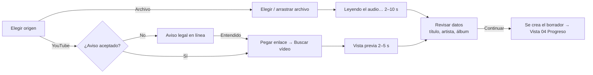

# 03 — Añadir canción (fuente: archivo local o YouTube)

- Paso del pipeline: 1 (Fuente)
- ADRs: [0003](../adr/0003-fuente-de-audio.md), [0006](../adr/0006-persistencia-y-modelo-de-datos.md)
- Restricciones: [arquitectura.md "Restricciones e implicaciones para UX" §2–§4, §7](../arquitectura.md)
- Preguntas: [0005](../preguntas/0005-viabilidad-detalles-ux-fase-0.md) §3 y §12, [0006](../preguntas/0006-ajustes-specs-ux-tras-0005.md) §3 (respondidas)

## Objetivo
Conseguir el audio de una canción desde un **archivo del equipo** o un **enlace de YouTube** y confirmar su **título y artista** (que la heurística suele acertar a medias), para lanzar la separación y la búsqueda de letra.

Usuario/tarea principal: "Tengo esta canción (archivo o vídeo) y quiero convertirla en karaoke".

## Flujo

**Momento de creación del borrador**: la canción aparece en la biblioteca cuando el usuario pulsa **Continuar** en "Revisar datos" (YouTube: la descarga empieza entonces). Para archivos locales, la importación (copia + decodificación) ocurre antes, durante "Leyendo el audio…", en una carpeta de preparación oculta (`biblioteca/.importando/<id>/`, que la biblioteca no muestra); al pulsar Continuar la canción aparece completa de una vez (ADR 0006). Si el usuario cancela, vuelve a la Biblioteca o cierra la app antes de Continuar, no queda ningún borrador ni archivo (la carpeta se borra, y al arrancar se vacía por si acaso). YouTube no crea nada antes de Continuar.

**El archivo del usuario no se toca**: la app lo lee y guarda su propia copia del audio (`fuente/mezcla.flac`); el original (que puede ser un vídeo) ni se mueve ni se modifica ni se copia entero. Del original solo se guarda su nombre, para mostrarlo en el resumen.

## Wireframes

**A — Elegir origen** (dentro del espacio de canción; stepper con "Nueva canción" y paso 1 actual)
```
┌──────────────────────────────────────────────────────────────────────────┐
│ ‹ Biblioteca │ Nueva canción                                              │
│   (1)● Fuente ──── (2)○ Separación ──── (3)○ Letra ──── (4)○ Editor       │
├──────────────────────────────────────────────────────────────────────────┤
│   ¿De dónde sale la canción?                                             │
│   [ 📁 Archivo de tu equipo ] [ 🔗 Enlace de YouTube ]  (control segmentado)│
│                                                                          │
│   ┌ ─ ─ ─ ─ ─ ─ ─ ─ ─ ─ ─ ─ ─ ─ ─ ─ ─ ─ ─ ─ ─ ─ ─ ─ ─ ─ ─ ─ ─ ┐        │
│          Arrastra aquí un archivo de audio o vídeo                       │
│   │                        o                                    │        │
│                    [ Elegir archivo… ]  (primario)                       │
│   │  MP3, M4A, FLAC, WAV, OGG/Opus, WebM · vídeo MP4, MKV, MOV   │        │
│   └ ─ ─ ─ ─ ─ ─ ─ ─ ─ ─ ─ ─ ─ ─ ─ ─ ─ ─ ─ ─ ─ ─ ─ ─ ─ ─ ─ ─ ─ ┘        │
└──────────────────────────────────────────────────────────────────────────┘
```
Columna central de 640 px. La zona de arrastre: borde discontinuo 2 px `borde-control`, alto 240 px; al arrastrar encima, borde `info` y fondo `info-tenue`, texto "Suelta para añadir".

**B — YouTube, primera vez: aviso legal en línea** (sustituye el contenido de la pestaña)
```
│   ┌──────────────────────────────────────────────────────────────────┐   │
│   │ ⓘ Antes de usar YouTube                                          │   │
│   │                                                                  │   │
│   │ Shinobi Karaoke puede descargar el audio de un vídeo de YouTube   │   │
│   │ para que hagas tu karaoke en tu ordenador.                       │   │
│   │                                                                  │   │
│   │ • Usa solo contenido que tengas derecho a descargar (por ejemplo, │   │
│   │   tus propias canciones o música con licencia que lo permita).   │   │
│   │ • Las condiciones de YouTube no permiten descargar la mayoría de  │   │
│   │   los vídeos sin su permiso.                                     │   │
│   │ • Lo que hagas es solo para uso personal y es tu responsabilidad.│   │
│   │   Shinobi Karaoke no comparte ni sube nada.                      │   │
│   │                                                                  │   │
│   │ Solo te lo mostraremos esta vez. Puedes releerlo en Ajustes.     │   │
│   │                                                                  │   │
│   │      [ Usar un archivo en su lugar ] (fantasma) [ Entendido ] (primario)│
│   └──────────────────────────────────────────────────────────────────┘   │
```

**C — YouTube: enlace y vista previa**
```
│   Enlace del vídeo                                                       │
│   [ https://www.youtube.com/watch?v=…                    ] [ Buscar vídeo ]│
│   Pega el enlace de un vídeo (no de una lista ni de un directo).         │
│                                                                          │
│   ┌──────────────┬───────────────────────────────────────────────────┐   │
│   │ [miniatura   │ Queen – Bohemian Rhapsody (Official Video)        │   │
│   │  160×90]     │ Queen Official · 5:59                             │   │
│   └──────────────┴───────────────────────────────────────────────────┘   │
│   (debajo, el formulario D)                                              │
```

**D — Revisar datos** (común a archivo y YouTube)
```
│   ✓ Audio leído: bohemian.mp3 · 5:55            (archivo)                │
│                                                                          │
│   Revisa los datos de la canción                                         │
│   Los usaremos para buscar la letra. Puedes cambiarlos después.          │
│   Título *   [ Bohemian Rhapsody                                    ]    │
│   Artista    [ Queen                                                ]    │
│   Álbum      [                                                      ]    │
│              (opcional, ayuda a encontrar la letra exacta)               │
│                                                                          │
│   ⚠ Esta canción dura 12:40. Separarla tardará más de lo normal           │
│     (unos 15 minutos en tu equipo).                    (solo si > 10 min)│
│                                                                          │
│                       [ Cancelar ] (fantasma)   [ Continuar ] (primario) │
```
En YouTube el botón primario dice **"Descargar y continuar"**.

## Componentes e interacciones
| Elemento | Comportamiento |
|----------|----------------|
| Selector de origen | Control segmentado. Por defecto "Archivo de tu equipo" (no requiere conexión). Recuerda la última elección durante la sesión. Si el módulo de YouTube está desactivado en la build (ADR 0003, mitigación 5), el selector no se muestra. |
| Zona de arrastre / "Elegir archivo…" | Diálogo nativo con filtro "Audio y vídeo" (extensiones anunciadas) + "Todos los archivos". Un solo archivo; si se arrastran varios: aviso "Añade las canciones de una en una." y se usa el primero. |
| Leyendo el audio | Al elegir el archivo, la zona de arrastre se sustituye por: nombre del archivo, barra indeterminada, "Leyendo el audio…" y botón "Cancelar". 2–10 s. |
| Aviso legal | Bloque en línea (no modal) que aparece la primera vez que se selecciona "Enlace de YouTube" si `config.aviso_youtube_aceptado` es nulo. "Entendido" registra la fecha y muestra C con el foco en el campo de enlace. "Usar un archivo en su lugar" vuelve a la pestaña Archivo sin registrar nada. El aviso se volverá a mostrar mientras no se acepte. |
| Campo de enlace | Al pegar (Ctrl/Cmd+V) una URL válida se lanza automáticamente la búsqueda; Intro o "Buscar vídeo" también. Validación local inmediata (sin red) de formato `youtube.com/watch`, `youtu.be`, `music.youtube.com`, `/shorts/`; si no coincide → error `URL_NO_VALIDA` bajo el campo, sin llamada. |
| Buscar vídeo | Botón en estado cargando ("Buscando…") 2–5 s; cancelable con Esc o con el botón "Cancelar" que sustituye a "Buscar vídeo" mientras carga. |
| Vista previa | Miniatura, título original del vídeo, canal y duración. Debajo, formulario D prerrellenado con la heurística de ADR 0003. |
| Formulario D | Título obligatorio (si se vacía: "Escribe un título."); artista y álbum opcionales. Recorta espacios. Máx. 200 caracteres. Foco inicial en Título con el texto seleccionado (para corregir rápido). |
| Aviso de duración | Si la duración > 10 min, banner `aviso` con estimación según perfil de separación. No bloquea. |
| Continuar / Descargar y continuar | Crea el borrador con los metadatos, encola la descarga (YouTube) y/o la separación, y navega a la vista 04. Intro en el último campo = Continuar. |
| Cancelar | Vuelve a la Biblioteca sin crear nada (si había una lectura/búsqueda en curso, se cancela). |
| Paso 1 ya completado (al volver por el stepper) | Muestra el resumen: origen (nombre de archivo o enlace + miniatura), duración, y el formulario D para editar título/artista/álbum (autoguardado al salir del campo; mensaje "Guardado"). Nota `texto-3`: "Para usar otro audio, añade una canción nueva." |
| Paso 1 en error / interrumpido (al volver por el stepper o "Continuar") | Banner con el error y "Reintentar" (repite la descarga con el mismo enlace) o, si no es reintentable, "Usar otro enlace" / "Elegir otro archivo" (vuelve a A conservando los metadatos). |

## Estados
| Estado | Presentación |
|--------|--------------|
| Vacío | A, con la zona de arrastre o el campo de enlace vacío. |
| Cargando | "Leyendo el audio…" (archivo) / "Buscando…" (YouTube) con Cancelar. |
| Error | Bajo el campo (errores de URL) o como banner en la zona de arrastre / vista previa (resto). El foco va al mensaje (`role="alert"`). |
| Éxito | Formulario D con "✓ Audio leído: {nombre} · {duración}" o vista previa del vídeo. |
| Borrador | El borrador existe desde "Continuar"; volver a esta vista muestra el resumen editable. |
| Sin conexión (YouTube) | Banner `SIN_CONEXION` y enlace "Usar un archivo de tu equipo". |

## Microcopy
| Clave | Texto |
|-------|-------|
| `add.titulo` | Nueva canción |
| `add.pregunta` | ¿De dónde sale la canción? |
| `add.origen.archivo` | Archivo de tu equipo |
| `add.origen.youtube` | Enlace de YouTube |
| `add.arrastre` | Arrastra aquí un archivo de audio o vídeo |
| `add.arrastre.soltar` | Suelta para añadir |
| `add.boton.elegir` | Elegir archivo… |
| `add.formatos` | MP3, M4A, FLAC, WAV, OGG/Opus, WebM · vídeo MP4, MKV, MOV |
| `add.varios` | Añade las canciones de una en una. |
| `add.leyendo` | Leyendo el audio… |
| `add.leido` | Audio leído: {nombre} · {duración} |
| `add.legal.titulo` | Antes de usar YouTube |
| `add.legal.cuerpo` | (texto del wireframe B, literal) |
| `add.legal.aceptar` | Entendido |
| `add.legal.rechazar` | Usar un archivo en su lugar |
| `add.url.etiqueta` | Enlace del vídeo |
| `add.url.ayuda` | Pega el enlace de un vídeo (no de una lista ni de un directo). |
| `add.boton.buscar` | Buscar vídeo |
| `add.buscando` | Buscando… |
| `add.datos.titulo` | Revisa los datos de la canción |
| `add.datos.ayuda` | Los usaremos para buscar la letra. Puedes cambiarlos después. |
| `add.campo.titulo` / `artista` / `album` | Título · Artista · Álbum |
| `add.campo.album.ayuda` | Opcional, ayuda a encontrar la letra exacta |
| `add.error.titulo.vacio` | Escribe un título. |
| `add.aviso.larga` | Esta canción dura {duración}. Separarla tardará más de lo normal (unos {n} minutos en tu equipo). |
| `add.boton.continuar` | Continuar |
| `add.boton.descargar` | Descargar y continuar |
| `add.boton.cancelar` | Cancelar |
| `add.resumen.nota` | Para usar otro audio, añade una canción nueva. |
| `add.error.FORMATO_NO_SOPORTADO` | **No podemos leer este archivo.** Puede estar dañado o no tener sonido. Prueba con otro archivo. |
| `add.error.AUDIO_DEMASIADO_CORTO` | **El audio es demasiado corto.** Tiene que durar al menos 10 segundos. |
| `add.error.URL_NO_VALIDA` | **Este enlace no es de un vídeo de YouTube.** Cópialo desde la barra de direcciones del vídeo o desde «Compartir». |
| `add.error.URL_NO_SOPORTADA` | **Las listas y los directos no se pueden usar.** Abre el vídeo concreto y copia su enlace. |
| `add.error.VIDEO_NO_DISPONIBLE` | **Este vídeo no está disponible.** Puede ser privado, haberse eliminado o tener restricción de edad o de país. Prueba con otro vídeo o usa un archivo. |
| `add.error.YOUTUBE_BLOQUEADO` | **YouTube no permite la descarga ahora mismo.** Ya hemos probado a actualizar el descargador. Inténtalo más tarde o usa un archivo de tu equipo. |
| `add.error.SIN_CONEXION` | **Sin conexión a internet.** YouTube necesita conexión. Puedes usar un archivo de tu equipo. |
| `add.error.SIN_ESPACIO` | **No queda espacio en el disco.** Cada canción ocupa unos 100 MB. Libera espacio y vuelve a intentarlo. |
| `add.error.generico` | **Algo salió mal.** Vuelve a intentarlo. [Copiar detalles] |
| `add.interrumpido` | **La descarga se interrumpió** porque se cerró la aplicación. [Reintentar] |

## Criterios de aceptación
1. La vista abre con "Archivo de tu equipo" seleccionado y el foco en "Elegir archivo…".
2. Elegir o soltar un archivo muestra "Leyendo el audio…" con Cancelar y, al terminar, el formulario de datos con "✓ Audio leído: {nombre} · {duración}" y título/artista prerrellenados.
3. Soltar varios archivos usa el primero y muestra "Añade las canciones de una en una.".
4. La primera vez que se selecciona "Enlace de YouTube" (sin aceptación previa en `config.json`) se muestra el aviso legal en línea; hasta pulsar "Entendido" no se muestra el campo de enlace ni se puede usar YouTube.
5. "Entendido" guarda la fecha en `aviso_youtube_aceptado`; el aviso no vuelve a aparecer en ninguna sesión posterior. "Usar un archivo en su lugar" no guarda nada.
6. Una URL que no coincide con los formatos de vídeo de YouTube muestra `URL_NO_VALIDA` sin llamar a la red; las listas y directos muestran `URL_NO_SOPORTADA`.
7. Pegar una URL válida lanza la búsqueda automáticamente; la vista previa (miniatura, título, canal, duración) aparece con el formulario prerrellenado.
8. Cada código de error de fuente muestra su texto de la tabla de microcopy con `role="alert"` y una acción de salida (reintentar, otro archivo/enlace o archivo local).
9. Si la duración supera 10 min se muestra el aviso con estimación y se puede continuar.
10. El título es obligatorio; con el título vacío, "Continuar" no avanza y muestra "Escribe un título." asociado al campo.
11. "Continuar"/"Descargar y continuar" crea el borrador, que aparece en la biblioteca, y navega a la vista 04; abandonar antes (Cancelar, ‹ Biblioteca, Esc o cerrar la app) no deja ningún borrador visible ni archivos en `biblioteca/` (salvo la carpeta oculta `.importando/`, que se vacía al arrancar). El archivo original del usuario queda intacto en su ubicación.
12. Volver al paso 1 de una canción existente muestra el resumen de la fuente y permite editar título/artista/álbum con autoguardado; no permite cambiar el audio.
13. Un paso de fuente `error` o `interrumpido` muestra su banner con "Reintentar" que repite el trabajo con la misma fuente.
14. Toda la vista se opera con teclado; Esc cancela la operación en curso o, si no hay, vuelve a la Biblioteca.
