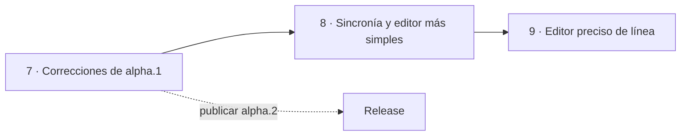

# Feedback de 0.2.0-alpha.1 y propuesta de fases 7 a 9

Prueba del usuario del 2026-11-21 en Windows 11 con la app instalada (RTX 4070, una pantalla de 3440 × 1440). Este documento reúne lo reportado, lo que se comprobó en el código y en la carpeta de datos, y una propuesta de fases para añadir al [plan](plan-2.md). **Aprobada el 2026-11-21:** las fases 7 a 9 pasan a la versión 0.2.1 ([plan](../0.2.1/plan-3.md)). Las correcciones de exportación, registro, icono en las ventanas y distribución ya salieron en 0.2.0-alpha.2.

Canciones usadas: Final Ruin, A Pesar de Mí, Arrópame, Dedos Rotos y Funerales (José Madero), Valiente (Paty Cantú) y Assassins Creed Unity (Zarcort, solo «Letra lista»).

## 1. Qué se comprobó

### 1.1 Exportación: `PERFIL_NO_SOPORTADO` (reproducido, corrección probada)

- **Causa.** La ventana offscreen de captura se crea con el tamaño del perfil (`app/src/main/exportacion/ventana.ts:123-138`), pero Windows recorta ese tamaño al área de trabajo de la pantalla (pantalla menos barra de tareas: 1440 − 48 = 1392). `enableLargerThanScreen` no lo evita en la creación y el código no vuelve a fijar el tamaño.
- **Reproducción** con el Electron del repo en este equipo:

  | Pedido | Hoy | Con `setContentSize` tras crear |
  |---|---|---|
  | 1920 × 1080 | 1920 × 1080 | 1920 × 1080 |
  | 2560 × 1440 | 2560 × 1392 | 2560 × 1440 |
  | 3840 × 2160 | 3440 × 1392 | 3840 × 2160 |

- **Alcance del fallo.** Falla todo perfil cuyo ancho o alto supere el área de trabajo. En este equipo: 1440p y superiores. En un monitor 1080p al 100 % fallaría también 1920 × 1080, que es el perfil predeterminado (extrapolado, no medido). Las dos exportaciones a 1080p de hoy sí terminaron.
- **Por qué no se detectó.** Los E2E de captura solo corren en Linux con una pantalla virtual de 3840 × 2160 (`.github/workflows/ci.yml:64-67`); la prueba técnica del ADR 0019 se hizo en macOS; y el sondeo de perfiles prueba el codificador, no la captura. La [tarea 0242](../../tareas/0242-captura-4k-en-linux-con-tamano-incorrecto.md) (3839 × 2159 en Linux) es probablemente la misma familia de fallo.
- **Segundo defecto.** Los fallos de exportación no se escriben en `app.log`: `cerrarTrabajo` termina el trabajo con error sin registrar (`app/src/main/exportacion/servicio.ts:920-930`).

### 1.2 Icono de la barra de tareas (no reproducido en el paquete)

El `.exe` instalado lleva el icono de `app/build/icon.png` en 7 tamaños y el AppUserModelId coincide con el de los accesos directos. Dos explicaciones posibles, sin confirmar:

1. El icono actual es un marcador de posición (rombo rojo sobre cuadrado oscuro); la [tarea 0140 del icono](../../tareas/0140-icono-de-la-app-en-los-instaladores.md) sigue en curso.
2. La ventana que se vio era de desarrollo o de pruebas: ahí sí sale el icono de Electron, porque ninguna `BrowserWindow` pasa `icon` (`app/src/main/index.ts:250`, `:313`) y se usa el mismo AppUserModelId (`:344`).

**Hace falta una captura de la barra de tareas con la app instalada para cerrar la causa.**

### 1.3 Chrome marca la descarga como peligrosa

- Lo descargado fue el **artefacto de GitHub Actions** (un zip de 121,8 MB), no una Release. Dentro va el instalador NSIS **sin firmar** (decisión vigente en ADR 0012 y ADR 0020).
- Cambiar de zip a instalador o al revés no evita el aviso. Sin firma, el aviso seguirá al principio también desde Releases.
- Opciones sin coste: distribuir solo desde GitHub Releases, documentar el aviso de Chrome en `INSTALAR.md`, solicitar firma gratuita para software libre (SignPath Foundation: requiere solicitud, pueden rechazarla y el editor mostrado sería «SignPath Foundation») y publicar en winget como canal sin navegador. Las opciones de pago (Azure Artifact Signing, certificado OV/EV, Microsoft Store) rompen la gratuidad o tienen requisitos de alta que no se pudieron confirmar.

### 1.4 Tiempos por palabra (punto 3 del feedback): causa en datos y código

- Al mover el **inicio** de una línea, sus palabras se desplazan con ella (`app/src/shared/letra.ts:278`). Al fijar el **fin** no se reescalan. El barrido pinta cada palabra con sus tiempos importados (`app/src/renderer/src/karaoke/render.ts:148`), así que deja de coincidir con la línea corregida.
- En la biblioteca del usuario:

  | Canción | Líneas con palabras | Lo que se ve |
  |---|---|---|
  | Final Ruin | 35 de 36 | El barrido termina antes que la línea: 0,9 s de mediana y hasta 2 s. Una línea con palabras que acaban 0,5 s después del fin. |
  | Valiente | 69 de 71 | Dos líneas con palabras que acaban 3,8 s y 2,8 s después del fin (barrido cortado a medias). Un «Oh» de 15 ms. |
  | Sinmigo | 28 de 28 | Una línea con el barrido terminado 4 s antes del fin. |
  | Assassins Creed Unity | 101 de 101 | Sin efecto: «Letra lista» no muestra barrido. |
  | A Pesar de Mí, Arrópame, Dedos Rotos | 0 | Sin el problema: barrido progresivo. |

- La «por palabra» importada de LRCLIB es, en la práctica, peor que el barrido automático en cuanto se corrige una línea. Coincide con lo reportado.

### 1.5 Resto de puntos, localizados

| Punto | Dónde está hoy | Nota |
|---|---|---|
| 4 · Atajo S | `app/src/renderer/src/vistas/editor/atajos.ts:78` | La función «Sincronizar al ritmo» se conserva; solo se retira la tecla. |
| 5 · Doble clic en la línea de tiempo | `PistaSincronia.tsx:389` (hoy solo selecciona) | Nueva constante de antelación, 500 ms. |
| 6 · Desplazamiento de toda la letra | `PanelSincronia.tsx:185-206`, teclas `,` y `.` en `atajos.ts:86` | Las 18 canciones tienen `offset_ms: 0`. |
| 7 · Menú «…» | `Editor.tsx:1095-1133` | Ahí viven hoy exportar, ajustar silencios, cambiar a «Letra lista» y volver a borrador. |
| 7 · Tarjeta «Letra lista» | `biblioteca/tarjeta.ts:259-271` | Hoy solo ofrece «Reproducir». |
| 8 · Fecha de añadido | `creada` en `app/src/shared/cancion.ts:86` | Las 18 canciones ya la tienen: no hace falta migración. |
| 9 · Barra de espera | `karaoke/pantallaLetra.module.css:104` | Barra centrada al 40 % que se encoge, de un solo color. |

### 1.6 Registros

Sin trazas, caídas ni fallos del pipeline entre el 6 y el 21 de noviembre. Queda por confirmar el aviso `CUDAExecutionProvider not available in ONNXruntime` (17 veces, una por separación): los tiempos medidos sugieren que la GPU sí se usa, pero conviene registrar el dispositivo de forma explícita.

## 2. Propuesta de fases

> La fase 10, «Detalles de release», ya está aprobada y en el [plan](plan-2.md#fase-10--detalles-de-release). Cubre la parte de distribución desde Releases del punto 6 de la fase 7; la firma de código sigue pendiente de la decisión D1.

La fase 7 puede publicarse sola como `0.2.0-alpha.2`. La 8 retira lo que estorba antes de construir la 9 encima.

### Fase 7 · Correcciones de alpha.1 · S–M

**Objetivo.** Que todos los perfiles ofrecidos se puedan exportar en Windows y que la app se pueda descargar e identificar.

1. **Tamaño de la captura.** Fijar `setContentSize(ancho, alto)` tras crear la ventana y antes de cargarla; si el tamaño real no coincide, fallar ahí con `PERFIL_NO_SOPORTADO`, antes de lanzar el trabajo. Nunca escalar. Revisar si cierra la tarea 0242.
2. **Registro de fallos.** `cerrarTrabajo` escribe en `app.log` código, mensaje, perfil y fotogramas alcanzados.
3. **Pruebas.** Doble de ventana que recorta en el constructor (unitaria); `exportacion-captura.spec.ts` también en `windows-latest`, con un caso mayor que el área de trabajo del runner.
4. **Sondeo de perfiles con captura real** (opcional, M): que el diálogo no ofrezca perfiles que no se pueden capturar.
5. **Icono.** Cerrar la tarea 0140 con el icono definitivo y un `.ico` versionado; pasar `icon` a las ventanas principal y secundaria; AppUserModelId distinto en desarrollo. Verificar en `scripts/verificar-paquete.mjs` que el icono del exe no es el de Electron.
6. **Distribución.** Publicar y enlazar solo GitHub Releases; documentar el aviso de Chrome en `INSTALAR.md`. La firma depende de la decisión D1.

**Aceptación.** En este equipo se exportan 2560 × 1440 y 3840 × 2160 en MKV y WebM. Un fallo de exportación deja una línea de error en `app.log`. El CI de Windows ejecuta la captura.

**ADRs y specs.** Revisar ADR 0019 §2 «Tamaño» (arquitecto) y, si se firma, ADR 0012/0020 y la pregunta 0001. [Descarga e instalación](../../ux/09-descarga-e-instalacion.md).

### Fase 8 · Sincronía y editor más simples · M

**Objetivo.** Quitar lo que confunde o empeora el resultado y dejar a la vista las funciones principales.

1. **Retirar los tiempos por palabra importados** (punto 3, primera parte). Las líneas usan barrido progresivo; se retiran la etiqueta «por palabra» y su tooltip. Qué hacer con las canciones existentes es la decisión D2.
2. **Regla nueva:** cualquier edición de inicio o fin en la línea de tiempo, el panel o el teclado descarta los tiempos por palabra de esa línea (prepara la fase 9).
3. **Quitar el atajo S** (punto 4). «Sincronizar al ritmo» sigue disponible desde su botón.
4. **Doble clic en una región** (punto 5): reproduce esa línea empezando 500 ms antes, con el valor en una constante con nombre.
5. **Quitar «Desplazamiento de toda la letra»** (punto 6): panel, teclas `,` y `.` y textos. El campo `offset_ms` se conserva en el esquema y se sigue respetando al reproducir (decisión D3).
6. **Estados y acciones** (punto 7):
   - Tarjeta «Letra lista» en Biblioteca con «Reproducir» y «Editar».
   - En el editor, botones visibles «Hecho» y «Marcar como lista» también para «Letra lista».
   - Nueva pestaña «Funciones» junto a «Sincronía» y «Estilo» con exportar video, ajustar los silencios, cambiar entre Lista y Letra lista y volver a borrador. El menú «…» queda para atajos y restablecer la distribución.
7. **Agrupar por «Fecha de añadido»** (punto 8), con `creada`. Una canción sin fecha válida recibe la fecha por defecto y se muestra en «Sin agrupar».
8. **Barra de espera como barra de carga** (punto 9): ancho fijo, fondo con el color de letra y relleno con el color de resaltado, que avanza hasta la entrada del verso.

**Aceptación.** Corregir el fin de una línea de Final Ruin o Valiente deja el barrido terminando con la línea. S no hace nada en el editor. El doble clic empieza 0,5 s antes. Las funciones mayores se alcanzan sin abrir «…». La barra de espera se llena de izquierda a derecha con los dos colores del tema, también en la exportación.

**ADRs y specs.** Precisar ADR 0005 (palabras) y 0018 (espera). Actualizar antes de implementar [Editor](../../ux/06-editor.md), [Biblioteca](../../ux/02-biblioteca.md), [Reproductor](../../ux/07-reproductor.md) y [Sistema visual](../../ux/sistema-visual.md).

**Riesgo.** Atajos y textos repartidos en muchas pruebas (unas 75 archivos mencionan estas piezas); la barra debe verse igual en editor, reproductor y exportación.

### Fase 9 · Editor preciso de línea · L

**Objetivo.** Dar tiempo a cada palabra de una línea a mano, para un barrido mejor que el automático.

- **Ventana flotante dentro del editor** (estilo subventana de Adobe), abierta desde la lista de «Líneas» para la línea seleccionada.
- **Por palabra:** marcar inicio y fin, con la forma de onda de la voz ampliada a esa línea.
- **Bucle de la línea** con margen antes y después, y **velocidad de escucha** variable.
- **Edición rápida del texto** de la línea sin salir de la ventana.
- Los tiempos por palabra solo nacen aquí. Editar después esa línea en la línea de tiempo los descarta (regla de la fase 8), con aviso y deshacer.

**Aceptación.** Una línea con palabras marcadas a mano se barre palabra a palabra en editor, reproductor y exportación; guardar y reabrir la conserva; mover su inicio o fin en la línea de tiempo vuelve al barrido progresivo y se puede deshacer en un paso.

**ADRs y specs.** Revisión de ADR 0005 y 0010 (bucle y velocidad en el motor de audio). Spec nueva dentro de [Editor](../../ux/06-editor.md). Es la pieza que más diseño necesita: UX primero, después el desglose del arquitecto.

**Riesgo.** Velocidad variable sin cambiar el tono, foco y teclado de una ventana flotante, y coherencia con el historial de deshacer del editor.

## 3. Decisiones que necesita el usuario

| # | Decisión | Recomendación |
|---|---|---|
| D1 | Firma de código en Windows | Releases y documentación ya; solicitar SignPath Foundation; winget como canal alternativo. |
| D2 | Canciones que ya tienen tiempos por palabra importados (Final Ruin, Valiente, Sinmigo, Assassins Creed Unity) | Dejar de usarlos al reproducir desde la fase 8 y borrarlos del archivo solo cuando la línea se edite. Así no se reescribe nada sin que el usuario toque la canción. |
| D3 | `offset_ms` al quitar el desplazamiento | Conservar el campo y respetarlo; solo se retira la interfaz. |
| D4 | Icono | Confirmar con una captura si lo visto fue la app instalada; aprobar el icono definitivo. |
| D5 | ¿Se publica la fase 7 sola como `0.2.0-alpha.2`? | Sí: desbloquea la exportación sin esperar al editor preciso. |
| D6 | Las fases 8 y 9 añaden y retiran funciones respecto al alcance 0.2.0 | Al aprobar, actualizar `docs/00-vision-y-alcance.md` y `plan-2.md`. |

## 4. Siguientes pasos al aprobar

1. Añadir las fases 7 a 9 al plan y al backlog (tareas desde la 0244).
2. Arquitecto: revisión del ADR 0019 y desglose de la fase 7.
3. Diseñador UX: specs de la fase 8 y de la ventana del editor preciso.
4. QA: caso de captura en Windows en la suite y guía manual de exportación en 1440p y 4K.
