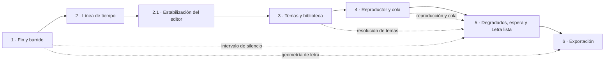

# Plan de Shinobi Karaoke 0.2.0-alfa

La alfa parte del [MVP 0.1.0](../0.1.0/plan-1.md). Primero corrige el fin y el resaltado de las líneas, después amplía el editor, la biblioteca y el reproductor para eventos y prepara la exportación local de video. El [backlog](backlog.md) contiene el desglose de las fases 1 y 2. Las siguientes se desglosan al comenzar.

## Resumen

| Fase | Entrega | Estado |
|---|---|---|
| 1 | Fin independiente y barrido por renglón | Cerrada · [informe](informe-fase-1.md)|
| 2 | Regiones editables, bucle, zoom y picos de voz | Implementada · [informe](informe-fase-2.md) |
| 2.1 | Estabilización del editor y paneles adaptables | Cerrada · [informe](informe-fase-2.1.md) |
| 3 | Temas y agrupación de biblioteca | Implementada · [informe](informe-fase-3.md) |
| 4 | Ventana secundaria y cola | En curso · [backlog](backlog.md#fase-4--ventana-secundaria-y-cola) |
| 5 | Degradados, ayudas de espera y Letra lista | Pendiente |
| 6 | Exportación de video | Pendiente · prueba técnica |

Las flechas continuas marcan el orden de integración. Las punteadas señalan contratos consumidos después. Ventana y cola avanzan juntas porque comparten dueño de sesión e IPC. La prueba técnica de exportación puede adelantarse para informar los perfiles de salida.

### 0.2.0 lista

- Las fases y sus criterios quedan verificados, con informe y PR a `develop` por fase. Las decisiones de producto quedan respondidas o se actualiza el alcance con la decisión del usuario.
- Se abre una biblioteca de esquema 1 y se comprueba que conserva tiempos y estilos persistidos hasta que el usuario solicita cambios. La prueba incluye cambios de tema, guardado, reapertura y recuperación de referencias.
- CI en los tres sistemas, E2E sin red con audio generado y letras inventadas, y verificación con artefacto empaquetado de los flujos nuevos. Probar dos pantallas, una canción larga en un equipo modesto y exportaciones de los perfiles aprobados.
- Cierre mediante PR de `develop` a `main` y tag `v0.2.0-alpha` según el [flujo de Git](../../workflow.md). Si implica primera publicación pública, resolver también la [tarea 0142](../../tareas/0142-primera-version-publica.md), visible en la [hoja de ruta](../../roadmap.md).

## Fase 1 · Fin y barrido

**Objetivo.** Cantar cada verso dentro de su intervalo y ver el resaltado en el orden de lectura.

### 1. Fin independiente · M

**Decisión final.** Conservar `finEfectivo` y `fin_ms: null` para fin automático. Hacer visible qué valor es automático, fijarlo con el campo o el cabezal y permitir volver al automático. Sin migración de tiempos. Usar `inicio < fin ≤ siguiente elemento con tiempo` y preservar invariantes de palabras, pausas y offset.

**Discusión.** Ambos agentes prefieren preservar el comportamiento de proyectos e importaciones. La energía vocal sirve de referencia visual en la fase 2. Convertirla en una sugerencia automática exigiría validar falsos cortes y queda fuera de esta alfa. [R2 arquitectura](discusion/r2-arquitecto.md) · [R2 UX](discusion/r2-disenador-ux.md).

**Aceptación.** Con líneas 12,40–15,80 s y 17,10–20,30 s, al llegar a 15,80 s sale la línea activa y la siguiente queda en espera sin resaltado hasta 17,10 s, también al buscar durante la reproducción. Fijar el fin conserva la marca vecina. O, campo, límites, deshacer, escucha de comprobación y volver a automático siguen operativos. Cubrir una pausa explícita, offset distinto de cero y datos anteriores con los mismos tiempos efectivos y huecos.

**ADRs y specs.** Precisar 0005 y 0010, respetar 0006. [Editor](../../ux/06-editor.md) y [Reproductor](../../ux/07-reproductor.md).

**Riesgo.** Confundir tiempo de audio con tiempo de letra, o modificar palabras importadas al ajustar el límite.

### 2. Barrido por renglón visual · M

**Decisión final.** Medir el texto base después del ajuste tipográfico con `Range.getClientRects()`, agrupar cajas por renglón visual y repartir el avance por suma de anchos. Pintar la capa decorativa sin alterar saltos y reutilizarla en vista previa y reproductor. Mantener las ventanas de tiempo por palabra importada.

**Discusión.** La alternativa de envolver cada palabra puede cambiar la disposición y el peso visual. Los agentes acuerdan usar la geometría real, medir al variar el layout y actualizar solo el relleno con el reloj de audio. [R1 arquitectura](discusion/r1-arquitecto.md#2--barrido-por-renglón-visual--m) · [R2 UX](discusion/r2-disenador-ux.md).

**Aceptación.** Vitest comprueba que en anchos 120/60 el 50 % pinta 90/0 y el 75 % pinta 120/15, además de los extremos. E2E con ventana angosta comprueba renglones sucesivos y redimensiona durante reproducción. Cargar una fuente y cambiar de escala invalida geometría. Se conserva la sincronía por palabra y el comportamiento de una sola línea.

**ADRs y specs.** 0005, 0010 y 0011. [Editor](../../ux/06-editor.md), [Reproductor](../../ux/07-reproductor.md) y [Sistema visual](../../ux/sistema-visual.md).

**Riesgo.** Redondeo, fuentes tardías, ligaduras y fragmentación. Separar lecturas de layout de las escrituras por fotograma.

## Fase 2 · Línea de tiempo

**Objetivo.** Ajustar tiempos con referencia visual y escucha precisa a cualquier escala.

**Desglose.** [0146–0153](backlog.md#fase-2--línea-de-tiempo). Coordenadas, motor de bucle y generación de picos pueden empezar en paralelo. La integración de Sincronía reúne gestos y motor. La caché y el IPC se integran después con Canvas. El [ADR 0015](../../adr/0015-linea-de-tiempo-y-picos-de-voz.md) define el formato y los contratos.

### 3. Marcadores y Bloquear enunciado · L

**Decisión final.** Regla para buscar, pista de regiones para seleccionar. Tiradores de inicio y fin de la región activa, campos y teclado I/O/L, Alt + flechas para inicio y Ctrl/Cmd + flechas para fin, con Mayús para pasos de 100 ms. Retirar los botones ±10/100 ms cuando existan controles accesibles equivalentes. El fin automático se distingue en texto y contorno. Se fija al confirmar un ajuste válido. El bucle usa el motor de audio y el intervalo efectivo, traducido por offset y limitado a la pista.

**Discusión.** UX conserva la escucha de comprobación para ajustes puntuales. Arquitectura propone actualizar límites en el motor y reanclar solo si el cabezal sale del intervalo. El arrastre cancelado restaura los valores. Esc fuera del gesto desarma el bucle antes de navegar. [R2 arquitectura](discusion/r2-arquitecto.md) · [R2 UX](discusion/r2-disenador-ux.md).

**Aceptación.** Los tiradores anuncian nombre y tiempo y se ajustan con flechas ±10 ms y Mayús ±100 ms. Un arrastre se deshace en un paso, respeta vecinas y conserva avisos de límite sin repetir toasts. «Bloquear enunciado» reproduce desde el inicio y actualiza el bucle durante el ajuste. Cambiar selección o desactivar el bucle restaura la posición anterior en pausa. Buscar fuera del bucle lo desactiva y lleva al destino. Esc durante el arrastre solo cancela ese gesto. Fuera del bucle y en pausa, «Escuchar al ajustar» actúa una vez al confirmar.

**ADRs y specs.** [0015](../../adr/0015-linea-de-tiempo-y-picos-de-voz.md), 0005 y 0010. [Editor](../../ux/06-editor.md#segunda-fase-de-020--línea-de-tiempo-de-sincronía).

**Riesgo.** Intervalos sin intersección audible, gestos cancelados o cambio de velocidad. No introducir otro reloj.

### 4. Zoom y picos de voz · L

**Decisión final.** Zoom horizontal Ctrl/Cmd + rueda anclado al puntero, con límites al llegar a extremos. Zoom a la línea, ver canción completa, centrar cabezal, paneo horizontal y minimapa. Precalcular picos min/máx multinivel de voz por bloques con PyAV. Caché versionada por pista, en la carpeta de canción, escrita atómicamente y regenerada tras re-separación o bajo demanda. Pintar solo lo visible.

**Discusión.** Audacity inspira el anclaje y ajuste a selección, REAPER la vista general y Premiere la navegación horizontal. Se descarta recalcular desde el buffer de reproducción o introducir otro motor. [R1 arquitectura y fuentes](discusion/r1-arquitecto.md#4--zoom-navegación-y-picos-de-voz--l) · [R2 UX](discusion/r2-disenador-ux.md).

**Aceptación.** La posición bajo el puntero se conserva salvo al topar un extremo y el audio sigue sin saltos. Los botones permiten operar sin rueda. Paneo, minimapa y zoom no mueven el cabezal. Sin picos o con error, el usuario puede editar y reintentar su generación. Probar una hora de voz generada, picos acotados por píxeles visibles y perfil de uso de CPU, memoria y disco en equipo modesto documentado.

**ADRs y specs.** [0015](../../adr/0015-linea-de-tiempo-y-picos-de-voz.md), con revisiones en 0006, 0008 y 0010. [Editor](../../ux/06-editor.md) y [Sistema visual](../../ux/sistema-visual.md).

**Riesgo.** Caché obsoleta, transferencias grandes y disputa del gesto con el sistema operativo.

## Subfase 2.1 · Estabilización del editor

**Objetivo.** Corregir las regresiones del [reporte de Windows](reporte-editor-fase-2.md) y entregar el layout adaptable antes de comenzar la fase 3.

1. **Desbordamiento horizontal.** Reproducir y confirmar la realimentación entre el tamaño intrínseco de los canvas y su medición. Verificar que la forma de onda y el minimapa conservan un ancho estable sin redimensionar y se ajustan al crecer o encoger la ventana, con DPR 1, 1,25 y 1,5. Cubrir espera, reproducción y resize en Electron.
2. **Layout y paneles.** UX actualiza primero la spec del editor. Separar cabecera, columnas y dock inferior. Mantener la previa centrada en 16:9 y el scroll dentro de lista y panel. Añadir divisores accesibles con mínimos, doble clic para restablecer y modos minimizados con controles rápidos. Persistir tamaños y estados globalmente. Verificar los tamaños del reporte a escala 100 % y 125 %, con capturas de revisión.
3. **Seguimiento del cabezal.** La spec vigente indica centrado manual y viewport independiente del audio. El comportamiento reportado coincide con esa decisión. Si se quiere seguimiento automático, abrir una pregunta de producto separada y mantener el criterio actual mientras se decide.

**Flujo.** Desde `develop` con la fase 2 integrada, abrir `fase/0.2.0-2.1-estabilizacion-editor`. UX y arquitectura coordinan la spec y el desglose desde 0154, previa verificación de numeración. Cerrar con informe, CI y PR fusionado a `develop` antes de abrir la rama de fase 3.

## Fase 3 · Temas y biblioteca

**Objetivo.** Reusar estilo con alcance visible y encontrar canciones por su discografía.

### 5. Temas guardables · L

**Decisión final.** Catálogo local versionado, ids estables y resolución única en main: canción, álbum, artista, predeterminado. Conservar el estilo anterior como propio en proyectos migrados. Acciones de guardar, aplicar, volver a heredar, renombrar, duplicar y borrar. «Personalizar» escribe solo el estilo local. «Editar tema» muestra alcance de referencias vivas y la sesión en marcha conserva su instantánea. «Temas definidos» mantiene vínculos vivos y «Tema personalizado» conserva una copia propia. Guardar sobre el tema confirma el impacto. «Guardar como tema nuevo…» pide nombre, conserva el original y permite aplicar la copia en un paso explícito. Al borrar, confirmar el conteo efectivo y persistir las apariencias completas como estilos propios antes de retirar el tema y sus referencias. El tema predeterminado se elige en Ajustes. Si se borra, las nuevas canciones reciben un tema aleatorio del catálogo en el momento de su creación, con estilo incluido si el catálogo está vacío. La elección queda estable al reabrir. La herencia de artista o álbum tiene precedencia sobre esta elección de respaldo. En Biblioteca se pueden seleccionar varias canciones editables y aplicar el tema a nivel canción tras confirmar la lista. [0047](../../preguntas/0047-temas-asignados-edicion-y-borrado.md)

**Discusión.** Un catálogo evita duplicación y permite editar en conjunto. UX pide distinguir referencias recuperadas sin catálogo de un borrado deliberado. La respuesta confirma congelar los estilos efectivos al borrar y aplicar temas en lote previa confirmación. [R4 arquitectura](discusion/r4-arquitecto.md) · [R4 UX](discusion/r4-disenador-ux.md) · [R2 arquitectura](discusion/r2-arquitecto.md) · [R2 UX](discusion/r2-disenador-ux.md).

**Aceptación.** Aplicación rápida con procedencia, operaciones completas de catálogo y herencia comprobada en los cuatro niveles. Una edición local no toca el tema. Los usos afectados excluyen overrides, una canción de esquema 1 conserva su apariencia y una carpeta recuperada muestra el respaldo si no puede resolver la referencia. Borrar deja la apariencia de las canciones afectadas como «Tema personalizado» incluso si la heredaban. En lote, se confirma la lista y se comunican cambios y fallos por canción. Si la escritura se interrumpe, el catálogo conserva el tema hasta completar las copias. Ajustes permite seleccionar el predeterminado y, al borrarlo, la siguiente canción recibe la asignación aleatoria prevista.

**ADRs y specs.** ADR nuevo de catálogo e identidad, revisar 0006, 0008 y 0010. [Editor](../../ux/06-editor.md), [Biblioteca](../../ux/02-biblioteca.md) y [Sistema visual](../../ux/sistema-visual.md).

**Riesgo.** Confirmaciones obsoletas ante cambios concurrentes y referencias que faltan al restaurar copias.

### 6. Agrupación por artista y álbum · M

**Decisión final.** Compartir claves con temas. Normalizar Unicode NFC, espacios y mayúsculas preservando diacríticos para identidad. El álbum pertenece al artista y los metadatos ausentes se agrupan visualmente sin asignación colectiva. La búsqueda usa comparación flexible en título, artista y álbum. Mantener índice en memoria.

**Discusión.** Los nombres de álbum globales mezclarían discos homónimos. Ambos agentes separan identidad estricta de búsqueda flexible y mantienen editables los metadatos existentes. [R1 arquitectura](discusion/r1-arquitecto.md) · [R2 UX](discusion/r2-disenador-ux.md).

**Aceptación.** Vistas sin agrupar, por artista y por álbum. Buscar y filtrar por metadatos y estado en combinación. Dos álbumes del mismo nombre y distinto artista permanecen separados. «Editar datos» mueve la tarjeta y reevalúa herencia. Estados vacíos, foco y desplazamiento se verifican.

**ADRs y specs.** Mismo ADR nuevo de 5 y 0006. [Biblioteca](../../ux/02-biblioteca.md) y [Mapa](../../ux/00-mapa-de-vistas.md).

**Riesgo.** Homónimos reales, agrupaciones con metadatos incompletos y pérdida de foco al actualizar resultados.

## Fase 4 · Reproducción en eventos

**Objetivo.** Mostrar la letra en otra pantalla y operar la sesión desde la ventana principal.

### 10. Ventana secundaria · L

**Decisión final.** Mantener el flujo local y añadir secundaria de rol fijo para eventos. Main administra monitor, fullscreen, reposo e IPC. La secundaria posee el único motor de audio de la sesión en vivo. La pantalla elegida afecta a la imagen y el audio sigue su salida habitual. Bloquear el editor durante la sesión emergente, incluidas pausa y transición. Resolver el autoguardado al iniciar si había un editor abierto. La Biblioteca y cola siguen operables. Mostrar «No se puede editar mientras el reproductor está abierto en otra ventana». El selector de dispositivos queda como mejora futura de prioridad baja. [0048](../../preguntas/0048-escucha-editor-durante-evento.md)

**Discusión.** Enviar el reloj por IPC añade desfase y deja el evento atado al editor. Los agentes acuerdan autonomía y permisos por rol. El usuario pide bloquear la edición y avisar en vez de permitir edición silenciosa. [R4 arquitectura](discusion/r4-arquitecto.md) · [R4 UX](discusion/r4-disenador-ux.md) · [R2 arquitectura](discusion/r2-arquitecto.md) · [R2 UX](discusion/r2-disenador-ux.md).

**Aceptación.** Elegir pantalla y fullscreen, alternar en la secundaria y mantener operable la principal. Recuperarse al desconectar monitor o cerrar la secundaria. La sesión bloquea edición incluso al pausar y entre canciones, y permite editar al cerrarse. Con un editor abierto, se resuelve su guardado antes de iniciar. Main valida payloads y origen, ventana, frame y rol de cada llamada. Sin duplicar audio, rutas de medios por protocolo autorizado y limpieza del bloqueo de reposo al terminar. Verificar en dos pantallas reales.

**ADRs y specs.** [ADR 0017](../../adr/0017-ventana-secundaria-sesion-en-vivo-y-cola-de-reproduccion.md) (con 11), revisiones de 0006, 0008, 0010 y 0011. Tareas 0177–0190 en el [backlog](backlog.md#fase-4--ventana-secundaria-y-cola). [Biblioteca](../../ux/02-biblioteca.md), [Editor](../../ux/06-editor.md), [Reproductor](../../ux/07-reproductor.md) y [Mapa](../../ux/00-mapa-de-vistas.md).

**Riesgo.** Eventos de sistema tardíos, pérdida de monitor, caída de renderer y permisos excesivos.

### 11. Cola · M

**Decisión final.** Main conserva sesión, revisión y orden, con identificador por entrada. Principal administra pendientes y la secundaria consume la activa. Revalidar canción y pistas al consumir, y proteger el avance contra eventos tardíos o duplicados. Cola en memoria durante la app. En fin natural, avanzar con contador central animado, configurable y de 4 s por defecto, y vista previa inferior derecha. Reiniciar la cuenta solo si cambia la candidata. Ante fallo, mostrar la causa y ofrecer pasar a la siguiente por acción explícita. Al cerrar con cola, ofrecer eliminarla, conservarla o cancelar. Conservar mantiene pendientes y selecciona el último elemento reproducido. Una canción interrumpida puede reanudarse en el mismo segundo al reabrir y el usuario puede reiniciarla. Si terminó antes del cierre, conservarla como selección de contexto y ofrecer iniciar la siguiente. [0049](../../preguntas/0049-politica-cola-de-reproduccion.md)

**Discusión.** La cola de trabajos sirve al pipeline y la de reproducción tiene orden y controles de sesión. Ambos agentes separan activa de pendientes y requieren alternativas al arrastre. La cuarta ronda define cómo congelar la transición mientras se confirma el cierre y cómo actualizar la vista previa tras reordenar. [R4 arquitectura](discusion/r4-arquitecto.md) · [R4 UX](discusion/r4-disenador-ux.md) · [R1 arquitectura](discusion/r1-arquitecto.md) · [R2 UX](discusion/r2-disenador-ux.md).

**Aceptación.** «Reproducir a continuación» coloca al frente de pendientes y «Agregar al final» al final. Se puede repetir una canción, quitar y reordenar por ratón o teclado sin interrumpir la activa. La cuenta presenta la próxima canción y se adapta a movimiento reducido. Avisar si falla una entrada y avanzar solo por acción. Al cerrar, eliminar o conservar cola según la confirmación. Si se conserva, se mantienen selección, orden y segundo de reproducción mientras la app siga abierta. Reanudar recupera el segundo y «Reiniciar canción» empieza desde el comienzo. En transición se mantiene la próxima canción pendiente. Al salir de la app, se vacía. E2E cubre eventos duplicados y fin de cola.

**ADRs y specs.** Mismo ADR que 10 y 0008/0011. [Biblioteca](../../ux/02-biblioteca.md) y [Reproductor](../../ux/07-reproductor.md).

**Riesgo.** Doble avance, cambios concurrentes y entrada borrada mientras espera.

## Fase 5 · Estilo, espera y Letra lista

**Objetivo.** Ampliar fondos, orientar la próxima entrada vocal y ofrecer un modo de letra sincronizada sin barrido.

### 8. Degradados y movimiento · M

**Decisión final.** Lineal, radial y cónico, con movimiento opcional desactivado al inicio. Mantener el estilo anterior como lineal estático. Usar una fase ligada a tiempo de canción, con fase estática bajo movimiento reducido. Guardar en temas y evaluar peor contraste de letra y resaltado sobre la paleta y sus transiciones, incluido cierre cónico.

**Discusión.** Se prefiere mover la geometría con paleta fija. UX y arquitectura coinciden en comprobar peor contraste. El aviso de fallo exclusivo durante movimiento solo procede si la evaluación puede distinguirlo. [R2 arquitectura](discusion/r2-arquitecto.md) · [R2 UX](discusion/r2-disenador-ux.md).

**Aceptación.** Los tres tipos tienen controles pertinentes, se guardan y reaplican como tema. Buscar al mismo instante da la misma fase en editor y reproductor. La vista previa admite detener movimiento y respeta movimiento reducido. Los avisos cubren los colores de letra y resaltado.

**ADRs y specs.** ADR de estilo ampliado, revisar 0006, 0010 y 0011. [Editor](../../ux/06-editor.md), [Reproductor](../../ux/07-reproductor.md) y [Sistema visual](../../ux/sistema-visual.md).

**Riesgo.** Variación de contraste y animaciones divergentes entre reproducción y exportación.

### 9. Comodines de espera · M

**Decisión final.** Puntos, barra y cuenta 3·2·1 combinables, con umbral de silencio y preferencias de tema reemplazables en canción. Derivar todos del intervalo entre el fin efectivo y el inicio siguiente. Mantener compatibilidad con puntos legados, separando primera entrada y umbral entre versos.

**Discusión.** UX reserva sitio a indicadores para que no muevan el texto. Arquitectura reutiliza el cálculo temporal, evitando marcas de pausa generadas y temporizadores independientes. [R2 arquitectura](discusion/r2-arquitecto.md) · [R2 UX](discusion/r2-disenador-ux.md).

**Aceptación.** Combinaciones, herencia y umbral funcionan en primera entrada, silencios cortos y largos, con ausencia de siguiente línea y tras buscar o pausar. La cuenta ocupa los últimos tres segundos disponibles y la barra termina al entrar el siguiente verso. Mantener posición del texto, movimiento reducido y anuncios por hitos.

**ADRs y specs.** 0005, 0006, 0011 y ADR de estilo ampliado. [Editor](../../ux/06-editor.md), [Reproductor](../../ux/07-reproductor.md) y [Sistema visual](../../ux/sistema-visual.md).

**Riesgo.** Saturación de pantalla y alteración del aviso inicial existente.

### 12. Letra lista · M

**Decisión final.** Ofrecer «Marcar como letra lista» junto a «Marcar como lista». Requiere medios reproducibles y que todas las líneas de texto tengan inicio y fin válido, incluidos los tiempos efectivos procedentes de la API. Registrar la modalidad por canción de forma separada del tema y conservar el estado Lista a efectos de compatibilidad y acciones. Mostrar la distinción en Biblioteca. El Editor conserva el barrido para revisar sincronía. La reproducción y la exportación muestran letra sincronizada sin barrido ni color de resaltado, con texto legible y los controles normales. Admite reproducir, encolar y exportar. La primera activación presenta un aviso del efecto en el reproductor y la casilla «No volver a mostrar este aviso», guardada al confirmar.

**Discusión.** La respuesta equipara barrido y contraste de resaltado. Un modo de canción permite suprimir el barrido sin cambiar la legibilidad del tema ni reactivarlo por una actualización en cascada. Va en la fase 5 porque usa los intervalos de la fase 1 y la sesión de la fase 4. Exportación consume el mismo modo en la fase 6. [0048](../../preguntas/0048-escucha-editor-durante-evento.md) · [R4 arquitectura](discusion/r4-arquitecto.md) · [R4 UX](discusion/r4-disenador-ux.md).

**Aceptación.** Una canción de tiempos completos de API puede marcarse, mientras que una línea sin tiempos impide activar la modalidad. El aviso aparece al activar por primera vez y puede silenciarse. Se conserva la variante con barrido en Editor. Biblioteca distingue «Letra lista» y permite abrirla y encolarla. El modo se conserva al guardar y reabrir. En fase 6, la exportación de la modalidad conserva tiempos y estilo sin barrido.

**ADRs y specs.** Revisar 0005, 0006 y 0011, y enlazar ADR de exportación. [Editor](../../ux/06-editor.md), [Biblioteca](../../ux/02-biblioteca.md) y [Reproductor](../../ux/07-reproductor.md).

**Riesgo.** Confundir contraste de legibilidad con color de progreso o perder elegibilidad al editar la letra. Revalidar con los contratos de tiempos y medios de Lista.

## Fase 6 · Exportación

**Objetivo.** Generar un video local con la letra y el estilo reproducidos con tiempos deterministas.

### 7. Exportar a video · L

**Decisión final.** Trabajar sobre una instantánea y compartir el render en una ventana offscreen gobernada por el índice de fotograma. El worker PyAV codifica con contrapresión y mezcla instrumental con voz opcional, sujeto a códecs y licencias verificados. Destino elegido en main, temporal hasta éxito y cancelación con limpieza. Marca de agua «Shinobi Karaoke». Evaluar MKV AV1/Opus y WebM VP9/Opus como candidatos de formato libre con referencia de OBS. Ofrecer relaciones 4:3 hasta 2880×2160 y 16:9 hasta 3840×2160, con resoluciones habituales y 24, 30 o 60 FPS según la matriz verificada. Permitir simultaneidad con evento si el trabajo puede aislarse y el equipo sostiene la reproducción. Bloquear con motivo si hay incompatibilidad técnica. [0050](../../preguntas/0050-perfiles-y-concurrencia-exportacion.md)

**Discusión.** Captura en tiempo real dificulta garantizar FPS y sincronía, y renderizar otra vez en Python duplica layout. La respuesta prioriza formato libre y toma OBS como referencia. El estudio evalúa contenedores, códecs disponibles y costes antes de cerrar perfiles. [R4 arquitectura y fuentes](discusion/r4-arquitecto.md) · [R4 UX](discusion/r4-disenador-ux.md) · [R1 arquitectura y fuentes](discusion/r1-arquitecto.md#7--exportación-de-video--l) · [R2 UX](discusion/r2-disenador-ux.md).

**Aceptación.** Con medios válidos, el diálogo permite elegir voz, resolución, FPS y destino entre perfiles aprobados. Un video de audio generado conserva duración, sincronía de voz y letra, estilo, marca de agua y FPS. La cancelación o fallo limpia el temporal y conserva el archivo existente. Verificar costo en memoria, tiempo y disco, licencias y disponibilidad de códecs en Windows, macOS y Linux. Probar un perfil modesto y 4K/60 como candidato y medir continuidad del audio, latencia y fotogramas con una sesión de reproducción activa. Distinguir falta de soporte de un perfil e incompatibilidad temporal con un evento.

**ADRs y specs.** Nuevo ADR de exportación y revisión de 0005, 0008, 0012 y 0013. Nueva spec de exportación con entradas en [Biblioteca](../../ux/02-biblioteca.md) y [Editor](../../ux/06-editor.md), y revisión del [Sistema visual](../../ux/sistema-visual.md).

**Riesgo.** Coste de bitmaps, soporte de códecs, licencias de builds y discrepancias tipográficas. La marca de agua no otorga derechos sobre el material de origen.

## Prioridades

| Feature | Prioridad | Fase |
|---|---|---|
| 1 · Fin independiente | Crítica | 1 |
| 2 · Barrido por renglón | Crítica | 1 |
| 3 · Marcadores y bucle | Alta | 2 |
| 4 · Zoom y picos | Alta | 2 |
| 5 · Temas | Alta | 3 |
| 6 · Biblioteca agrupada | Media | 3 |
| 7 · Exportar video | Media | 6 |
| 8 · Degradados | Media | 5 |
| 9 · Comodines | Media | 5 |
| 10 · Ventana secundaria | Media | 4 |
| 11 · Cola | Media | 4 |
| 12 · Letra lista | Media | 5 |

## Decisiones y verificaciones pendientes

Las preguntas de producto de [temas](../../preguntas/0047-temas-asignados-edicion-y-borrado.md), [evento y Letra lista](../../preguntas/0048-escucha-editor-durante-evento.md) y [cola](../../preguntas/0049-politica-cola-de-reproduccion.md) tienen respuesta. El [estudio de exportación](../../preguntas/0050-perfiles-y-concurrencia-exportacion.md) debe confirmar la combinación de contenedor y códecs, la matriz de perfiles y la coexistencia con un evento.
