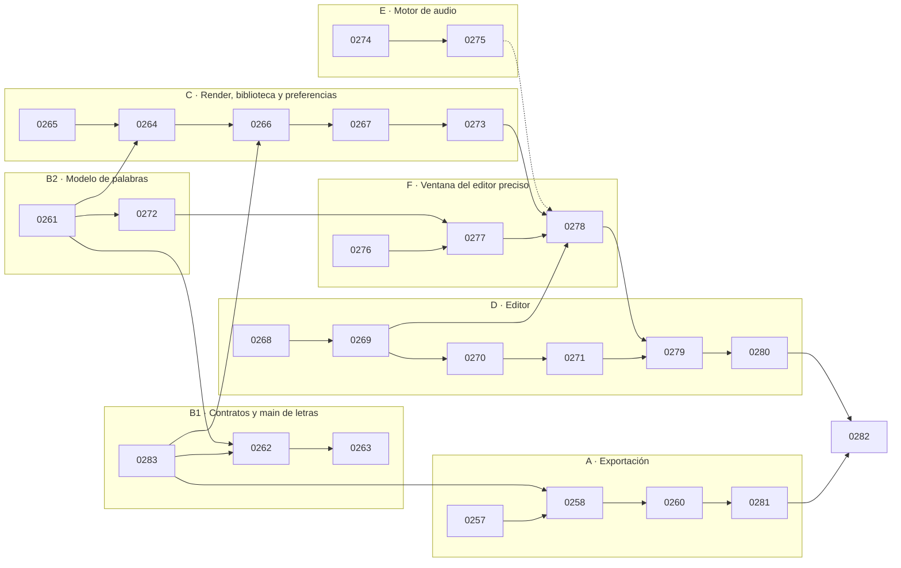

# Backlog de Shinobi Karaoke 0.2.1

Ver el [plan](plan-3.md), el [feedback de alpha.1](../0.2.0/feedback-alpha-1.md) y el [flujo de Git](../../workflow.md). Decisiones: [ADR 0021](../../adr/0021-sincronia-simplificada-y-editor-preciso-de-linea.md) (fases 8 y 9) y la revisión para 0.2.1 de los ADR [0005](../../adr/0005-letras-y-formato-de-sincronia.md), [0006](../../adr/0006-persistencia-y-modelo-de-datos.md), [0010](../../adr/0010-editor-motor-de-audio-reloj-y-guardado.md), [0015](../../adr/0015-linea-de-tiempo-y-picos-de-voz.md), [0016](../../adr/0016-catalogo-de-temas-e-identidad-de-artista-y-album.md), [0018](../../adr/0018-estilo-ampliado-espera-letra-lista-y-ajuste-de-silencios.md) y [0019](../../adr/0019-exportacion-de-video-render-por-fotograma-y-worker-pyav.md) (fase 7). Numeración de las previas: `0.2.1-alpha.N` ([ADR 0020](../../adr/0020-publicacion-en-github-releases-y-politica-de-versiones.md) §2; pregunta [0150](../../preguntas/0150-publicar-0-2-1-sin-sufijo.md)).

## Fase 7 · Correcciones pendientes de alpha.1

| Tarea | Tamaño | Estado | Depende de | Lote |
|---|---|---|---|---|
| [0257 · Estimación de tamaño recalibrada](../../tareas/0257-estimacion-de-tamano-de-la-exportacion-sobrestimada.md) | S | Pendiente | — | A |
| [0258 · Carpeta sin permiso al empezar y `CANCION_EXPORTANDOSE`](../../tareas/0258-destino-sin-permiso-y-cancion-ya-exportandose.md) | M | Pendiente | 0257, 0283 | A |
| [0260 · Sondeo con captura real y «Reintentar»](../../tareas/0260-sondeo-de-perfiles-con-captura-real.md) | M | Pendiente | 0258, 0283 | A |
| [0242 · Captura 4K en Linux](../../tareas/0242-captura-4k-en-linux-con-tamano-incorrecto.md) | — | Se cierra con 0260 | 0260 | A |
| [0281 · Verificación, capturas e informe de la fase 7](../../tareas/0281-verificacion-capturas-e-informe-de-la-fase-7.md) | S | Pendiente | 0257, 0258, 0260 | A |
| [0140 · Icono de la app](../../tareas/0140-icono-de-la-app-en-los-instaladores.md) | — | En curso (icono definitivo ya en la rama) | — | Se cierra en 0282 |

## Fase 8 · Sincronía y editor más simples

| Tarea | Tamaño | Estado | Depende de | Lote |
|---|---|---|---|---|
| [0283 · Contratos compartidos de 0.2.1 y `editarTextoLinea`](../../tareas/0283-contratos-compartidos-de-0-2-1-y-editar-texto-de-una-linea.md) | M | Pendiente | — | B1 (primera) |
| [0261 · Origen de las palabras, fin sin importadas y regla de descarte](../../tareas/0261-origen-de-las-palabras-y-regla-de-descarte.md) | M | Pendiente | — | B2 (primera) |
| [0262 · `guardarTiempos` con palabras manuales](../../tareas/0262-guardar-tiempos-con-palabras-manuales.md) | S | Pendiente | 0261, 0283 | B1 |
| [0263 · Importar letras sin tiempos por palabra](../../tareas/0263-importar-letras-sin-tiempos-por-palabra.md) | S | Pendiente | 0262, 0261 | B1 |
| [0265 · Barra de espera como barra de carga](../../tareas/0265-barra-de-espera-como-barra-de-carga.md) | S | Pendiente | — | C (primera) |
| [0264 · Render solo con palabras hechas a mano](../../tareas/0264-render-solo-con-palabras-hechas-a-mano.md) | S | Pendiente | 0261 | C |
| [0266 · Agrupar por fecha de añadido](../../tareas/0266-agrupar-la-biblioteca-por-fecha-de-anadido.md) | M | Pendiente | 0283, 0264 | C |
| [0267 · «Reproducir» y «Editar» en las tarjetas](../../tareas/0267-reproducir-y-editar-en-las-tarjetas-lista-y-letra-lista.md) | S | Pendiente | 0266 | C |
| [0268 · Sin S, sin desplazamiento y sin marcas de palabras importadas](../../tareas/0268-retirar-s-desplazamiento-y-palabras-importadas-del-editor.md) | M | Pendiente | — | D (primera) |
| [0269 · Doble clic y Mayús + L escuchan la línea](../../tareas/0269-doble-clic-y-mayus-l-escuchan-la-linea.md) | S | Pendiente | 0268 | D |
| [0270 · Dock, pestaña «Funciones» y menú ⋯](../../tareas/0270-dock-pestana-funciones-y-menu-de-la-cabecera.md) | L | Pendiente | 0269 | D |
| [0271 · Verificación, limpieza, capturas e informe de la fase 8](../../tareas/0271-verificacion-capturas-e-informe-de-la-fase-8.md) | M | Pendiente | 0261–0270 | D |

## Fase 9 · Editor preciso de línea

| Tarea | Tamaño | Estado | Depende de | Lote |
|---|---|---|---|---|
| [0272 · Operaciones puras del editor preciso](../../tareas/0272-operaciones-puras-de-palabras-manuales.md) | M | Pendiente | 0261 | B2 |
| [0273 · Preferencias de la ventana](../../tareas/0273-preferencias-de-la-ventana-del-editor-preciso.md) | S | Pendiente | 0266 | C (última) |
| [0274 · Estiramiento WSOLA con tono conservado](../../tareas/0274-estiramiento-wsola-con-tono-conservado.md) | M | Pendiente | — | E (primera) |
| [0275 · Tramo con tono conservado en `MotorAudio`](../../tareas/0275-tramo-con-tono-conservado-en-el-motor-de-audio.md) | M | Pendiente | 0274 | E |
| [0276 · Ventana flotante no modal](../../tareas/0276-componente-ventana-flotante-no-modal.md) | M | Pendiente | — | F (primera) |
| [0277 · Onda ampliada, regla, tiradores y tira de palabras](../../tareas/0277-onda-ampliada-regla-y-tira-de-palabras.md) | M | Pendiente | 0276, 0272 | F |
| [0278 · Ventana del editor preciso](../../tareas/0278-ventana-del-editor-preciso-de-linea.md) | L | Pendiente | 0276, 0277, 0272, 0269, 0273 (0275 opcional) | F |
| [0279 · Integrar el editor preciso en el editor](../../tareas/0279-integrar-el-editor-preciso-en-el-editor.md) | L | Pendiente | 0271, 0278, 0283, 0262, 0272, 0273 | D |
| [0280 · Verificación, capturas e informe de la fase 9](../../tareas/0280-verificacion-capturas-e-informe-de-la-fase-9.md) | M | Pendiente | 0272, 0274–0279 | D (última) |

## Cierre

| Tarea | Tamaño | Estado | Depende de |
|---|---|---|---|
| [0282 · Cierre de 0.2.1-alpha.1: notas, icono, paquete y ensayo](../../tareas/0282-cierre-version-0-2-1-alpha-1-notas-paquete-y-ensayo.md) | M | Pendiente | 0271, 0280, 0281 |

Fuera de 0.2.1 (siguen en el backlog de 0.2.0): [0259](../../tareas/0259-calibracion-de-silencios-con-verdad-fiable.md) (calibración con verdad fiable; herramienta de desarrollo). La firma de código sigue su camino (D1).

## Lotes paralelos

Seis lotes, cada uno con **un programador** que hace sus tareas en orden. Varios trabajan a la vez en el mismo árbol, así que **cada archivo tiene un solo dueño a la vez**. Una tarea que necesita algo de otro lote lo dice en «Depende de» y espera a que esa tarea esté `Hecha`.

| Lote | Tareas (en orden) | Archivos de los que es dueño |
|---|---|---|
| **A · Exportación** | 0257 → 0258 → 0260 (cierra 0242) → 0281 | `app/src/main/exportacion/**`, `app/src/shared/exportacion.ts` y su test, `app/src/renderer/src/exportacion/**`, `app/e2e/exportacion-captura.spec.ts`, `app/e2e/exportacion-capturas.spec.ts`, `docs/ux/revision-0.2.1-fase-7/`, `docs/versiones/0.2.1/informe-fase-7.md` |
| **B1 · Contratos y main de letras** | 0283 → 0262 → 0263 | `app/src/shared/ipc.ts`, `shared/canales.ts`, `shared/errores.ts`, `shared/letrasBusqueda.ts`, `app/src/preload/index.ts`, `app/src/main/index.ts`, `app/src/main/letras/**`, `app/src/shared/letras/lrc.ts`, `normalizar.ts`, `letras.test.ts`, `app/src/renderer/src/vistas/letra/**`, `app/e2e/letras.spec.ts`; **de pasada en 0283**, solo para añadir métodos o campos a los dobles: `vistas/editor/fixturesApi.ts`, `vistas/biblioteca/fixturesApi.ts`, `vistas/letra/fixturesApi.ts`. En 0262, la función `aPeticionTiempos` de `shared/letras/tiempos.ts` (cuando 0261 ya terminó). |
| **B2 · Modelo de palabras** | 0261 → 0272 | `app/src/shared/letra.ts`, `shared/letras/tiempos.ts` (salvo `aPeticionTiempos` en 0262 y la limpieza de 0271), `shared/letras/palabras.ts` (nuevo), `shared/letras/index.ts`, `shared/silencios.ts` y sus tests |
| **C · Render, biblioteca y preferencias** | 0265 → 0264 → 0266 → 0267 → 0273 | `app/src/renderer/src/karaoke/PantallaLetra.tsx`, `pantallaLetra.module.css`, `render.ts` y sus tests; `app/src/shared/config.ts`, `shared/cancion.ts`, `shared/paneles.ts` y sus tests; `app/src/main/biblioteca/resumen.ts`; `app/src/renderer/src/vistas/biblioteca/**` (salvo `fixturesApi.ts` mientras 0283 lo toca); `app/e2e/biblioteca*.spec.ts` y `temas-biblioteca.spec.ts`. **No** toca `e2e/fase5.spec.ts`, `e2e/reproductor.spec.ts` ni `e2e/exportacion.spec.ts` (son de D y A): si una aserción suya depende de la barra o de las palabras importadas, lo anota para 0271 |
| **D · Editor** | 0268 → 0269 → 0270 → 0271 → 0279 → 0280 | `app/src/renderer/src/vistas/editor/**` salvo la carpeta `preciso/`; `app/src/renderer/src/vistas/reproductor/**`; `app/src/shared/escucha.ts` (nuevo, 0269); `app/e2e/editor*.spec.ts`, `e2e/reproductor.spec.ts`, `e2e/fase5.spec.ts`, `e2e/fixtures/editor.ts`, `e2e/fase8*.spec.ts`, `e2e/editor-preciso*.spec.ts`; `docs/ux/revision-0.2.1-fase-8/`, `revision-0.2.1-fase-9/`, `docs/versiones/0.2.1/informe-fase-8.md` e `informe-fase-9.md`; en 0271, el borrado de las funciones de desplazamiento de `shared/letras/tiempos.ts` |
| **E · Motor de audio** | 0274 → 0275 | `app/src/renderer/src/karaoke/motorAudio.ts`, `reloj.ts`, `estiramiento.ts`, `estiramiento.worker.ts` (nuevos) y sus tests |
| **F · Ventana del editor preciso** | 0276 → 0277 → 0278 | `app/src/renderer/src/componentes/VentanaFlotante.tsx`, `ventanaFlotante.module.css`, `geometriaVentana.ts` (nuevos) y sus tests; `app/src/renderer/src/vistas/editor/preciso/**` (carpeta nueva) |
| **Cierre** | 0282 | versión, README, `INSTALAR.md`, `docs/versiones/0.2.1/notas/`, este backlog, `app/build/` (solo comprobar) |

Reglas de convivencia:

- **Empezar a la vez**: A (0257), B1 (0283), B2 (0261), C (0265), D (0268), E (0274) y F (0276) no se esperan entre sí.
- **Puntos de espera**: 0258 y 0266 esperan a 0283; 0262 y 0264 esperan a 0261; 0277 espera a 0272; 0278 espera a 0269 y 0273 (y usa 0275 si ya está); 0279 espera a 0278, 0283, 0262, 0272 y 0273; 0282 espera a 0271, 0280 y 0281.
- `docs/pruebas.md` y `app/e2e/criticos/` son de `qa`: las tareas que los afecten (0260, regla 10; 0270, si el crítico usaba el menú ⋯) lo anotan para la sesión principal.
- Las capturas de revisión van a carpetas distintas por fase, así que no chocan.

## Decisiones y preguntas de 0.2.1

- Respondidas por el arquitecto: [0144](../../preguntas/0144-readme-en-e0-o-e-medio-antes-de-publicar.md), [0145](../../preguntas/0145-contratos-de-las-fases-8-y-9-para-las-specs.md), [0146](../../preguntas/0146-captura-reintentar-y-errores-tempranos-de-la-exportacion.md).
- Abiertas para el usuario (no bloquean): [0147](../../preguntas/0147-decisiones-provisionales-de-ux-de-0-2-1.md) (diseñador), [0148](../../preguntas/0148-decisiones-provisionales-del-arquitecto-de-0-2-1.md) (arquitecto), [0150](../../preguntas/0150-publicar-0-2-1-sin-sufijo.md) (número de versión).
- Abierta para el diseñador (no bloquea): [0149](../../preguntas/0149-indicador-por-palabra-en-la-vista-letra.md) (insignia «por palabra» de la vista Letra).
