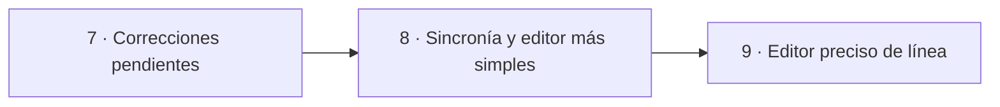

# Plan de Shinobi Karaoke 0.2.1

La 0.2.1 parte de [0.2.0-alpha.2](../0.2.0/plan-2.md) y recoge lo que el usuario pidió tras probar 0.2.0-alpha.1 el 2026-11-21: quitar lo que confunde en la sincronía y en el editor, y añadir un editor preciso de línea. El origen, la evidencia en datos y el código afectado están en el [feedback de alpha.1](../0.2.0/feedback-alpha-1.md).

Aprobada por el usuario el 2026-11-21 («apruebo las fases 7 a 9, que sea 0.2.1»). Las fases conservan su número del feedback para no romper referencias.

## Resumen

| Fase | Entrega | Estado |
|---|---|---|
| 7 | Correcciones pendientes de alpha.1 | Aprobada · por desglosar |
| 8 | Sincronía y editor más simples | Aprobada · por desglosar |
| 9 | Editor preciso de línea | Aprobada · por desglosar |

La fase 8 retira piezas antes de construir la 9 encima. La 7 es independiente y puede ir en paralelo.

### 0.2.1 lista

- Las tres fases verificadas, con informe y PR a `develop` por fase.
- Una biblioteca de 0.2.0 se abre sin perder tiempos ni estilos; los tiempos por palabra importados dejan de usarse pero no se borran hasta que el usuario edita la línea.
- CI en los tres sistemas y guías manuales de las tres fases.
- Numeración de las previas según el [ADR 0020](../../adr/0020-publicacion-en-github-releases-y-politica-de-versiones.md) §2: `0.2.1-alpha.N` hasta que el usuario decida publicar `0.2.1`.

## Fase 7 · Correcciones pendientes de alpha.1

**Objetivo.** Cerrar lo que quedó fuera de 0.2.0-alpha.2.

En alpha.2 ya salieron el tamaño de la captura de exportación, el registro de fallos, la captura en el CI de Windows, el icono en las ventanas y la distribución desde Releases (tareas 0244–0256). Queda:

1. **Sondeo de perfiles con captura real** ([tarea 0260](../../tareas/0260-sondeo-de-perfiles-con-captura-real.md)): que el diálogo no ofrezca resoluciones que el equipo no puede capturar, y que el diálogo de fallo ofrezca reintentar.
2. **Estimación de tamaño** ([0257](../../tareas/0257-estimacion-de-tamano-de-la-exportacion-sobrestimada.md)): hoy sobrestima entre 2,2 y 2,7 veces.
3. **Destino sin permiso y canción ya exportándose** ([0258](../../tareas/0258-destino-sin-permiso-y-cancion-ya-exportandose.md)): fallar al iniciar y con el código correcto.
4. **Icono definitivo** de la app (tarea 0140 del icono): el actual es provisional. Necesita la aprobación del usuario.
5. **Captura a 3840 × 2160 en Linux** ([0242](../../tareas/0242-captura-4k-en-linux-con-tamano-incorrecto.md)): el CI sigue dando 3839 × 2159.

**Aceptación.** El diálogo de exportación solo ofrece perfiles que el equipo captura. La estimación de tamaño queda dentro de ±50 % en los perfiles medidos. Una carpeta sin permiso falla antes de arrancar el codificador.

**ADRs y specs.** ADR 0019. [Exportación](../../ux/10-exportacion.md).

**Fuera.** La firma de código sigue su propio camino (solicitud a SignPath Foundation, decisión del usuario).

## Fase 8 · Sincronía y editor más simples

**Objetivo.** Quitar lo que confunde o empeora el resultado y dejar a la vista las funciones principales.

1. **Retirar los tiempos por palabra importados.** Las líneas usan barrido progresivo; se retiran la etiqueta «por palabra» y su tooltip. Las canciones que ya los tienen dejan de usarlos al reproducir y exportar, y se borran del archivo solo cuando la línea se edita.
2. **Regla nueva:** cualquier edición de inicio o fin de una línea descarta sus tiempos por palabra.
3. **Quitar el atajo S.** «Sincronizar al ritmo» sigue disponible desde su botón.
4. **Doble clic en una región de la línea de tiempo:** reproduce esa línea empezando 500 ms antes, con el valor en una constante con nombre.
5. **Quitar «Desplazamiento de toda la letra»:** panel, teclas `,` y `.` y textos. El campo `offset_ms` se conserva en el archivo y se sigue respetando.
6. **Estados y acciones:**
   - Tarjeta «Letra lista» en Biblioteca con «Reproducir» y «Editar».
   - En el editor, botones visibles «Hecho» y «Marcar como lista» también para «Letra lista».
   - Pestaña «Funciones» junto a «Sincronía» y «Estilo» con exportar video, ajustar los silencios, cambiar entre Lista y Letra lista y volver a borrador. El menú «…» queda para atajos y restablecer la distribución.
7. **Agrupar por «Fecha de añadido»** con el campo `creada`. Una canción sin fecha válida recibe la fecha por defecto y se muestra en «Sin agrupar».
8. **Barra de espera como barra de carga:** ancho fijo, fondo con el color de letra y relleno con el color de resaltado, que avanza hasta la entrada del verso.

**Decisiones tomadas al aprobar.** Los puntos 1 y 5 aplican las recomendaciones D2 y D3 del feedback. El usuario aprobó las fases en conjunto y puede cambiarlas al revisar las specs.

**Aceptación.** Corregir el fin de una línea de «Final Ruin» o «Valiente» deja el barrido terminando con la línea. S no hace nada en el editor. El doble clic empieza 0,5 s antes. Las funciones mayores se alcanzan sin abrir «…». La barra de espera se llena de izquierda a derecha con los dos colores del tema, también en la exportación.

**ADRs y specs.** Precisar ADR 0005 (palabras) y 0018 (espera). Antes de implementar: [Editor](../../ux/06-editor.md), [Biblioteca](../../ux/02-biblioteca.md), [Reproductor](../../ux/07-reproductor.md) y [Sistema visual](../../ux/sistema-visual.md).

**Riesgo.** Atajos y textos repartidos en muchas pruebas. La barra debe verse igual en editor, reproductor y exportación.

## Fase 9 · Editor preciso de línea

**Objetivo.** Dar tiempo a cada palabra de una línea a mano, para un barrido mejor que el automático.

- **Ventana flotante dentro del editor** (como las subventanas de los programas de Adobe), abierta desde la lista de «Líneas» para la línea seleccionada.
- **Por palabra:** marcar inicio y fin, con la forma de onda de la voz ampliada a esa línea.
- **Bucle de la línea** con margen antes y después, y **velocidad de escucha** variable.
- **Edición rápida del texto** de la línea sin salir de la ventana.
- Los tiempos por palabra solo nacen aquí. Editar después esa línea en la línea de tiempo los descarta (regla de la fase 8), con aviso y deshacer.

**Aceptación.** Una línea con palabras marcadas a mano se barre palabra a palabra en editor, reproductor y exportación. Guardar y reabrir la conserva. Mover su inicio o fin en la línea de tiempo vuelve al barrido progresivo y se deshace en un paso.

**ADRs y specs.** Revisión de ADR 0005 y 0010 (bucle y velocidad en el motor de audio). Spec nueva dentro de [Editor](../../ux/06-editor.md). UX primero, después el desglose del arquitecto.

**Riesgo.** Velocidad variable sin cambiar el tono, foco y teclado de una ventana flotante, y coherencia con el historial de deshacer.

## Prioridades

| Feature | Prioridad | Fase |
|---|---|---|
| Retirar tiempos por palabra importados | Crítica | 8 |
| Estados y pestaña «Funciones» | Alta | 8 |
| Editor preciso de línea | Alta | 9 |
| Doble clic, atajo S y desplazamiento | Media | 8 |
| Fecha de añadido y barra de espera | Media | 8 |
| Sondeo de perfiles y estimación de tamaño | Media | 7 |
| Icono definitivo | Media | 7 |

## Pendiente antes de empezar

- Publicar `v0.2.0-alpha.2` y subir `develop` a la siguiente previa.
- Desglose: UX escribe las specs de las fases 8 y 9; el arquitecto revisa los ADR y crea las tareas y el backlog de esta versión.
